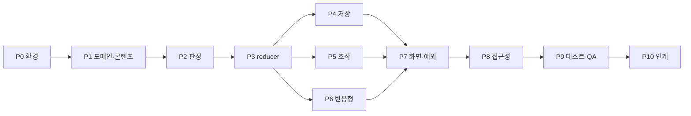

# 구현계획 — 5×5 아동용 인지발달 교구 (도안 버전)

> 문서 버전: 1.0 · 작성일: 2026-10-06 · 기준 문서: [상세서.md](./상세서.md) v1.0
> 대상: 프론트엔드 개발자(이 문서만 보고 Phase 순서대로 구현), QA, 기획
>
> **범위 원칙**
>
> - **백엔드 없음.** 서버·DB·인증·결제는 만들지 않는다. 콘텐츠는 번들된 정적 JSON, 진행 저장은 브라우저 IndexedDB(불가 시 메모리)다.
> - 나중에 **Supabase**로 옮길 수 있도록 콘텐츠·진행 저장은 반드시 `Repository` 인터페이스 뒤에 둔다. UI·도메인 코드는 저장 수단을 직접 알지 못한다.
> - 상세서의 **확정 요구 / 설계 기본값**을 구현한다. **자료 확인 필수(D02~D05, D09, D10)** 항목은 개발용 데이터로 대체하며 실물 일치 검증을 완료로 기록하지 않는다.
> - Lovable 연동 프로젝트다(AGENTS.md). 이미 push된 커밋의 force push·rebase·amend 금지. Phase 단위로 작은 커밋을 쌓고 각 커밋에서 앱이 동작해야 한다.

---

## 목차

1. 현황 분석
2. 미구현·누락·보완 목록 (Gap Register)
3. 목표 구조와 설계 결정
4. Phase 전체 로드맵
5. Phase 0 — 개발 환경 복구·기준선
6. Phase 1 — 도메인 계약·콘텐츠 팩·콘텐츠 검증
7. Phase 2 — 판정 엔진 완성 (exact/connection)
8. Phase 3 — 풀이 상태 모델(reducer)과 화면 분해
9. Phase 4 — 진행 저장·복원 (IndexedDB + 메모리 모드)
10. Phase 5 — 터치·드래그·키보드 조작 엔진
11. Phase 6 — 디자인 토큰·반응형 레이아웃·공통 컴포넌트
12. Phase 7 — 화면·모달·예외 상태·문제 전환 완성
13. Phase 8 — 접근성 완성
14. Phase 9 — 통합/E2E 테스트·QA·성능
15. Phase 10 — 정리·인계·Supabase 전환 준비
16. 스킬 탐색·적용 기록 (find-skills)
17. 범위 외 항목과 미결 사항

---

## 1. 현황 분석

### 1.1 기술 스택 (현재)

| 항목          | 현재 값                                                             | 상세서 대비                                                                                                 |
| ------------- | ------------------------------------------------------------------- | ----------------------------------------------------------------------------------------------------------- |
| 프레임워크    | TanStack Start(React 19, SSR) + TanStack Router(파일 기반) + Vite 8 | 상세서 D07은 Vite SPA 제안. **TanStack Start 유지**(Lovable 기본 구조). 브라우저 API는 effect 안에서만 사용 |
| 스타일        | Tailwind CSS v4 + `src/styles.css` 토큰                             | 색상 토큰은 상세서 5.2와 일치. breakpoint·간격 규칙은 미반영                                                |
| UI 라이브러리 | shadcn/ui 40여 개 파일(`src/components/ui`)                         | 게임 화면에서는 미사용                                                                                      |
| 상태          | `useState` 14개가 `play.$problemId.tsx` 한 파일에 분산              | 상세서 9장/19.1은 명시적 reducer 요구                                                                       |
| 저장          | `localStorage` (`src/game/storage.ts`)                              | 상세서 18장은 IndexedDB                                                                                     |
| 테스트        | Vitest + RTL 설정, 테스트 1건(라우팅 매칭)                          | J01~~J20, T01~~T38 미작성                                                                                   |
| 의존성        | **`node_modules` 없음** → tsc/lint/test 실행 불가                   | Phase 0에서 복구                                                                                            |
| 버전관리      | 로컬 폴더가 git 저장소가 아님                                       | Lovable 연결 저장소 clone 여부 확인 필요                                                                    |

### 1.2 파일별 상태

| 파일                              | 역할                                       | 상태                                                                                            |
| --------------------------------- | ------------------------------------------ | ----------------------------------------------------------------------------------------------- |
| `src/routes/index.tsx`            | S01 시작                                   | 기본 동작. Empty/Error 상태, 장식 그림 alt, 메모리 모드 진행 표시 누락                          |
| `src/routes/problems.tsx`         | S02 목록                                   | 기본 동작. 카드 경계/hover/배지 규격, 스크롤 복원, 카드 오류, breakpoint 600 누락               |
| `src/routes/play.$problemId.tsx`  | S03 + M01~M05 + 드래그 + 저장 호출 (569줄) | 핵심 흐름 동작. 구조·상태·조작 예외·레이아웃·접근성 다수 보완 필요                              |
| `src/game/types.ts`               | 도메인 타입                                | ExactJudge·ContentPack·asset·difficulty 없음, `shape` 하드코딩                                  |
| `src/game/content.ts`             | 개발용 15문제 생성기                       | TS 하드코딩, 팩 메타 없음, `CONTENT_VERSION="dev-1.0.0"`(semver 위반), 검증 없음                |
| `src/game/judge.ts`               | connection 판정                            | 그래프 판정 로직은 상세서 10.3과 대체로 일치. exact 없음, 구조검증 불완전, 전역 `typeById` 의존 |
| `src/game/storage.ts`             | localStorage 저장                          | 키·필드·큐·복원 규칙 불일치                                                                     |
| `src/components/game/Modal.tsx`   | 공통 모달                                  | 포커스 트랩·inert·aria-labelledby·스크롤 잠금 없음                                              |
| `src/components/game/Visuals.tsx` | 조각/도안 SVG                              | 동작. asset 레지스트리 구조로 전환 필요                                                         |
| `src/routes/__root.tsx`           | 앱 셸                                      | 404/Error 화면이 **영어**·토큰 미적용, 외부 Google Fonts                                        |

### 1.3 이미 구현되어 유지할 것 (회귀 금지)

- 5×5 보드, 탭 선택→빈칸 배치, 드래그 배치(8px 임계값, pointer capture, 미리보기 중심 기준 히트 테스트 `floor((c-G+2)/P)`), 회전(allowedRotations 순환), 조각함 회수.
- 확인하기 → incomplete/incorrect/correct/system_error 분기, 성공 모달 M04, 마지막 문제 M05 문구 분기, 다시 하기 M03(초기 상태 빠른 경로 포함).
- connection 판정: 포트 회전 N→E→S→W, 내부/외부 간선, terminal 연결, dangling/cycle/branch/disconnected 정책, required/forbidden pairs.
- 색상 토큰, 타이포 클래스(`t-display` 등), `prefers-reduced-motion` 0ms 처리, terminal 표식 위치(격자 바깥 6px 중심).

---

## 2. 미구현·누락·보완 목록 (Gap Register)

심각도는 상세서 20.3 기준(P0 풀이 불가/상태 손실/오판정, P1 핵심 동작 일부 불가, P2 표시·접근 오류, P3 시각 오차). **해결 Phase** 열이 이 문서의 작업 위치다.

| ID  | 심각도 | 항목                                                                                                                                                                                                  | 현재 코드 근거                            | 상세서             | 해결 Phase |
| --- | ------ | ----------------------------------------------------------------------------------------------------------------------------------------------------------------------------------------------------- | ----------------------------------------- | ------------------ | ---------- |
| G01 | P0     | 의존성 미설치, typecheck/lint/test 실행 불가 (`vitest/globals` 타입 오류)                                                                                                                             | 루트                                      | 20.3-7             | 0          |
| G02 | P0     | 판정·도메인 단위 테스트 0건                                                                                                                                                                           | `src/test`                                | 20.2 J01~J20       | 1, 2, 3    |
| G03 | P1     | 콘텐츠 팩 메타(schemaVersion·packId·purpose) 없음, `CONTENT_VERSION` semver 위반, 콘텐츠 검증(16.1) 전무                                                                                              | `content.ts`                              | 11.1, 16.1         | 1          |
| G04 | P1     | 타입 불일치: ExactJudge 없음, `asset` 대신 `shape`, topology 필수, difficulty 없음, pattern.asset 없음                                                                                                | `types.ts`                                | 11.1               | 1          |
| G05 | P1     | 조각 라벨 충돌: `line-1`, `bend-1`이 모두 "1"로 표시되어 구분 불가                                                                                                                                    | `play…tsx` L106, L440                     | 13.4 "조각 {순번}" | 1, 6       |
| G06 | P1     | exact 모드 미구현, `validateState`에 allowedRotations·locked 위치·type 참조 검증 없음, judge가 전역 `typeById` 의존(순수 함수 아님)                                                                   | `judge.ts`                                | 10.1~10.2          | 2          |
| G07 | P1     | 풀이 로직 단일 파일·`useState` 분산, reducer 부재. `commit()`이 렌더 시점 `pieces`를 캡처(stale closure 위험)                                                                                         | `play…tsx` L58~L131                       | 9, 19.1            | 3          |
| G08 | P1     | 상태 enum 누락: `interaction`, `checking`, `navigationStatus`, `saveStatus`. `canEdit/canCheck/canNext` 조건 불완전, M04 다음 버튼이 `canNext` 미검사                                                 | `play…tsx` L117~L119, L548                | 9.1                | 3          |
| G09 | P1     | 고정 조각(`locked`) 미지원: 자물쇠 표시·FIXED_PIECE 안내·드래그 차단 없음, 샘플도 없음                                                                                                                | 전체                                      | 4.1, 8.2, 13.4     | 1, 3, 5    |
| G10 | P1     | 저장소가 localStorage, 키/필드(schemaVersion·packId·savedAt) 불일치, 매 상태 변경마다 동기 저장, 디바운스·직렬 큐·flush 없음                                                                          | `storage.ts`, `play…tsx` L91              | 18.1~18.2          | 4          |
| G11 | P1     | **'이어 하기' 오표시**: 문제를 열기만 해도 save effect가 실행되어 last 갱신                                                                                                                           | `play…tsx` L91~L101                       | 3.3, 18.2          | 4          |
| G12 | P1     | 복원: saved correct를 재판정 없이 신뢰, RESTORE_INVALID·버전 변경 안내 없음, 메모리 모드에서 화면 간 이력 유실, 저장 실패 경고가 다른 피드백에 덮임                                                   | `play…tsx` L73~L88                        | 18.3, 13.7         | 4          |
| G13 | P1     | 조작 예외: lostpointercapture·resize/회전 중 취소 없음, 백그라운드 전환 시 캡처 해제·저장 flush 없음, Escape 우선순위(모달→드래그→선택)에 드래그 취소 없음, 보드 밖 여백 탭 선택 해제가 사실상 미동작 | `play…tsx` L276~L311, L461                | 8.2, 8.6           | 5          |
| G14 | P2     | 드래그 중 매 프레임 `setPreview` → Play 전체 리렌더. 무효 드롭 160ms 복귀·120ms 스냅·유효 후보 '놓기 아이콘' 없음                                                                                     | `play…tsx` L263~L273                      | 8.3, 8.5, 5.4      | 5          |
| G15 | P1     | 보드 크기 B를 H 기준으로 계산하지 않음(1024×600에서 넘침). breakpoint 600/840 미적용, 세로 레이아웃 순서·피드백 위치 불일치                                                                           | `play…tsx` L358, L475                     | 6.1~6.4            | 6          |
| G16 | P1     | 조각함: 페이지 크기 6 고정, 13.4 산식(가로 2×rows, 세로 cols) 미적용, 카드 80×88 규격·페이지 버튼 48px·aria·페이지 알림 불일치                                                                        | `play…tsx` L49, L420~L456                 | 13.4               | 6          |
| G17 | P2     | 버튼: 헤더 버튼 48px(규격 56), 정답 후 Primary 전환(다음=Primary, 확인=Secondary) 없음, 비활성 사유 문구 없음, 연타 동기 잠금 없음, `확인 중` 상태 없음                                               | `play…tsx` L464~L488                      | 13.2, 7.3          | 3, 6       |
| G18 | P1     | 다음 문제 전환: 준비 완료 전 URL 변경, navigationStatus 없음, 이동 전 저장 flush(500ms) 없음                                                                                                          | `play…tsx` L218~L222                      | 18.4, 3.3          | 7          |
| G19 | P1     | 오류 화면: E01 3종 중 '미존재'만 구현. 루트 404/Error가 영어. S01 Empty/Error, S02 카드 오류·Skeleton 없음                                                                                            | `__root.tsx`, `index.tsx`, `problems.tsx` | 7.9, 17            | 7          |
| G20 | P1     | 접근성 grid: `role=row`·rowindex/colindex·rowcount 없음, 이름 불일치, Home/End/Ctrl+Home/End 없음, 칸 이름에 각도·고정 없음                                                                           | `play…tsx` L361~L396                      | 15.2               | 5, 8       |
| G21 | P1     | Modal: 포커스 트랩·배경 inert·`aria-labelledby`·스크롤 잠금 없음, 제목 이중 정의                                                                                                                      | `Modal.tsx`                               | 13.6               | 8          |
| G22 | P2     | live region 이중(피드백 박스 `aria-live` + sr-only) → 중복 낭독, 1초 내 동일 code 합치기 없음                                                                                                         | `play…tsx` L347, L495                     | 14.2               | 8          |
| G23 | P2     | S01 소개 그림이 문제1 도안을 `role=img`로 노출(장식은 `alt=""`)                                                                                                                                       | `index.tsx` L38                           | 7.1                | 7          |
| G24 | P2     | S02 카드 경계 2px control·hover primary.soft·배지 28px·스크롤 복원·2열 breakpoint 600 불일치                                                                                                          | `problems.tsx`                            | 7.2, 13.3, 13.5    | 7          |
| G25 | P2     | 메시지 코드 레지스트리 없음(문구 하드코딩 분산)                                                                                                                                                       | 전체                                      | 16.3               | 1          |
| G26 | P2     | 브라우저 기능 검사(Pointer Events/Grid/SVG/IndexedDB) 없음                                                                                                                                            | —                                         | 19.4               | 7          |
| G27 | P3     | 폰트 외부 CDN(규격: 자체 호스팅 WOFF2), forced-colors 미지원                                                                                                                                          | `__root.tsx`, `styles.css`                | 5.3, 5.2           | 6, 8       |
| G28 | P3     | E2E·뷰포트·성능 측정 없음                                                                                                                                                                             | —                                         | 20.3~20.4          | 9          |
| G29 | P3     | 미사용 shadcn/ui·의존성의 번들 영향 미측정                                                                                                                                                            | `src/components/ui`                       | 19.4               | 10         |

---

## 3. 목표 구조와 설계 결정

### 3.1 설계 결정 (상세서와 다른 점 포함)

| ID  | 결정                                                                                                                                                                                            | 이유                                                                                                                                                         |
| --- | ----------------------------------------------------------------------------------------------------------------------------------------------------------------------------------------------- | ------------------------------------------------------------------------------------------------------------------------------------------------------------ |
| DD1 | 페이지 컴포넌트는 `src/pages/`가 아닌 **`src/features/<화면>/`**에 둔다. `src/routes/*.tsx`는 라우트 정의 + feature 컴포넌트 렌더만 담당                                                        | `src/routes/README.md`가 `src/pages/` 생성을 금지 (상세서 19.2 제안 구조보다 프로젝트 규칙 우선)                                                             |
| DD2 | 콘텐츠는 **번들 JSON**(`src/content/packs/engineering-demo.json`)을 `import`하고 `ContentRepository.getPack(): Promise<ContentPack>`로만 노출                                                   | 백엔드 없음. 비동기 인터페이스를 유지하여 Supabase 소스로 교체만 하면 됨. 상세서 19.3의 fetch timeout/retry는 원격 소스 도입 시 구현(Phase 10에 유틸만 준비) |
| DD3 | 진행 저장은 `ProgressRepository` 인터페이스 + `IndexedDbProgressRepository`(기본) + `MemoryProgressRepository`(폴백)                                                                            | 상세서 D08/18장 준수, Supabase 교체 지점 확보                                                                                                                |
| DD4 | TanStack Start SSR 유지. IndexedDB·`window`·`visualViewport` 접근은 `useEffect`/이벤트 핸들러 안에서만, Repository는 클라이언트에서 지연 생성                                                   | SSR 시 `window is not defined` 방지                                                                                                                          |
| DD5 | 판정·검증·보드 조작·레이아웃 산식은 **React 비의존 순수 함수**(`src/domain/**`)로 작성하고 Vitest로 100% 경로 테스트                                                                            | 상세서 10.1, 19.1                                                                                                                                            |
| DD6 | 신규 패키지는 테스트용 devDependency만 추가: `fake-indexeddb`(IndexedDB 단위 테스트), `@playwright/test`(E2E), `@testing-library/user-event`(통합). 런타임 상태관리·드래그 라이브러리 추가 금지 | 상세서 19.1 "대규모 라이브러리 추가 금지, 목적 기록"                                                                                                         |
| DD7 | 폰트 자체 호스팅은 Phase 6의 선택 작업(도안 버전에서는 Google Fonts + `display=swap` + 시스템 폴백 유지 허용)                                                                                   | 도안 버전 우선순위                                                                                                                                           |

### 3.2 목표 폴더 구조 (Phase 10 완료 시점)

```text
src/
  routes/                         # 라우트 정의만 (얇게)
    __root.tsx                    # 한국어 404/Error, 셸
    index.tsx                     # → features/start/StartScreen
    problems.tsx                  # → features/problems/ProblemListScreen
    play.$problemId.tsx           # → features/play/PlayScreen
  features/
    start/StartScreen.tsx
    problems/ProblemListScreen.tsx, ProblemCard.tsx
    play/
      PlayScreen.tsx              # 조립(레이아웃·모달 전환)
      PlayHeader.tsx, PatternPanel.tsx, Board.tsx, BoardCell.tsx,
      PieceTray.tsx, PieceCard.tsx, PieceTools.tsx, ActionBar.tsx,
      DragPreview.tsx
      modals/HelpModal.tsx, PatternModal.tsx, ResetModal.tsx,
             SuccessModal.tsx, FinishModal.tsx
      usePlayController.ts        # reducer + 저장 큐 + 판정 호출 연결
      usePointerInteraction.ts    # 8장 조작 엔진
      useBoardKeyboard.ts         # 15.2 roving grid
      useResponsiveLayout.ts      # 6장 산식 → CSS 변수
  components/
    game/                         # 공통 게임 UI
      Modal.tsx, Button.tsx, IconButton.tsx, Badge.tsx,
      InlineFeedback.tsx, Skeleton.tsx, ErrorPanel.tsx, LiveAnnouncer.tsx
      art/PieceArt.tsx, art/PatternArt.tsx, art/registry.ts
    ui/                           # 기존 shadcn (수정 금지, 미사용)
  domain/
    types.ts                      # 상세서 11.1 계약
    ids.ts                        # 정규식·NFC 문자 수
    content/validateContent.ts    # 16.1 검증 → ContentPack | ContentError
    board/board.ts                # placePiece/returnToTray/rotatePiece/isInitial
    board/invariants.ts           # 9.3 불변식 검사
    judge/validateState.ts, judge/evaluate.ts, judge/exact.ts,
    judge/connection.ts, judge/rotation.ts
    layout/layout.ts              # 보드 B, 조각함 페이지 산식
    layout/hitTest.ts             # 8.4 드롭 계산
    messages.ts                   # 16.3 코드→문구/톤
  state/
    playReducer.ts, playSelectors.ts, playTypes.ts
  services/
    content/ContentRepository.ts, BundledContentSource.ts
    progress/ProgressRepository.ts, IndexedDbProgressRepository.ts,
             MemoryProgressRepository.ts, createProgressRepository.ts,
             saveQueue.ts, restoreAttempt.ts
    support/browserSupport.ts
  content/packs/engineering-demo.json
  test/
    setup.ts
    fixtures/                     # 정답/오답 배치 fixture(JSON)
    unit/                         # domain, state, services
    integration/                  # RTL 화면 흐름
e2e/                              # Playwright (vitest include 밖)
  playwright.config.ts, *.spec.ts
```

> 기존 `src/game/*`는 Phase 1~4에서 `src/domain`, `src/services`로 옮기고, 마지막에 삭제한다(이동 중에는 re-export로 빌드 유지).

---

## 4. Phase 전체 로드맵

| Phase | 이름                       | 우선순위 | 해결 Gap            | 선행  | 핵심 산출물                                                      |
| ----- | -------------------------- | -------- | ------------------- | ----- | ---------------------------------------------------------------- |
| 0     | 환경 복구·기준선           | P0       | G01                 | —     | 설치·typecheck·lint·test 통과 기준선                             |
| 1     | 도메인 계약·콘텐츠 팩·검증 | P0       | G03 G04 G05 G09 G25 | 0     | `domain/types.ts`, `validateContent`, JSON 팩, 메시지 레지스트리 |
| 2     | 판정 엔진 완성             | P0       | G02 G06             | 1     | exact/connection, J01~J20                                        |
| 3     | 상태 모델·화면 분해        | P1       | G07 G08 G17(일부)   | 2     | `playReducer`, selectors, feature 컴포넌트                       |
| 4     | 저장·복원                  | P1       | G10 G11 G12         | 3     | IndexedDB/메모리 Repository, 저장 큐, 복원 검증                  |
| 5     | 조작 엔진                  | P1       | G09 G13 G14 G20(키) | 3     | `usePointerInteraction`, `useBoardKeyboard`                      |
| 6     | 토큰·반응형·공통 컴포넌트  | P1       | G05 G15 G16 G17 G27 | 3     | `useResponsiveLayout`, Button/IconButton/Badge/Feedback          |
| 7     | 화면·모달·예외·문제 전환   | P1       | G18 G19 G23 G24 G26 | 4 5 6 | E01 3종, 안전한 다음 문제 전환, 한국어 404                       |
| 8     | 접근성 완성                | P1       | G20 G21 G22 G27     | 5 6 7 | grid ARIA, 모달 포커스 트랩, live region 통합                    |
| 9     | 통합/E2E·QA·성능           | P1       | G28                 | 7 8   | T01~T38 매핑 테스트, 7개 뷰포트 스크린샷                         |
| 10    | 정리·인계·Supabase 준비    | P3       | G29                 | 9     | README, 콘텐츠 작성 가이드, 전환 체크리스트                      |



**공통 작업 규칙 (모든 Phase)**

1. 시작 전 해당 Phase의 "적용 스킬" SKILL.md를 읽고 응답에 `Active Skill: …`을 기록한다.
2. Phase 종료 시 `bun run typecheck && bun run lint && bun run test`가 모두 통과해야 다음 Phase로 간다.
3. 사용자에게 보이는 문구는 상세서 표기를 **글자 그대로** 사용한다(띄어쓰기 포함). 새 문구는 `domain/messages.ts`에만 추가한다.
4. 화면 치수는 상세서 5.4의 간격 토큰(4, 8, 12, 16, 20, 24, 32, 40, 48px)만 사용한다.
5. 콘솔/화면에 저장 데이터 전체·정답 배열을 출력하지 않는다(16.2).

---

## 5. Phase 0 — 개발 환경 복구·기준선

**목표:** 의존성을 설치하고 typecheck/lint/test/build가 통과하는 기준선을 만든다.

### 적용 스킬

| 구분             | 스킬                                                                                          | 적용 포인트                                                                                                                            |
| ---------------- | --------------------------------------------------------------------------------------------- | -------------------------------------------------------------------------------------------------------------------------------------- |
| 로컬             | `systematic-debugging` (`C:\Users\dbcdk\.gemini\config\skills\systematic-debugging\SKILL.md`) | 설치·타입 오류를 재현→원인→수정 순서로 처리                                                                                            |
| 로컬             | `git-workflow`                                                                                | 커밋 규칙, Lovable 이력 보호                                                                                                           |
| find-skills 후보 | `deckardger/tanstack-agent-skills@tanstack-start-best-practices`                              | TanStack Start SSR/라우팅 관례 확인 (설치 선택: `npx skills add deckardger/tanstack-agent-skills@tanstack-start-best-practices -g -y`) |

### 작업

- [ ] **0-1** Lovable 연결 저장소 확인: 로컬 폴더가 git 저장소가 아니므로 Lovable에 연결된 GitHub 저장소를 clone하여 그 작업 사본에서 진행한다. 이 폴더에 임의로 `git init` 후 push하지 않는다.
- [ ] **0-2** `bun install` 실행(`bun.lock` 존재). bun이 없으면 `npm i -g bun` 후 진행. npm으로 설치하지 않는다(락 파일 이원화 방지).
- [ ] **0-3** `package.json` scripts에 추가:
  ```json
  "typecheck": "tsc --noEmit",
  "test:e2e": "playwright test -c e2e/playwright.config.ts",
  "check": "bun run typecheck && bun run lint && bun run test"
  ```
- [ ] **0-4** devDependencies 추가: `bun add -d fake-indexeddb @testing-library/user-event @playwright/test` 후 `bunx playwright install chromium webkit`.
- [ ] **0-5** `bun run check`, `bun run build` 실행 후 기존 오류를 기록·수정한다. 기존 코드의 동작 변경은 하지 않는다(타입/린트 수정만).
- [ ] **0-6** `src/test/unit/`, `src/test/integration/`, `src/test/fixtures/`, `e2e/` 폴더 생성(빈 `.gitkeep`).

### 적용 기준·예외

- `tsc` 오류가 shadcn `src/components/ui/*`에서만 나면 해당 파일은 수정하지 않고 원인(의존성 버전)을 먼저 확인한다.
- Prettier 포맷 차이로 lint가 대량 실패하면 `bun run format`을 **별도 커밋**으로 분리한다(기능 변경과 섞지 않음).

### 검증

- `bun run check` 0 오류, `bun run build` 성공, `bun run dev` 후 `/`, `/problems`, `/play/p-001` 수동 확인.
- 기준선 수치 기록: build 산출 JS/CSS gzip 크기(19.4 비교용) → `docs/baseline.md`가 아닌 PR 설명/커밋 메시지에 기록.

**완료 조건:** 위 명령 모두 통과, 기존 3개 화면 동작 동일.

---

## 6. Phase 1 — 도메인 계약·콘텐츠 팩·콘텐츠 검증

**목표:** 상세서 11.1 계약대로 타입을 정비하고, 개발용 콘텐츠를 JSON 팩으로 옮기며, 16.1 검증기를 만든다.

### 적용 스킬

| 구분             | 스킬                                          | 적용 포인트                                                        |
| ---------------- | --------------------------------------------- | ------------------------------------------------------------------ |
| 로컬             | `software-architecture`                       | domain/services 경계, 의존 방향(domain은 아무것도 import하지 않음) |
| 로컬             | `test-driven-development`, `testing-patterns` | 검증 규칙마다 실패 테스트 먼저 작성                                |
| find-skills 후보 | `mattpocock/skills@domain-modeling`           | 타입으로 불가능한 상태 표현 금지(판별 유니온)                      |
| find-skills 후보 | `mattpocock/skills@tdd`                       | Red→Green→Refactor 루프                                            |

### 작업

- [ ] **1-1 `src/domain/types.ts` 작성** — 상세서 11.1을 그대로 옮기고 아래를 추가한다.
  ```ts
  export type Rotation = 0 | 90 | 180 | 270;
  export type Side = "N" | "E" | "S" | "W";
  export type Cell = { row: number; col: number };
  export type PieceState =
    | { instanceId: string; location: "tray"; rotation: Rotation }
    | { instanceId: string; location: "board"; cell: Cell; rotation: Rotation };
  export type BoardPieceState = Extract<PieceState, { location: "board" }>;
  export interface Topology {
    ports: { id: string; side: Side; channel: string }[];
    internalNodes: string[];
    internalEdges: [string, string][];
  }
  export interface PieceType {
    id: string;
    judgeKey: string;
    name: string;
    asset: string;
    allowedRotations: Rotation[];
    equivalentRotations: Rotation[][];
    topology?: Topology;
  }
  export interface PieceInstance {
    id: string;
    typeId: string;
    locked: boolean;
  }
  export interface Requirements {
    minPlaced: number;
    maxPlaced: number;
    requireAllMovablePieces: boolean;
    requiredCells: Cell[];
    emptyCells: Cell[];
    requiredTypeCounts: { judgeKey: string; count: number }[];
  }
  export interface Terminal {
    id: string;
    cell: Cell;
    side: Side;
    channel: string;
  }
  export interface ExactJudge {
    mode: "exact";
    solutions: (null | { judgeKey: string; rotation: Rotation })[][];
  }
  export interface ConnectionJudge {
    mode: "connection";
    terminals: Terminal[];
    requiredPairs: [string, string][];
    forbiddenPairs: [string, string][];
    allowDanglingPorts: boolean;
    allowCycles: boolean;
    allowBranches: boolean;
    allowDisconnectedComponents: boolean;
  }
  export interface Problem {
    id: string;
    order: number;
    title: string;
    prompt: string[];
    pattern: { asset?: string; alt: string; description: string }; // asset 없으면 생성형 도안(PatternArt)
    board: { rows: 5; cols: 5; blockedCells: Cell[] };
    pieces: PieceInstance[];
    initialPieces: PieceState[];
    requirements: Requirements;
    judge: ExactJudge | ConnectionJudge;
    difficulty?: 1 | 2 | 3;
  }
  export interface ContentPack {
    schemaVersion: 1;
    packId: string;
    contentVersion: string;
    purpose: "development" | "release";
    title: string;
    pieceTypes: PieceType[];
    problems: Problem[];
  }
  export interface JudgeResult {
    status: "correct" | "incorrect" | "incomplete" | "system_error";
    code: string;
    checkedRevision: number;
  }
  /** 검증 후 런타임에서 쓰는 인덱스. UI·판정은 이것만 사용 */
  export interface ResolvedPack extends ContentPack {
    typeById: Record<string, PieceType>;
    problemById: Record<string, Problem>;
    orderedProblems: Problem[]; // order 오름차순
    instanceLabel: Record<string, Record<string, number>>; // problemId → instanceId → 1부터 순번
  }
  ```
  - `pattern.asset`은 선택(설계 결정: 실물 도안 수령 전에는 생성형 도안 사용). release 검증에서는 필수로 바꾼다(아래 1-3 규칙 R-ASSET).
- [x] **1-2 개발용 팩 JSON 생성** — `scripts/build-dev-pack.ts`(일회성, Node/bun 실행)로 기존 `content.ts`의 `specs`/`build()` 결과를 `src/content/packs/engineering-demo.json`으로 출력하고, 이후 JSON을 원본으로 사용한다.
  - 팩 메타: `"schemaVersion":1, "packId":"engineering-demo", "contentVersion":"1.0.0", "purpose":"development", "title":"생각 연결 보드"`.
  - `pieceTypes[].asset`: `"assets/pieces/straight-blue.svg"`, `"assets/pieces/corner-blue.svg"` (렌더는 1-6 레지스트리가 담당).
  - 문제 ID는 기존 `p-001`~`p-015` 유지(기존 저장과 무관하게 contentVersion이 바뀌므로 자동 이식 없음).
  - **커버리지용 수정 3건**(15문제 유지):
    - `p-003` → `judge.mode:"exact"`, solutions 1개(행 우선 25칸, 경로 칸에 `{judgeKey, rotation}` 정답, 나머지 null). 직선은 등가 최솟값(0 또는 90)으로 기록.
    - `p-009` → 경로 첫 칸 조각 1개를 `locked:true`로 바꾸고 `initialPieces`에서 해당 칸·정답 회전으로 `board` 배치. prompt에 `"자물쇠 조각은 움직이지 않아요."` 추가(30자 이하).
    - `p-012` → 회전 제한 검증용 신규 타입 `straight-blue-fixed`(judgeKey `straight-blue`가 아닌 **별도 judgeKey `straight-blue-h`**, `allowedRotations:[0,180]`, `equivalentRotations:[[0,180]]`) 사용 여부를 검토. 경로에 세로 직선이 필요하면 적용하지 않는다(정답 불가능 문제 금지). 적용 불가 시 T12는 단위 테스트 fixture로만 검증.
  - `scripts/build-dev-pack.ts` 실행 후 `content.ts`는 Phase 1 말미에 삭제한다.
- [x] **1-3 `src/domain/content/validateContent.ts`** — `validateContent(raw: unknown): { ok: true; pack: ResolvedPack } | { ok: false; errors: ContentIssue[] }`.
  - `ContentIssue = { code: ContentErrorCode; path: string; problemId?: string }`; 코드: `CONTENT_INVALID`, `CONTENT_UNSUPPORTED_VERSION`, `CONTENT_INVALID_COUNT`, `CONTENT_INVALID_ORDER`, `CONTENT_INVALID_ROTATION`, `CONTENT_INVALID_FIXED`, `CONTENT_INVALID_RULE`, `CONTENT_INVALID_TOPOLOGY`, `CONTENT_INVALID_TERMINAL`, `CONTENT_INVALID_SOLUTION`.
  - **구현 방식:** zod(이미 의존성 있음)로 1차 구조 파싱(타입·필수 필드) → 이후 아래 의미 규칙을 순수 함수로 순차 검사. 첫 오류에서 멈추지 말고 문제 단위로 모두 수집한다.
  - **문제 단위 비활성:** 팩 메타 오류(schemaVersion, contentVersion, 문제 수, order)는 팩 전체 실패. 개별 문제 규칙 오류는 `invalidProblems: Record<problemId, ContentIssue[]>`로 반환하고 해당 문제만 목록에서 오류 카드로 표시(7.2).
  - 검사 규칙 (상세서 16.1 표를 그대로 코드화):

  | 규칙     | 검사                                                                                                                                                                                                                                 | 코드                        |
  | -------- | ------------------------------------------------------------------------------------------------------------------------------------------------------------------------------------------------------------------------------------ | --------------------------- |
  | R-ID     | 모든 id `^[a-z0-9][a-z0-9-]{0,39}$`, 각 집합 내 유일                                                                                                                                                                                 | CONTENT_INVALID             |
  | R-VER    | contentVersion `^\d+\.\d+\.\d+$`                                                                                                                                                                                                     | CONTENT_INVALID             |
  | R-SCHEMA | schemaVersion === 1                                                                                                                                                                                                                  | CONTENT_UNSUPPORTED_VERSION |
  | R-COUNT  | release 10~~20, development 1~~20                                                                                                                                                                                                    | CONTENT_INVALID_COUNT       |
  | R-ORDER  | order가 1..N 중복·누락 없는 정수                                                                                                                                                                                                     | CONTENT_INVALID_ORDER       |
  | R-TEXT   | title NFC 후 1~~30 code point, prompt 1~~3개·각 1~~30, alt 1~~200, description 1~1000 (`[...s.normalize("NFC")].length`)                                                                                                             | CONTENT_INVALID             |
  | R-ASSET  | asset이 있으면 `assets/` 시작 상대경로, `..`·`:`(scheme) 포함 금지. release면 pattern.asset 필수                                                                                                                                     | CONTENT_INVALID             |
  | R-ROT    | allowedRotations 비어있지 않고 중복 없음·{0,90,180,270} 부분집합, equivalentRotations가 allowed를 정확히 1회 분할, 같은 judgeKey 타입끼리 둘 다 동일                                                                                 | CONTENT_INVALID_ROTATION    |
  | R-PIECES | pieces 1~25, 모든 typeId 존재, initialPieces가 pieces를 정확히 1회씩 포함, 좌표 정수 0..4, rotation ∈ allowed, 초기 점유 중복·금지칸 없음                                                                                            | CONTENT_INVALID             |
  | R-FIXED  | locked 조각은 initialPieces에서 board, 금지칸과 겹치지 않음                                                                                                                                                                          | CONTENT_INVALID_FIXED       |
  | R-REQ    | 정수, minPlaced≥1, maxPlaced≥minPlaced, maxPlaced≤min(총조각수, 25−blocked), counts 0..25, requiredTypeCounts judgeKey 유일·존재·`고정 배치 수 ≤ count ≤ 보유 수`, requireAllMovablePieces면 전체 수가 min..max 안 & count = 보유 수 | CONTENT_INVALID_RULE        |
  | R-CELLS  | required/empty/blocked 각각 좌표 유효·중복 없음, required∩empty=∅, required∩blocked=∅                                                                                                                                                | CONTENT_INVALID_RULE        |
  | R-TOPO   | connection 문제의 모든 사용 타입에 topology, node id(포트+내부) 유일, edge 참조 존재, 한 면 포트 ≤1, 자기간선·중복간선 없음                                                                                                          | CONTENT_INVALID_TOPOLOGY    |
  | R-TERM   | terminal은 경계 칸의 바깥 면(예: row 0이면 N), id 유일, (cell,side) 유일, 모든 terminal이 requiredPairs에 1회 이상 등장                                                                                                              | CONTENT_INVALID_TERMINAL    |
  | R-PAIR   | pair는 서로 다른 존재 terminal 2개, required와 forbidden 충돌 없음, 4개 정책 boolean 모두 존재                                                                                                                                       | CONTENT_INVALID_RULE        |
  | R-SOL    | exact: 각 solution 길이 25, judgeKey 존재, rotation ∈ 해당 키 allowed, 고정 조각 칸과 일치, 금지칸은 null, 가변 조각 1개 이상                                                                                                        | CONTENT_INVALID_SOLUTION    |
  | R-START  | 초기 배치가 이미 correct인 문제 거부(evaluate 사용 — Phase 2 이후 활성화)                                                                                                                                                            | CONTENT_INVALID_RULE        |
  - 문자열은 trim을 title/prompt에만 적용. ID·channel은 보정하지 않는다. HTML은 렌더하지 않는다(React 텍스트 노드만).

- [x] **1-4 `src/domain/messages.ts`** — 상세서 16.3 + 10.4 + 8.2 문구를 코드로 등록.
  ```ts
  export type MessageCode = "SELECT_FIRST" | "TARGET_OCCUPIED" | "TARGET_BLOCKED" | "OUTSIDE_BOARD" | "FIXED_PIECE"
    | "MISSING_REQUIRED" | "REQUIRED_CELL_EMPTY" | "RULE_NOT_MET" | "NETWORK_FAILED" | "CONTENT_INVALID"
    | "ACCESS_DENIED" | "STORAGE_UNAVAILABLE" | "STORAGE_FAILED" | "RESTORE_INVALID" | "CHECK_FAILED"
    | "CONTENT_CHANGED" | "NEXT_LOAD_FAILED" | "ROTATION_LOCKED";
  export const MESSAGES: Record<MessageCode, { text: string; tone: "info" | "warning" | "error" | "success" }> = {
    SELECT_FIRST: { text: "먼저 조각을 골라요.", tone: "warning" },
    TARGET_OCCUPIED: { text: "다른 조각이 있어요. 빈칸에 놓아 보세요.", tone: "error" },
    // … 16.3 표 전부 + CONTENT_CHANGED: "문제가 바뀌어 처음부터 풀어요.", ROTATION_LOCKED: "이 조각은 돌리지 않아요"
  };
  /** 판정 code → 화면 code 매핑: incorrect의 세부 code(TOO_MANY 등)는 모두 RULE_NOT_MET로 표시 */
  export function judgeToMessage(r: JudgeResult): MessageCode | null;
  /** 동적 안내(선택/배치/회전)는 함수로 */
  export const say = { selected: (name: string) => `${name}을 골랐어요. 빈칸을 눌러요.`, placed: (name: string, c: Cell) => `${name}을 ${c.row + 1}행 ${c.col + 1}열에 놓았어요.`, rotated: (name: string, r: Rotation) => `${name}, ${r}도로 돌렸어요.`, … };
  ```
  - 조사 처리(을/를): 이름 끝 글자 받침 여부로 `을/를` 선택하는 `josa(name, "을/를")` 헬퍼를 둔다(예: "조각 2를").
- [x] **1-5 조각 이름·라벨 규칙** — `instanceLabel`(1-1)을 `problem.pieces` 배열 순서로 1부터 부여. 표시 규칙:
  - 조각함 카드 문구: `조각 {n}` (13.4)
  - 접근성 이름/선택 설명: `{type.name} 조각 {n}, {rotation}도` 예: `파란 직선 조각 2, 90도`
  - 기존 `id.split("-")[1]` 사용 코드를 모두 제거한다.
- [x] **1-6 아트 레지스트리** — `src/components/game/art/registry.ts`: `Record<string, (props) => JSX>`로 `asset` 문자열 → 기존 `PieceArt`의 straight/corner SVG 매핑. 미등록 asset은 **콘텐츠 오류**로 처리(validateContent에 레지스트리 키 목록을 주입하여 R-ASSET에서 검사). 실물 SVG 수령 시 `` 렌더러로 교체 가능하도록 컴포넌트 시그니처를 `({ asset, rotation, className })`로 통일.
- [x] **1-7 ContentRepository** — `src/services/content/`
  ```ts
  export interface ContentSource {
    loadRaw(): Promise<unknown>;
  } // Supabase 교체 지점
  export class BundledContentSource implements ContentSource {
    loadRaw = async () => devPackJson;
  }
  export class ContentError extends Error {
    constructor(
      public code:
        | "CONTENT_INVALID"
        | "CONTENT_UNSUPPORTED_VERSION"
        | "NETWORK_FAILED"
        | "ACCESS_DENIED"
        | "NOT_FOUND",
      public issues?: ContentIssue[],
    ) {
      super(code);
    }
  }
  export function createContentRepository(source: ContentSource) {
    let cache: Promise<ResolvedPack> | null = null; // 동일 요청 합치기
    return {
      getPack(): Promise<ResolvedPack> {
        /* loadRaw → validateContent → 실패 시 ContentError, 실패한 Promise는 캐시에서 제거 */
      },
      reset() {
        cache = null;
      },
    };
  }
  export const contentRepository = createContentRepository(new BundledContentSource());
  ```
  - React에서는 기존 `QueryClient`를 활용: `packQuery = { queryKey: ["content-pack"], queryFn: () => contentRepository.getPack(), staleTime: Infinity, retry: false }`. 각 화면은 `useQuery(packQuery)`로 `loading/ready/empty/error`를 파생한다.
  - 라우트 `head()`의 제목은 번들 팩이므로 `getBundledPackSync()`(모듈 로드 시 1회 검증 결과)로 계산해도 된다. 단, UI 상태 흐름은 반드시 비동기 `getPack()`을 사용한다.
- [x] **1-8 기존 코드 연결** — `src/game/content.ts`의 export(`problems`, `problemById`, `typeById`, `CONTENT_VERSION`)를 임시로 `ResolvedPack` 기반 re-export로 바꿔 화면을 깨지 않게 유지한다. Phase 3에서 화면이 `usePack()`으로 전환되면 삭제.

### 적용 기준·예외

- 팩 전체 실패 → S01/S02에서 E01 데이터 오류(`이 문제를 준비하지 못했어요.`)와 진단 code caption.
- 문제 1개 실패 → 목록에서 해당 카드만 `문제를 준비하지 못했어요` + 다시 시도, 직접 링크 진입 시 S03 대신 E01 데이터 오류.
- development 팩에 개발용 표식: S01 하단 caption `개발용 문제 묶음 (1.0.0)` 표시(보호자용, 14px). release 팩에서는 표시하지 않는다.

### 검증 (Vitest, `src/test/unit/domain/validateContent.test.ts`)

- 정상 팩(engineering-demo) → ok, 15문제, `orderedProblems[0].id === "p-001"`.
- 규칙별 위반 픽스처 1개씩(R-ID…R-SOL, 최소 16케이스) → 기대 code·problemId.
- J19: 모순 수량(`minPlaced > maxPlaced`), 같은 judgeKey 다른 회전 규격 → 파싱 단계 오류.
- `instanceLabel`: `line-1`→1, `bend-1`→(직선 수+1) 확인.
- 상세서 11.2 JSON(demo-001)을 fixture로 저장하여 ok 확인.

**완료 조건:** 앱이 JSON 팩으로 동작, 15문제 표시 동일, 검증 테스트 전부 통과, 카드 라벨이 서로 다른 번호로 표시.

---

## 7. Phase 2 — 판정 엔진 완성 (exact/connection)

**목표:** `evaluate`를 UI·저장·전역 상태와 무관한 순수 함수로 만들고 exact 모드와 완전한 구조검증을 추가한다.

### 적용 스킬

| 구분             | 스킬                      | 적용 포인트                         |
| ---------------- | ------------------------- | ----------------------------------- |
| 로컬             | `test-driven-development` | J01~J20을 먼저 작성 후 구현         |
| 로컬             | `javascript-mastery`      | 그래프(Union-Find/BFS), 불변 데이터 |
| find-skills 후보 | `mattpocock/skills@tdd`   | 테스트 우선 루프                    |

### 작업

- [x] **2-1 시그니처 변경** — `evaluate(pack: ResolvedPack, problem: Problem, pieces: PieceState[], revision: number): JudgeResult`. 전역 `typeById` import 제거. 입력 배열·객체를 변경하지 않는다(테스트에서 `Object.freeze`로 확인).
- [x] **2-2 `validateState(pack, problem, pieces)`** → `{ ok: true } | { ok: false; code: "INVALID_STATE" }`. 상세서 9.3 불변식 전부:
  1. 길이 = problem.pieces 길이, 모든 instanceId 존재·중복 없음
  2. rotation ∈ 해당 타입 `allowedRotations`
  3. board 좌표 정수 0..4, 점유 중복 없음, 금지칸 아님
  4. locked 인스턴스는 initialPieces와 위치·회전 **동일**
  - 이 함수는 저장 복원(Phase 4)과 reducer 불변식 검사(Phase 3)에서 재사용한다.
- [x] **2-3 requirements 검사 순서** (10.1-2): ① `placed > maxPlaced` → incorrect `TOO_MANY` ② emptyCells 점유 → incorrect `EMPTY_CELL_USED` ③ 타입별 count 초과 → incorrect `TOO_MANY_TYPE` ④ `placed < minPlaced` 또는 requireAllMovable 미달 또는 타입 count 미달 → incomplete `MISSING_REQUIRED` ⑤ requiredCells 미점유 → incomplete `REQUIRED_CELL_EMPTY`. (현재 구현 순서 유지, 테스트로 고정)
- [x] **2-4 `judge/rotation.ts`** — `normalizeRotation(type, r)`: `equivalentRotations`에서 r이 속한 그룹의 최솟값 반환. 그룹이 없으면 throw → evaluate가 `system_error/UNSUPPORTED_RULE`로 변환.
- [x] **2-5 `judge/exact.ts`** — 보드를 행 우선 25칸 배열로 만들고(빈칸 null, 조각은 `{judgeKey, rotation: normalize}`), solutions 각각도 동일하게 정규화하여 **하나라도 25칸 전부 일치**하면 correct, 아니면 incorrect `RULE_NOT_MET`. instanceId는 비교하지 않는다(같은 judgeKey 교환 허용).
- [x] **2-6 `judge/connection.ts`** — 현재 `judge.ts`의 그래프 로직을 이동. 보완점:
  - 포트 사전 계산: 조각별 `rotatedPorts`를 한 번만 계산하여 Map에 저장(현재 `portsOf`가 반복 호출됨 → 성능).
  - topology 없음 → `system_error/UNSUPPORTED_RULE` (콘텐츠 검증을 통과했다면 발생하지 않아야 하므로 개발 모드 `console.warn(code, problemId)`만).
  - 순환 판정: 중복 간선 제거 후 Union-Find 합치기 시 같은 루트면 cycle (현재와 동일).
  - 정책 검사 순서 고정: dangling → cycle → branch → requiredPairs → forbiddenPairs → disconnected. 모두 실패 code는 `RULE_NOT_MET`(세부 사유는 `JudgeResult`에 `debugReason?: string`으로 개발용만 추가, UI 미표시).
- [x] **2-7 실행 시간 측정** — evaluate 내부는 시간 측정하지 않는다. 호출 측(Phase 3 controller)이 `performance.now()`로 감싸 1초 초과 시 개발 경고, 2초 초과 시 `CHECK_FAILED`로 처리.
- [x] **2-8 R-START 활성화** — validateContent에서 초기 배치를 evaluate하여 correct면 오류.
- [x] **2-9 기존 `src/game/judge.ts` 삭제**, import 경로를 `@/domain/judge/evaluate`로 교체.

### 적용 기준·예외

- 런타임 구조 오류는 절대 `incorrect`가 아니다 → `system_error` + 화면 `CHECK_FAILED` 문구, 완료/오답 기록 없음.
- 알 수 없는 `mode` → `system_error/UNSUPPORTED_RULE`.

### 검증 (`src/test/unit/domain/judge.*.test.ts`, fixture는 `src/test/fixtures/judge/*.json`)

| ID   | 입력                                                       | 기대                                                                                 |
| ---- | ---------------------------------------------------------- | ------------------------------------------------------------------------------------ |
| J01  | 상세서 11.3 fixture                                        | correct                                                                              |
| J02  | line-01↔line-05 교환                                       | correct                                                                              |
| J03  | line-03 180° / 90°                                         | correct / incorrect                                                                  |
| J04  | 존재하지 않는 instanceId, 좌표 5, rotation 45, locked 이동 | system_error INVALID_STATE                                                           |
| J05  | exact 25칸 일치 / 빈칸에 추가 조각(조각 수 늘린 문제)      | correct / incorrect                                                                  |
| J06  | exact solutions 2개 중 두 번째 일치                        | correct                                                                              |
| J07  | p-007 대표 경로와 다른 합법 경로(테스트용 문제)            | correct                                                                              |
| J08  | 교차 타입 `[[n,s],[e,w]]`로 N↔E 요구                       | incorrect                                                                            |
| J09  | T자(`center` 내부 노드) allowBranches false/true           | incorrect / 나머지 조건 결과                                                         |
| J10  | 2×2 고리 allowCycles false/true                            | incorrect / 나머지 조건 결과                                                         |
| J11  | 다른 channel 인접 + allowDanglingPorts false/true          | incorrect / correct(조건 충족 시)                                                    |
| J12  | required 연결 + forbidden도 연결                           | incorrect                                                                            |
| J13  | 성분 2개 allowDisconnectedComponents false/true            | incorrect / correct                                                                  |
| J14  | 부족 / 초과 / 동시 위반                                    | incomplete / incorrect / incorrect                                                   |
| J16  | 미지원 mode, 누락 정책, 없는 노드                          | 콘텐츠 검증 실패(validateContent)                                                    |
| PERF | 25칸 최대 사례(긴 뱀길 확장) evaluate 100회                | P95 ≤ 100ms (`vitest bench` 또는 루프 측정, CI 기기 편차 감안해 50ms 초과 시 경고만) |

**완료 조건:** J01~J14, J16, J19 통과, 앱의 확인하기 결과가 Phase 1 이전과 동일(15문제 각각 정답 경로를 fixture로 만들어 correct 확인).

---

## 8. Phase 3 — 풀이 상태 모델(reducer)과 화면 분해

**목표:** 9장의 상태·전이·파생 조건을 단일 reducer로 구현하고 569줄 라우트 파일을 feature 컴포넌트로 분해한다.

### 적용 스킬

| 구분             | 스킬                                                   | 적용 포인트                                           |
| ---------------- | ------------------------------------------------------ | ----------------------------------------------------- |
| 로컬             | `react-best-practices`                                 | 리렌더 최소화, 파생 상태는 계산(저장 금지), memo 경계 |
| 로컬             | `software-architecture`                                | controller(hook) ↔ 표현 컴포넌트 분리                 |
| find-skills 후보 | `wshobson/agents@react-state-management`               | useReducer 패턴·액션 설계                             |
| find-skills 후보 | `vercel-labs/agent-skills@vercel-composition-patterns` | 컴포넌트 조합·props 설계                              |

### 작업

- [x] **3-1 `src/state/playTypes.ts`**
  ```ts
  export type ViewStatus = "booting" | "loading" | "ready" | "empty" | "error";
  export type Interaction = "idle" | "pressing" | "dragging";
  export type JudgeStatus =
    "unchecked" | "checking" | "incomplete" | "incorrect" | "correct" | "system_error";
  export type SaveStatus = "idle" | "saving" | "saved" | "unavailable" | "error";
  export type NavigationStatus = "idle" | "loading" | "error";
  export type ModalKind = "none" | "help" | "pattern" | "reset" | "success" | "finish";
  export interface Feedback {
    code: MessageCode;
    text: string;
    tone: "info" | "warning" | "error" | "success";
    at: number;
  }
  export interface PlayState {
    problemId: string;
    viewStatus: ViewStatus;
    interaction: Interaction;
    selectedInstanceId: string | null;
    focusedCell: Cell;
    judgeStatus: JudgeStatus;
    boardRevision: number;
    checkedRevision: number | null;
    everSolved: boolean;
    saveStatus: SaveStatus;
    navigationStatus: NavigationStatus;
    modal: ModalKind;
    feedback: Feedback | null;
    persistentWarning: Feedback | null; // 저장 경고는 별도 슬롯(13.7)
    pieces: PieceState[];
    trayPage: number; // 1부터
  }
  ```
- [x] **3-2 `src/domain/board/board.ts`** (순수, reducer와 탭/드래그가 공용 — 8.5 "같은 검증 로직")
  ```ts
  type MoveResult = { ok: true; pieces: PieceState[]; changed: boolean } | { ok: false; code: "TARGET_OCCUPIED" | "TARGET_BLOCKED" | "FIXED_PIECE" | "OUTSIDE_BOARD" };
  placePiece(problem, pieces, instanceId, cell): MoveResult      // 자기 칸이면 ok+changed:false
  returnToTray(problem, pieces, instanceId): MoveResult          // 이미 tray면 ok+changed:false
  rotatePiece(pack, problem, pieces, instanceId): MoveResult      // allowed 오름차순 다음 값, 길이1이면 ok:false ROTATION_LOCKED
  isInitial(problem, pieces): boolean
  ```
  - 오류 우선순위(16.2): 준비 안 됨 → 고정/금지 → 점유 → 경계.
  - locked 인스턴스에 대한 모든 이동/회전은 `FIXED_PIECE`.
- [x] **3-3 `src/state/playReducer.ts`** — 액션과 처리:

  | Action                                                                              | 가드                                                                         | 상태 변화                                                                                                                                            |
  | ----------------------------------------------------------------------------------- | ---------------------------------------------------------------------------- | ---------------------------------------------------------------------------------------------------------------------------------------------------- |
  | `LOADED {pieces, boardRevision, everSolved, judgeStatus, checkedRevision, notice?}` | —                                                                            | viewStatus=ready, interaction=idle, selected=null, focusedCell=(0,0), modal=none, feedback=notice                                                    |
  | `SELECT {id\|null}`                                                                 | canEdit, 고정 아님                                                           | selected 변경, revision 불변                                                                                                                         |
  | `PLACE {id, cell}`                                                                  | canEdit                                                                      | `placePiece` 성공·changed → **EDIT 공통 처리**, 선택 유지; 실패 → feedback=code, 데이터 불변                                                         |
  | `RETURN_TO_TRAY {id}`                                                               | canEdit                                                                      | 성공·changed → EDIT, 선택 유지, trayPage=해당 인스턴스가 보이는 페이지                                                                               |
  | `ROTATE {id}`                                                                       | canUseTools                                                                  | 성공 → EDIT, 선택 유지                                                                                                                               |
  | `INTERACTION {value}`                                                               | —                                                                            | interaction 갱신(pressing/dragging/idle)                                                                                                             |
  | `CHECK_START`                                                                       | canCheck                                                                     | judgeStatus=checking                                                                                                                                 |
  | `CHECK_RESULT {result}`                                                             | `result.checkedRevision === boardRevision` 아니면 **무시**(J15)              | 상태 반영, checkedRevision=revision, correct면 everSolved=true & modal=success & feedback=null, 그 외 feedback=judgeToMessage                        |
  | `RESET {pieces=initial}`                                                            | canEdit                                                                      | isInitial이면 revision 유지, 아니면 +1; judge=unchecked, checkedRevision=null, selected=null, feedback=null, trayPage=1, modal=none, everSolved 유지 |
  | `OPEN_MODAL {kind}` / `CLOSE_MODAL`                                                 | 다른 모달이 열려 있으면 OPEN 무시(13.6, 단 success→finish는 `REPLACE_MODAL`) | interaction이 idle이 아니면 먼저 idle로(드래그 취소는 hook이 수행)                                                                                   |
  | `FOCUS_CELL {cell}`                                                                 | —                                                                            | focusedCell, revision 불변                                                                                                                           |
  | `SET_TRAY_PAGE {page}`                                                              | interaction=idle                                                             | clamp 1..totalPages                                                                                                                                  |
  | `FEEDBACK {code}` / `CLEAR_FEEDBACK`                                                | —                                                                            | 동일 code가 1초 내 반복이면 `at`만 갱신(14.2)                                                                                                        |
  | `SAVE_STATUS {status}`                                                              | —                                                                            | error/unavailable → persistentWarning 설정, saved → persistentWarning 해제                                                                           |
  | `NAV_START` / `NAV_FAIL` / `NAV_DONE`                                               | —                                                                            | navigationStatus                                                                                                                                     |

  **EDIT 공통 처리:** `pieces` 교체, `boardRevision+1`, `judgeStatus="unchecked"`, `checkedRevision=null`, `feedback=null`, `everSolved` 유지 (9.2 "실제 편집").
  - 개발 모드에서 매 액션 후 `validateState`를 실행해 실패 시 `console.error("INVARIANT", action.type)`(데이터 미출력).

- [x] **3-4 `src/state/playSelectors.ts`** (9.1 그대로)
  ```ts
  canEdit = viewStatus==="ready" && modal==="none" && judgeStatus!=="checking" && navigationStatus!=="loading"
  canUseTools = canEdit && interaction==="idle" && selectedInstanceId!==null
  canRotate = canUseTools && !locked(selected) && allowedRotations(selected).length > 1
  canReturn = canUseTools && location(selected)==="board"
  canCheck = canEdit && interaction==="idle" && placedMovableCount > 0
  canNext = viewStatus==="ready" && interaction==="idle" && modal==="none" && navigationStatus!=="loading"
            && judgeStatus==="correct" && checkedRevision===boardRevision
  canNextInSuccessModal = 위 조건에서 modal==="success"
  trayPieces = problem.pieces 순서대로 location==="tray"인 인스턴스 (13.4)
  ```
- [x] **3-5 `usePlayController(problemId)`** — `useReducer` + 판정 호출 + 동기 액션 잠금.
  - `actionLockRef`(13.2): `check()`, `reset()`, `next()`는 진입 시 `if (lock.current) return; lock.current = true;`, 종료(동기 처리 후 `queueMicrotask`)에서 해제 → 빠른 연타 1회만(T27).
  - `check()`: `dispatch(CHECK_START)` → `const t0=performance.now(); const r = evaluate(...)` (try/catch → system_error/CHECK_FAILED) → 소요 2초 초과면 `CHECK_FAILED` → `dispatch(CHECK_RESULT)`. 확인 버튼은 checking 동안 `aria-busy` + `확인 중` 문구(동기라 거의 보이지 않음, 300ms 미만은 spinner 생략 — 14.2).
  - 저장 큐 연결은 Phase 4에서 추가(지금은 기존 storage 호출을 controller 안으로 이동).
- [x] **3-6 화면 분해** — `src/features/play/*` 컴포넌트로 JSX를 이동. 규칙:
  - 표현 컴포넌트는 `state`와 콜백만 props로 받는다(도메인 로직 금지).
  - `BoardCell`, `PieceCard`는 `React.memo` + 필요한 원시 props만 전달(드래그 중 리렌더 범위 축소 — Phase 5 준비).
  - `src/routes/play.$problemId.tsx`는 `head` + `<PlayScreen problemId=…/>`만 남긴다.
- [x] **3-7 Primary 버튼 전환** (13.2): `canNext`가 true면 `다음 문제`=Primary, `확인하기`=Secondary; 아니면 반대. 다음 버튼 옆 `aria-describedby` 설명 `조건을 맞추면 다음 문제로 갈 수 있어요.`(비활성일 때만 시각 표시).
- [ ] **3-8** `src/game/content.ts` 임시 re-export 제거, 모든 화면이 `useQuery(packQuery)` 사용.

### 적용 기준·예외

- `system_error` 상태에서 편집 → unchecked로 전환, 오류 안내 제거(J20). 같은 배치 재확인 허용, 다음 버튼 비활성.
- M04 내부 다음 버튼은 `canNextInSuccessModal`이 false면 disabled.
- 고정 조각 탭 → `FIXED_PIECE` 안내, 선택 변화 없음(T13).

### 검증 (`src/test/unit/state/playReducer.test.ts`)

- T04(탭 배치 revision+1, 선택 유지), T09(자기 칸 revision 불변), T10(회수 회전 유지, 원래 순서), T11(0→90→180→270→0), T12([0,180] 순환), T13(고정), T18(오답 시 배치·선택 유지), T21(성공 후 편집 → 성공 해제, everSolved 유지), T22(다시 하기 3경로).
- J15: revision 5에서 CHECK_START → 편집(rev 6) → rev 5 결과 도착 → 무시, canNext=false.
- J18: 무작위 액션 100회(시드 고정 PRNG) 후 매 단계 `validateState` ok, 인스턴스 수 일정.
- J20: system_error → PLACE → unchecked, feedback null.
- 통합(RTL, `src/test/integration/play-basic.test.tsx`): p-001에서 탭만으로 5조각 배치 → 확인 → 성공 모달 → 다음 버튼 포커스(T35 일부).

**완료 조건:** 라우트 파일 ≤ 40줄, reducer 테스트 통과, 수동으로 기존 흐름 동일.

---

## 9. Phase 4 — 진행 저장·복원 (IndexedDB + 메모리 모드)

**목표:** 상세서 18장의 저장 위치·필드·시점·직렬화·복원 검증을 구현한다. Supabase 교체가 가능하도록 인터페이스로 분리한다.

### 적용 스킬

| 구분        | 스킬                                                                                 | 적용 포인트                                        |
| ----------- | ------------------------------------------------------------------------------------ | -------------------------------------------------- |
| 로컬        | `software-architecture`                                                              | Repository/Adapter 패턴, 실패 격리                 |
| 로컬        | `testing-patterns`                                                                   | fake-indexeddb, 타이머 모킹(`vi.useFakeTimers`)    |
| find-skills | `indexeddb` 검색 결과 중 직접 관련 스킬 없음 → 로컬 지침과 MDN IndexedDB 문서로 진행 | —                                                  |
| 참고(후속)  | `supabase/agent-skills@supabase-postgres-best-practices`                             | **지금 설치·적용하지 않음.** Supabase 전환 시 사용 |

### 작업

- [x] **4-1 인터페이스** `src/services/progress/ProgressRepository.ts`
  ```ts
  export interface SavedAttempt {
    schemaVersion: 1;
    packId: string;
    contentVersion: string;
    problemId: string;
    boardRevision: number;
    pieces: PieceState[];
    everSolved: boolean;
    lastCheck: null | { status: "correct" | "incorrect" | "incomplete"; revision: number };
    savedAt: string;
  }
  export interface ProgressRepository {
    readonly mode: "persistent" | "memory";
    getAttempt(packId: string, contentVersion: string, problemId: string): Promise<unknown | null>; // 검증 전 원시값
    listAttempts(packId: string, contentVersion: string): Promise<unknown[]>;
    getLastProblemId(packId: string, contentVersion: string): Promise<string | null>;
    putAttempt(a: SavedAttempt): Promise<void>; // attempts + meta(last) 같은 트랜잭션
    hasOtherVersion(packId: string, contentVersion: string, problemId: string): Promise<boolean>; // CONTENT_CHANGED 안내용
  }
  ```
- [x] **4-2 `IndexedDbProgressRepository`** — DB `cognitive-board`, version 1.
  - `onupgradeneeded`: `attempts` store `keyPath: ["packId","contentVersion","problemId"]` + index `byPack: ["packId","contentVersion"]`; `meta` store `keyPath: "key"`, 레코드 `{ key: \`last:${packId}@${contentVersion}\`, problemId, updatedAt }`.
  - `putAttempt`: `db.transaction(["attempts","meta"], "readwrite")`로 두 store 동시 갱신, `tx.oncomplete`에서 resolve, `onerror/onabort`에서 reject(QuotaExceededError 포함).
  - 모든 요청 Promise 래핑 헬퍼 `req<T>(r: IDBRequest<T>)` 직접 구현(`idb` 패키지 미사용, ~80줄).
- [x] **4-3 `MemoryProgressRepository`** — 모듈 레벨 `Map`(탭 수명 동안 화면 이동 간 유지). `mode="memory"`.
- [x] **4-4 `createProgressRepository()`** — 클라이언트에서 최초 1회 호출(싱글턴 Promise):
  1. `typeof indexedDB === "undefined"` → memory
  2. `indexedDB.open` 성공 + `attempts` 읽기 트랜잭션 테스트 성공 → persistent
  3. 실패/2초 내 응답 없음(Safari 프라이빗 등) → memory + `saveStatus="unavailable"` (STORAGE_UNAVAILABLE 지속 경고)
  - 기존 localStorage `cb:v1:*` 데이터는 이식·삭제하지 않는다(contentVersion이 달라 새 버전으로 시작).
- [x] **4-5 `saveQueue.ts`** (18.2)
  ```ts
  createSaveQueue(repo, { debounceMs: 250, maxWaitMs: 1000, onStatus })
    schedule(snapshot)   // 확정 편집: 250ms debounce, 첫 예약 후 최대 1000ms 내 반드시 실행
    now(snapshot)        // 성공 판정·다시 하기: 즉시 실행 예약(debounce 생략)
    flush(timeoutMs=500): Promise<"saved" | "timeout" | "error" | "idle">  // 앱 내 이동 전
    flushBestEffort()    // visibilitychange hidden / pagehide: 대기 없이 실행
  ```
  - 동시에 1개 쓰기만 실행. 쓰기 중 새 snapshot은 `pending`에 **최신 1개로 덮어쓰기**. 쓰기 완료 후 pending이 있으면 이어서 실행(오래된 저장이 최신을 덮지 않음).
  - 실패 시 `onStatus("error")`, 자동 재시도 루프 없음. 다음 schedule/now에서 다시 시도(18.2).
  - snapshot은 reducer 상태에서 **확정 데이터만** 구성: `{ boardRevision, pieces, everSolved, lastCheck }`. 선택·포커스·모달·미리보기 제외.
- [x] **4-6 저장 트리거 (controller)** — reducer 상태 변화를 감시하지 말고 **액션 발생 지점에서 명시적으로 호출**한다:
  - EDIT 계열 성공(PLACE/RETURN/ROTATE) → `schedule`
  - CHECK_RESULT correct → `now` (lastCheck={correct, revision}), incorrect/incomplete → `schedule`(lastCheck 포함). system_error → 저장하지 않음
  - RESET 확정 → `now` (빠른 경로는 lastCheck=null만 갱신)
  - 문제를 **열기만 한 경우 저장하지 않는다** → '이어 하기' 오표시(G11) 해결
- [x] **4-7 `restoreAttempt.ts`** (18.3) — `restoreAttempt(pack, problem, raw): RestoreResult`
  ```ts
  type RestoreResult =
    | { kind: "none" } // 기록 없음 → initialPieces, unchecked
    | {
        kind: "ok";
        pieces;
        boardRevision;
        everSolved;
        judgeStatus: "unchecked" | "correct";
        checkedRevision: number | null;
      }
    | { kind: "invalid" }; // → initialPieces + RESTORE_INVALID, 레코드 삭제 안 함
  ```
  1. zod로 SavedAttempt 구조 검사(schemaVersion 1, boardRevision 안전한 정수 ≥0, savedAt 문자열)
  2. packId/contentVersion/problemId 일치 확인
  3. `validateState(pack, problem, pieces)` 통과 필수(locked 위치 동일 포함)
  4. `lastCheck?.status==="correct" && lastCheck.revision===boardRevision`이면 **현재 엔진으로 재판정**, correct일 때만 judgeStatus=correct·checkedRevision=boardRevision. 그 외 unchecked/null
  5. incorrect/incomplete는 unchecked로 진입(배치는 복원)
  6. 현재 버전 기록 없음 + `hasOtherVersion` true → `notice: CONTENT_CHANGED`
- [x] **4-8 진행 집계** — `useProgressSummary(pack)`: `listAttempts`로 everSolved 수, 문제별 상태(`시작하기`/`이어서 풀기`(기록 있고 boardRevision>0)/`다시 살펴보기`(everSolved)), lastProblemId(해당 기록이 restoreAttempt ok일 때만). S01·S02·M05가 공용 사용. memory 모드면 S01에 "새로 실행하면 유지되지 않는다"는 의미로 `STORAGE_UNAVAILABLE` 문구 표시.
- [x] **4-9 수명주기 연결** — `PlayScreen`에서 `visibilitychange(hidden)`/`pagehide` → 드래그 취소(Phase 5) 후 `flushBestEffort()`. 언마운트 시 `flush(500)`.
- [x] **4-10** `src/game/storage.ts` 삭제.

### 적용 기준·예외

| 상황                | 처리                                                                                                            |
| ------------------- | --------------------------------------------------------------------------------------------------------------- |
| 쓰기 실패(quota 등) | 보드 되돌리지 않음, `STORAGE_FAILED` 지속 경고(InlineFeedback의 persistentWarning 슬롯), 다음 성공 저장 시 해제 |
| IndexedDB 불가      | memory 모드, `STORAGE_UNAVAILABLE` 지속 경고, 이어 하기·완료 배지는 탭 내 이력만                                |
| 손상 레코드         | 해당 문제만 초기 상태 + `RESTORE_INVALID`, 다른 문제 영향 없음, 자동 삭제 없음                                  |
| 다른 contentVersion | 자동 이식 없음, 새 버전 초기 상태 + `CONTENT_CHANGED` 안내 1회                                                  |
| 여러 탭 동시 편집   | 지원 범위 밖, 마지막 트랜잭션 우선(문서화만)                                                                    |

### 검증 (`src/test/unit/services/*.test.ts`, `import "fake-indexeddb/auto"`)

- putAttempt 후 get/list/last 일치, attempts·meta 원자성(트랜잭션 abort 시 둘 다 미반영).
- saveQueue: 100ms 간격 편집 10회 → 쓰기 횟수 ≤ 2(최대 1초 간격 보장), 쓰기 중 새 snapshot → 최신만 저장, 실패 후 다음 schedule에서 재시도, flush 500ms 타임아웃.
- restoreAttempt: T28(saved correct 재판정 후 correct 복원, 모달 자동 안 열림), 판정이 이제 incorrect가 되는 경우 unchecked, T30(버전 변경·손상), 중복 좌표 저장(11.3 마지막 행) → invalid.
- 통합: 문제 열고 아무것도 안 한 뒤 S01 → 이어 하기 없음(G11), 1조각 배치 후 S01 → 이어 하기 있음(T01, T02).
- T29: repository `putAttempt`를 reject하도록 모킹 → 보드 유지 + 경고 문구.

**완료 조건:** 새로고침 후 마지막 저장 상태 복원, 위 테스트 통과, localStorage 사용 코드 0건(`grep localStorage src` 결과 없음).

---

## 10. Phase 5 — 터치·드래그·키보드 조작 엔진

**목표:** 8장의 포인터 계약과 15.2 키보드 계약을 훅으로 분리 구현하고 예외(취소·캡처 소실·회전·백그라운드)를 처리한다.

### 적용 스킬

| 구분             | 스킬                                            | 적용 포인트                                             |
| ---------------- | ----------------------------------------------- | ------------------------------------------------------- |
| 로컬             | `mobile-touch`                                  | 터치 응답 <100ms, 제스처 연속성, 중단 가능한 애니메이션 |
| 로컬             | `javascript-mastery`                            | 이벤트 루프·rAF·클로저 함정 회피(ref 사용)              |
| 로컬             | `react-best-practices`                          | 드래그 중 리렌더 최소화                                 |
| find-skills 후보 | `owl-listener/designer-skills@gesture-patterns` | 제스처 임계값·피드백 패턴 참고                          |

### 작업

- [ ] **5-1 `src/domain/layout/hitTest.ts`** (순수)
  ```ts
  // gridRect: 실제 셀 격자(외곽선·padding 제외) [Gx,Gx+G)
  export function hitCell(
    cx: number,
    cy: number,
    grid: { left: number; top: number; size: number },
  ): Cell | null {
    const C = (grid.size - 16) / 5,
      P = C + 4;
    if (
      cx < grid.left ||
      cx >= grid.left + grid.size ||
      cy < grid.top ||
      cy >= grid.top + grid.size
    )
      return null;
    return {
      row: Math.min(4, Math.floor((cy - grid.top + 2) / P)),
      col: Math.min(4, Math.floor((cx - grid.left + 2) / P)),
    };
  }
  export function resolveDrop(
    center,
    gridRect,
    trayRect,
  ): { kind: "cell"; cell: Cell } | { kind: "tray" } | { kind: "outside" };
  ```
- [ ] **5-2 `usePointerInteraction({ dispatch, getState, gridRef, trayRef })`** — 모든 진행 데이터는 `useRef`에 보관(렌더 비의존).
  - **pointerdown** (가변 조각 요소만, locked 제외): 가드 `canEdit && activePointer===null && (pointerType!=="mouse" || button===0)`. snapshot `{ instanceId, startX, startY, ratioX, ratioY, prevSelected, gestureId }` 저장, `setPointerCapture`, `dispatch(INTERACTION "pressing")`.
  - **pointermove** (같은 pointerId만): 최대 이동거리 ≥ 8px이면 `dragging`으로 1회 전환(되돌아가도 tap 불가). 미리보기는 **DOM ref의 `style.transform`을 rAF에서 직접 갱신**(React state 미사용). 후보 칸이 바뀔 때만 `setDropTarget({cell, valid})`(state, 최대 25회 변화) → 셀 하이라이트.
  - 미리보기 크기 = 보드 조각 그림 `C-8`(최소 48), 잡은 지점 비율(ratio)을 미리보기 크기에 적용, 드롭 기준은 **미리보기 중심**.
  - **pointerup**: pressing → tap 자격만 확인하고 캡처 해제(동작은 이후 click에서 1회). dragging → `resolveDrop` → `PLACE`/`RETURN_TO_TRAY`/`FEEDBACK(OUTSIDE_BOARD)`; 실패 시 데이터 불변 + 선택을 `prevSelected`로 복구 + 160ms 복귀 애니메이션(미리보기를 원위치로 transition 후 제거, reduce-motion이면 즉시). 성공 시 120ms 스냅(선택). 해당 gestureId를 `suppressClickFor`에 기록.
  - **click 억제:** 조각/칸 onClick에서 `event.detail > 0`(포인터 click)이고 `suppressClickFor === 현재 gestureId`이면 무시 후 해제. 키보드 click(`detail===0`)은 절대 차단하지 않는다(8.5).
  - **pointercancel / lostpointercapture**(종료 처리 전): snapshot 복구(데이터는 원래 불변이므로 미리보기 제거 + 선택 복구), `INTERACTION idle`. 정상 pointerup 후 도착한 lostpointercapture는 `ended` 플래그로 무시(T16).
  - **두 번째 포인터:** activePointer가 있으면 다른 pointerdown 무시(T14).
  - **resize / orientationchange / visualViewport resize** 중 pressing·dragging → 취소(T17). 확정 보드·선택 유지.
  - **visibilitychange hidden / pagehide** → 취소 + 저장 flushBestEffort(Phase 4).
  - **모달 열림·라우트 이동 직전** → `cancelActive()`를 controller가 먼저 호출.
  - 드래그 중 조각함 페이지 버튼·회전·확인·다시 하기 비활성(selectors의 `interaction==="idle"`).
- [ ] **5-3 CSS 적용** — 가변 조각 요소(보드의 점유 칸, 조각함 카드)에만 `touch-action:none; user-select:none; -webkit-user-select:none; -webkit-touch-callout:none`, SVG/img에 `draggable={false}`. 빈칸·페이지·설명에는 적용 금지(스크롤·확대 유지). 문서 전체 `touchmove` preventDefault 금지.
- [ ] **5-4 탭 규칙 표(8.2) 구현** — `activateCell(cell)`, `activatePiece(id)`를 controller에 두고 click/Enter/Space가 같은 함수를 호출:

  | 선택 | 대상                | 동작                                           |
  | ---- | ------------------- | ---------------------------------------------- |
  | 없음 | 가변 조각           | SELECT + `say.selected`                        |
  | 있음 | 같은 조각           | SELECT null + `선택을 풀었어요.`(스크린리더만) |
  | 있음 | 다른 가변 조각      | SELECT 전환                                    |
  | 있음 | 빈칸                | PLACE (선택 유지)                              |
  | 없음 | 빈칸                | FEEDBACK SELECT_FIRST                          |
  | 무관 | 고정 조각           | FEEDBACK FIXED_PIECE                           |
  | 무관 | 금지칸              | FEEDBACK TARGET_BLOCKED                        |
  | 있음 | 보드 밖 일반 여백   | SELECT null                                    |
  | 있음 | 회전·회수·확인 버튼 | 해당 동작(선택 유지)                           |
  - **보드 밖 여백 탭:** `PlayScreen` 최상위 `main`에 `onClick` 위임, `event.target.closest("[data-keep-selection]")`가 없으면 선택 해제. 보드·조각함·도구·액션·헤더·모달 루트에 `data-keep-selection` 부여.

- [ ] **5-5 `useBoardKeyboard`** — grid에 `onKeyDown`:
  - Arrow: 한 칸 이동(가장자리 유지), Home/End: 현재 행 첫/마지막, Ctrl+Home/End: (0,0)/(4,4), Enter/Space: `activateCell(focused)` + `preventDefault`, Escape: 아래 5-6 순서.
  - roving tabindex: focusedCell만 `tabIndex=0`. 포커스 이동 시 `el.focus()` + `scrollIntoView({block:"nearest"})`. 포커스 이동은 선택을 바꾸지 않는다.
  - 방향키 기본 스크롤 차단은 grid 포커스일 때만.
- [ ] **5-6 Escape 우선순위** — 전역 keydown 1곳(`PlayScreen`)에서: 모달 열림 → 모달 닫기(Modal이 처리하고 `stopPropagation`) / 드래그 중 → 취소 / 선택 있음 → 해제. 한 번의 Escape는 한 단계만.
- [ ] **5-7 시각 표현** — 후보 칸 유효: 초록 3px inset 경계 + 놓기 아이콘(`ArrowDownToLine` 24px), 무효: 빨강 경계 + `Ban` 아이콘 + 배경 error-bg. 원래 자리 그림 opacity 0.30, 미리보기 opacity 0.95·z-index 40·`pointer-events:none`·드래그 그림자.
- [ ] **5-8 고정 조각 렌더** — `BoardCell`에 locked면 `Lock` 16px 아이콘을 칸 좌상단 바깥 여백(그림 위 X) + sr-only `고정된 조각`, pointer 핸들러 미부착.

### 적용 기준·예외

- 애니메이션 완료를 데이터 확정의 조건으로 쓰지 않는다(데이터 즉시 확정 후 표현만 지연).
- 미리보기·후보 정보는 저장·판정에 포함되지 않는다(9.3-5).
- `setPointerCapture` 예외(일부 브라우저) → try/catch 후 계속 진행.

### 검증

- 단위: `hitTest.test.ts` — J17(gap 가운데는 뒤 칸, 좌상단 포함, 우하단 제외), B=324/400/480 각각 셀 중심·gap 양쪽.
- 단위: 키보드 이동 함수(`nextFocus(cell, key, ctrl)`) 경계 테스트.
- 통합(RTL): 키보드만으로 p-001 해결(T34), 탭만으로 해결(T35), 고정 조각 탭(T13), Escape 단계(모달→선택).
- E2E(Phase 9): T05~~T08, T14~~T17은 Playwright `page.mouse`/`touchscreen`·CDP `Input.dispatchTouchEvent`로 검증(jsdom은 PointerEvent 좌표 미지원).
- 성능: Chrome DevTools Performance로 5초 드래그 기록 → React 커밋이 후보 칸 변경 시에만 발생하는지 확인(8.3-7).

**완료 조건:** T04~T17, T34, T35 시나리오가 수동/자동으로 통과, 드래그 중 Play 전체 리렌더 없음.

---

## 11. Phase 6 — 디자인 토큰·반응형 레이아웃·공통 컴포넌트

**목표:** 6장 산식으로 보드/조각함을 실제 뷰포트에 맞추고 13장 컴포넌트 규격을 공통 컴포넌트로 만든다.

### 적용 스킬

| 구분             | 스킬                                             | 적용 포인트                                 |
| ---------------- | ------------------------------------------------ | ------------------------------------------- |
| 로컬             | `tailwindcss-mobile-first`                       | Tailwind v4 커스텀 breakpoint, `@theme`     |
| 로컬             | `web-design-guidelines`                          | 터치 타깃·포커스·대비 점검                  |
| 로컬             | `frontend-design`, `ui-ux-pro-max`               | 아동용 시각 위계, 상태 표현(색+아이콘+글자) |
| find-skills 후보 | `vercel-labs/agent-skills@web-design-guidelines` | Vercel 인터페이스 가이드 점검               |

### 작업

- [x] **6-1 Breakpoint 토큰** — `src/styles.css`의 `@theme`에 추가하고 기존 `sm`(640) 의존 클래스를 교체:
  ```css
  @theme {
    --breakpoint-tab: 600px; /* 소형 태블릿 */
    --breakpoint-md: 768px;
    --breakpoint-wide: 840px; /* 외곽 여백 16→24 */
    --breakpoint-lg: 1024px; /* 3열 풀이 */
    --breakpoint-xl: 1280px;
  }
  ```
  - 여백: `px-4 wide:px-6`. 컨테이너: `max-w-[1280px] mx-auto`.
- [x] **6-2 `src/domain/layout/layout.ts`** (순수, 테스트 대상)
  ```ts
  export function computeLayout(W: number, H: number) {
    const M = W < 840 ? 16 : 24;
    const L = Math.min(W - 2 * M, 1280);
    const mode = W >= 1024 ? "three-column" : W >= 600 ? "stacked" : "narrow";
    let B: number;
    if (mode === "three-column") B = Math.max(324, Math.min(480, L - 472, H - 260));
    else B = Math.max(324, Math.min(480, L, H - 624)); // narrow도 동일, L<324면 보드 wrapper 가로 스크롤
    const C = (B - 44) / 5;
    const A = Math.max(392, H - 192); // 3열 workspace 높이
    const trayRows = Math.min(4, Math.max(1, Math.floor((A - 108) / 96)));
    const trayPageSize =
      mode === "three-column" ? 2 * trayRows : Math.max(1, Math.floor((L - 156) / 88));
    return { M, L, mode, B, C, A, trayPageSize, boardScroll: L < B };
  }
  ```
  - 세로 모드에서 도안 요약이 112px보다 커지면(글자 확대) `H - 624 - (실제도안높이 - 112)`로 보정: `useResponsiveLayout`이 도안 요약 `ResizeObserver` 높이를 받아 반영.
- [x] **6-3 `useResponsiveLayout()`** — W = `document.documentElement.clientWidth` − safe-area(left+right), H = `visualViewport?.height ?? innerHeight` − safe-area(top+bottom). safe-area는 `getComputedStyle`로 `env(safe-area-inset-*)`를 CSS 변수(`--sa-top` 등)에 담아 읽는다. `resize`, `visualViewport.resize`, `orientationchange`, `ResizeObserver(body)`에 rAF 스로틀. 결과를 `--board-size: {B}px` CSS 변수로 PlayScreen 루트에 주입. SSR/최초 렌더 기본값은 `{mode:"stacked", B:400}`이며 마운트 후 즉시 갱신.
- [x] **6-4 PlayScreen 레이아웃** (6.4 도식, DOM 순서 = 시각 순서)
  - three-column: `grid-cols-[240px_minmax(0,1fr)_192px] gap-5`, 행: 헤더72 / workspace(min-height 392) / 액션72. 좌: 도안 패널(제목 → 208×208 도안 → 조건 → InlineFeedback 최소 56px 예약). 중: 보드 B + 12px + 도구 56px. 우: 조각함.
  - stacked/narrow: 도안 요약(최소 112, 이미지 96×96, `크게 보기` 48px 버튼) → 보드 → 도구 → 조각함(128px) → **InlineFeedback(액션 바로 위, 13.7 "액션 인근")** → 액션.
  - narrow(<600): 액션 버튼 전체 폭 세로 배치, 헤더 문구 줄바꿈 허용, 보드 wrapper만 `overflow-x:auto`.
  - 보드 외곽: `width/height: var(--board-size)`, border 2px, padding 12px, grid gap 4px, `grid-template-columns: repeat(5, minmax(0,1fr))`. JS에서 셀 크기 반올림 금지.
- [x] **6-5 조각함 (13.4)**
  - three-column: 폭 192, padding 8, 헤더 28(`조각함` + 남은 수), 2열 80px gap 8, 행 수 `trayRows`, 남는 높이는 격자와 페이지 도구 사이, 페이지 도구 56px.
  - stacked: 높이 128, 좌측 136px(제목 28·진행 24·페이지 버튼 48), gap 12, 카드 한 줄(88px) 세로 중앙, 카드 간격 8.
  - `PieceCard`: 80×88, padding 4, radius 10, 2px inset 경계, 그림 48×48 → gap 8 → `조각 {n}` 16/24. 선택: 3px primary inset + 체크 16px(라벨 우측).
  - 페이지: 1부터, `totalPages=ceil(trayCount/pageSize)`, trayCount 0이면 페이지 도구 숨김 + 빈 상태 문구. 배치·회수·resize 후 clamp, 선택된 tray 인스턴스가 숨겨지면 그 페이지로 이동. 페이지 버튼 48×48 `IconButton`, `aria-label="조각함 이전 페이지"`/`"조각함 다음 페이지"`, 변경 시 live `조각함 {page}/{total}쪽`.
- [x] **6-6 공통 컴포넌트** (`src/components/game/`)
  - `Button` variant `primary|secondary|ghost`, size 기본 56px(헤더 버튼 포함 — 현재 48px `btn-sm` 제거), `loading`(spinner 20px 왼쪽, 폭 유지, `aria-busy` + `aria-disabled` + 이벤트 가드), Disabled는 native disabled. Active 시 `translateY(1px)`. Hover는 `@media (hover:hover) and (pointer:fine)`에서만.
  - `IconButton` 48×48, 아이콘 24, 필수 `aria-label`.
  - `Badge` 최소 높이 28, px 8, gap 4, 아이콘 16, radius 999, 탭 순서 제외.
  - `InlineFeedback` padding 12, 아이콘 24, gap 8, 18/28, radius 12, 최소 56, tone별 색+아이콘(success Check, warning AlertTriangle, error Ban, info Info). `role="status"`(Phase 8에서 live 정리).
  - `Skeleton` 바탕 `#E4E9E7`, `aria-hidden`, 실제 요소와 같은 외곽 크기, 300ms 지연 표시(`useDelayedFlag(300)`).
  - `ErrorPanel` (E01 레이아웃: 폭 min(560,L), padding 24, 아이콘 48, 제목 24/34, 본문 18/28, 간격 16, 진단 code caption).
- [x] **6-7 도구 영역** — `돌리기` 최소 144, `조각함으로` 최소 160, gap 12, 중앙. 선택 설명(`aria-describedby` 대상)을 도구 영역 안에 고정 높이로 포함: 미선택 `조각을 고르면 돌릴 수 있어요.`, 회전 불가 `이 조각은 돌리지 않아요`, 선택 `{이름} 선택됨`.
- [x] **6-8 액션 영역** — `다시 하기` 144 / `확인하기` 176 / `다음 문제`(마지막 `학습 마치기`) 144, gap 12, 최소 높이 72, 문서 흐름 안(고정 footer 금지).
- [ ] **6-9 (선택) 폰트 자체 호스팅** — Noto Sans KR(OFL) 400/500/600/700 WOFF2 한글 서브셋을 `public/assets/fonts/`에 두고 `@font-face { font-display: swap }`, `__root.tsx`의 Google Fonts link 제거. 합계 800KB 목표 초과 시 600·700만 유지.

### 적용 기준·예외

- 보드가 324px 미만이 되어야 하는 높이에서는 324 유지 + 페이지 스크롤(본문 스크롤 허용, 보드·글자 축소 금지).
- 고정 footer로 내용 가리기 금지, 주요 버튼 56px·아이콘 버튼 48px·칸 56px 이상(15.1).

### 검증

- 단위 `layout.test.ts`: 상세서 6.3 표 7개 뷰포트의 L/B/C 정확히 일치(600×960→336/58.4, 768×1024→400/71.2, 820×1180→480, 1024×768→480, 1024×600→340/59.2, 1180×820→480, 1366×1024→L1280/480) + trayPageSize(1024×768→8, 1024×600→6, 600×960→4, 768×1024→6, 820×1180→7).
- E2E 스크린샷(Phase 9) 7개 뷰포트에서 본문 가로 스크롤 0(`document.documentElement.scrollWidth <= clientWidth`).
- 수동: 버튼/칸 크기 DevTools 측정, 조각 15개 문제(p-015)·25개 fixture에서 페이지 넘김(T31).

**완료 조건:** 7개 뷰포트에서 산식대로 렌더, 버튼 규격 일치, 조각함 페이지 계산 정상.

---

## 12. Phase 7 — 화면·모달·예외 상태·문제 전환 완성

**목표:** 7장 화면 명세와 17·18.4 예외/전환 규칙을 완성한다.

### 적용 스킬

| 구분             | 스킬                                                              | 적용 포인트                                 |
| ---------------- | ----------------------------------------------------------------- | ------------------------------------------- |
| 로컬             | `interface-design`                                                | 상태별 화면(Empty/Error/Loading) 일관성     |
| 로컬             | `web-design-guidelines`                                           | 링크 vs 버튼, 포커스 이동                   |
| find-skills 후보 | `deckardger/tanstack-agent-skills@tanstack-router-best-practices` | 라우트 errorComponent/notFound, 스크롤 복원 |

### 작업

- [x] **7-1 루트 404/Error 한국어화** (`__root.tsx`) — 404: E01 레이아웃 `이 화면을 찾을 수 없어요.` + `처음으로`(링크 `/`). Error: `화면을 불러오지 못했어요.` + `다시 시도`(router.invalidate+reset) + `처음으로`. 토큰 클래스(`btn btn-primary` 등) 사용, 영어 문구 제거. `reportLovableError` 호출은 유지.
- [x] **7-2 S01 시작** (`features/start/StartScreen.tsx`)
  - 상태: loading(300ms 후 제목·진행·버튼 Skeleton), empty(`아직 준비된 문제가 없어요.` + `다시 확인` 버튼, 시작 비활성), error(E01 데이터 오류), ready.
  - 소개 그림: 160×160 개발용 5×5 도식(장식) `alt=""`/`aria-hidden` — 문제 도안을 `role=img`로 노출하지 않는다.
  - 진행: `풀어 본 문제 {n} / {total}`, 이어 하기는 `useProgressSummary().lastProblemId`가 유효할 때만 Primary + Secondary `문제 고르기`, 없으면 Primary `문제 시작` 하나.
  - 저장 불가 안내(memory 모드), development 팩 caption.
- [x] **7-3 S02 목록** (`features/problems/*`)
  - 카드: `<Link>` 전체 1개, 최소 높이 240, padding 16, radius 16, **경계 2px control**, hover(fine pointer) 배경 primary.soft + 경계 primary, 내부 버튼 중첩 금지.
  - 격자: `grid-cols-1 tab:grid-cols-2 md:grid-cols-3 lg:grid-cols-4`, gap 16(600~767) / 20, 하단 여백 32.
  - 배지 `풀었어요`(Badge, 체크), 상태 문구 3종, 도안 정사각 최대 144(고정 비율 영역 선확보).
  - 문제별 검증 실패 카드: 같은 크기에 `문제를 준비하지 못했어요` + `다시 시도`(팩 재검증 `contentRepository.reset()` + refetch). 링크 비활성.
  - 스크롤 복원: 풀이 → 목록 복귀 시에만 복원. `sessionStorage("cb:list-scroll")`에 목록 이탈 시 저장, PlayScreen의 `문제 목록` 링크에 `state: { restoreScroll: true }`를 전달하여 그때만 복원. 시작 화면에서 진입 시 맨 위.
  - 로딩: 현재 breakpoint 첫 2행 Skeleton.
- [x] **7-4 S03 진입 흐름** — `PlayScreen`:
  1. 팩 로딩 → Skeleton(도안·25칸·조각함) + `문제를 준비하고 있어요.`(300ms 후)
  2. problemId 없음 → E01 `이 문제를 찾을 수 없어요.` + `문제 목록`
  3. 문제 검증 실패 → E01 데이터 오류 + 진단 code caption
  4. 저장 복원(`restoreAttempt`) 완료 후 `LOADED` → 제목(`문제 {order} / {total}`, `tabIndex=-1`)으로 포커스
  - 브라우저 기능 검사(`services/support/browserSupport.ts`: `"PointerEvent" in window`, `CSS.supports("display","grid")`, `document.createElementNS` SVG) 실패 시 `이 브라우저에서는 조각을 움직일 수 없어요. 다른 브라우저로 열어 주세요.`
- [x] **7-5 안전한 다음 문제 전환 (18.4)** — `controller.next()`:
  1. 가드: M04면 `canNextInSuccessModal`, 아니면 `canNext`. 동기 잠금.
  2. 마지막 문제 → `REPLACE_MODAL finish`, navigationStatus idle 유지, 끝.
  3. 그 외: M04 닫기 → `NAV_START`(다음 버튼 Loading `가져오는 중`, 편집 잠금) → `saveQueue.flush(500)` → `prepareProblem(nextId)`(팩 조회 + 검증 + `getAttempt` + `restoreAttempt`) → 성공 시 `preparedCache.set(nextId, result)` 후 `navigate({ to:"/play/$problemId", params })` → 새 PlayScreen이 `preparedCache`를 동기 소비하여 로딩 깜빡임 없이 `LOADED` → 제목 포커스.
  4. 실패 → `NAV_FAIL`: 현재 URL·보드·성공 상태 유지, 액션 인근 `NEXT_LOAD_FAILED`(`다음 문제를 가져오지 못했어요. 다시 눌러 주세요.` — 신규 문구, messages.ts 등록), 다음 버튼 재활성, 성공 모달 재오픈 없음(T24).
  - 테스트를 위해 `prepareProblem`은 주입 가능하게(`PlayScreen`이 context로 받음).
- [x] **7-6 기타 이동** — `문제 목록`/`사용 방법` 등 문맥 전환 입력 시 `cancelActive()` → (목록 이동이면) `flush(500)` 후 이동. 실패해도 이동은 막지 않고 목록에 저장 경고 없음(목록 화면에는 InlineFeedback 없음 → 실패 시 다음 진입에서 STORAGE_FAILED 표시를 위해 `saveStatus`를 모듈 상태로 유지).
- [x] **7-7 모달 콘텐츠 정합** (각 `modals/*.tsx`)
  - M01: 폭 min(560,L), 3단계 카드(번호 32 + 그림 64 + 18/28 문구), `알겠어요` 전체 폭 56, 기본 포커스 `알겠어요`.
  - M02: 폭 min(720,L), 도안 `min(560px, L-48px, H-220px)`·최소 160, 조건 전체, `닫기` 56. 패널의 도안 이미지 버튼과 별도로 **`크게 보기` 텍스트 버튼(48px)** 제공.
  - M03: `계속 풀기`(기본 포커스) / `다시 하기`, 각 최소 128×56, narrow 세로.
  - M04: 체크 56, `해냈어요!`, `돌아보기` / `다음 문제`(마지막 `학습 마치기`, 기본 포커스), Escape·배경·닫기 = 돌아보기.
  - M05: `everSolvedCount === total` 분기 문구, 버튼 → `/problems`, Escape·닫기 → 현재 S03. 집계는 `useProgressSummary`(현재 문제 everSolved 반영).
- [x] **7-8 E01 3종 컴포넌트화** — `ErrorPanel kind="not_found" | "request_failed" | "content_invalid" | "access_denied"`, 문구는 상세서 7.9/16.3 그대로, 오류 제목으로 포커스 + 신규 발생 시 1회 `role="alert"`. (번들 팩에서는 request_failed가 발생하지 않지만 Supabase 대비 UI를 미리 둔다. 테스트는 모킹 ContentSource로 검증)

### 적용 기준·예외

- 이미 편집 중인 보드에서 다음 문제 로드 실패를 모달로 바꾸지 않는다(7.9 마지막 항목).
- 모달은 URL/history를 추가하지 않는다. 문제 ID가 바뀔 때만 페이지 이동.

### 검증

- 통합(RTL, 모킹 repository): T01, T02, T03, T19(빈 보드 확인 비활성), T20, T22, T23, T24(prepareProblem reject), T25, T26, T27(연타), T32(ContentSource가 `NETWORK_FAILED`/`ACCESS_DENIED`/`NOT_FOUND` throw), T33(0문제 → Empty, 손상 JSON → Error).
- 수동: 404 경로 `/play/zzz`, `/abc` 한국어 표시.

**완료 조건:** 상세서 3.1 화면 등록부(S01~~S03, M01~~M05, E01) 전부 구현, 위 테스트 통과.

---

## 13. Phase 8 — 접근성 완성

**목표:** WCAG 2.2 AA 검수 목표에 맞춰 15장 기준을 마무리한다(자동 검사 + 수동 체크리스트).

### 적용 스킬

| 구분             | 스킬                                          | 적용 포인트                      |
| ---------------- | --------------------------------------------- | -------------------------------- |
| 로컬             | `web-design-guidelines`                       | 포커스·라벨·대비 감사            |
| find-skills 후보 | `addyosmani/web-quality-skills@accessibility` | 접근성 감사 체크리스트           |
| find-skills 후보 | `wshobson/agents@wcag-audit-patterns`         | WCAG 2.2 기준별 점검             |
| find-skills 후보 | `wshobson/agents@screen-reader-testing`       | VoiceOver/TalkBack 수동 시나리오 |

### 작업

- [ ] **8-1 Board ARIA (15.2)** — `role="grid"` `aria-label="5행 5열 조각 보드"` `aria-rowcount={5}` `aria-colcount={5}` → `role="row"` 5개(`aria-rowindex` 1..5) → `role="gridcell"` 25개(`aria-colindex` 1..5, `aria-selected`).
  - 칸 이름: `3행 4열, 빈칸` / `3행 4열, 파란 직선 조각 2, 90도, 선택됨` / `1행 1열, 고정된 조각` / `2행 3열, 놓을 수 없음`. 정답·연결 여부는 포함하지 않는다.
  - terminal 표식은 `aria-hidden`, 대신 도안 영역의 `pattern.description`을 화면에 노출(sr-only 아님, 조건 아래 보조 설명) 또는 `aria-describedby`로 grid에 연결.
- [ ] **8-2 조각함 카드** — `<button aria-pressed>` 이름 `파란 직선 조각 2, 90도`. 회전 버튼 이름 `돌리기`, 설명 연결.
- [ ] **8-3 Modal (13.6)** — `Modal.tsx` 재작성:
  - `aria-labelledby`(모달 내부 `h2` id를 Modal이 생성해 `title` prop으로 렌더 — 자식에서 제목 중복 렌더 제거), 짧은 설명만 `aria-describedby`.
  - 포커스 트랩: 모달 내 focusable 목록에서 Tab/Shift+Tab 순환.
  - 배경 inert: 앱 루트(`#app-root` 래퍼)에 `inert` 속성 설정, 닫힐 때 제거. 스크롤 잠금: `body { overflow:hidden }` + 스크롤 위치 보존.
  - Escape: 처리 후 `stopPropagation`(PlayScreen 전역 Escape와 충돌 방지).
  - 포커스 복원: 호출 요소가 DOM에 없으면 페이지 제목(`#play-title`)으로.
  - 모달 열기 전 드래그 취소(Phase 5 `cancelActive`).
  - 포털(`createPortal(document.body)`)로 렌더하여 inert 대상과 분리.
- [ ] **8-4 Live region 통합 (14.2)** — `LiveAnnouncer`(앱 루트 1개, `role="status" aria-live="polite"`, sr-only) + `announce(text, code)` 훅. 규칙:
  - pointermove마다 알리지 않음. 선택·배치·회전·회수·판정 종료·조각함 페이지 변경 때만.
  - 동일 code 1초 내 반복은 1회만.
  - InlineFeedback은 시각 전용으로 두고 `aria-live` 제거(중복 낭독 방지). 판정 결과는 announcer로 1회.
  - 진행을 막는 로드 오류는 ErrorPanel의 `role="alert"`로만.
  - 성공은 M04 제목 포커스로 전달(announcer 중복 금지).
- [ ] **8-5 포커스 표시** — `:focus-visible` 흰 2px 분리 + 파랑 3px 외곽선 offset 2px가 선택(초록 inset)과 동시에 보이는지 확인. 보드 칸에서 `overflow:hidden` 부모에 잘리지 않도록 outline-offset 음수 금지, 보드 padding 12px 내에서 표시.
- [ ] **8-6 forced-colors / reduce-motion** — `@media (forced-colors: active)`: 칸·버튼 경계 `CanvasText`, 선택 `Highlight`, 포커스 `Highlight` outline, 금지칸 빗금 대신 `GrayText` 경계 + 아이콘. reduce-motion은 기존 0ms 유지 + 드래그 복귀/스냅도 0ms 확인.
- [ ] **8-7 확대·reflow (15.3)** — 200% 글자 확대(브라우저 설정 기본 글꼴 32px)에서 버튼 `min-height` 사용으로 줄바꿈 허용, 400% 페이지 확대(=320px 폭)에서 도안·조건·도구·액션 1열, 보드 wrapper만 가로 스크롤.
- [ ] **8-8 자동 검사 도입** — devDependency `@axe-core/playwright`를 Phase 9 E2E에 추가하여 S01/S02/S03/M01~M05 각 상태에서 serious/critical 위반 0.

### 검증

- 통합: 칸 accessible name 스냅샷(빈칸·조각·선택·고정·금지), 모달 Tab 순환·Escape·포커스 복원, announcer 1초 중복 제거(fake timers).
- 수동 체크리스트(T36, T37): iPad VoiceOver / Android TalkBack으로 p-001·p-009 해결, 200%·400% 확대 캡처.

**완료 조건:** axe serious/critical 0, 키보드·단일 탭만으로 문제 해결, 수동 체크리스트 기록.

---

## 14. Phase 9 — 통합/E2E 테스트·QA·성능

**목표:** 상세서 20장 테스트 명세를 자동화 가능한 범위에서 모두 자동화하고, 실기기 수동 항목은 체크리스트로 기록한다.

### 적용 스킬

| 구분             | 스킬                                                                     | 적용 포인트                     |
| ---------------- | ------------------------------------------------------------------------ | ------------------------------- |
| 로컬             | `playwright-skill`                                                       | 뷰포트·스크린샷·터치 에뮬레이션 |
| 로컬             | `testing-patterns`, `test-fixing`                                        | 실패 그룹화·수정                |
| find-skills 후보 | `currents-dev/playwright-best-practices-skill@playwright-best-practices` | 안정적 locator·재시도 정책      |
| find-skills 후보 | `wshobson/agents@e2e-testing-patterns`                                   | 시나리오 설계                   |
| find-skills 후보 | `cloudflare/skills@web-perf`                                             | 로드 성능 측정                  |

### 작업

- [ ] **9-1 Playwright 설정** `e2e/playwright.config.ts`: `webServer: { command: "bun run build && bun run preview", port }`, projects: `chromium-tablet`(hasTouch, isMobile false), `webkit-ipad`(devices["iPad (gen 7)"]), 7개 뷰포트 매트릭스(600×960, 768×1024, 820×1180, 1024×600, 1024×768, 1180×820, 1366×1024). 각 테스트 시작 시 IndexedDB 초기화(`context.clearCookies` + `indexedDB.deleteDatabase("cognitive-board")`).
- [ ] **9-2 locator 규칙** — `getByRole`/`getByLabel` 우선, 보조로 `data-testid`(`board`, `cell-r-c`, `tray`, `piece-{instanceId}`, `btn-check`, `btn-next`, `btn-reset`, `btn-rotate`, `btn-return`). testid는 Phase 6 컴포넌트에 추가.
- [ ] **9-3 E2E 시나리오** (`e2e/*.spec.ts`)

  | 파일                   | 포함 시나리오                                                                                                                                                                                                      |
  | ---------------------- | ------------------------------------------------------------------------------------------------------------------------------------------------------------------------------------------------------------------ |
  | `start-list.spec.ts`   | T01, T02, T03, T23, 스크롤 복원                                                                                                                                                                                    |
  | `drag.spec.ts`         | T05(7.9px 이동 → 탭), T06(8px → 드래그, 중복 click 없음), T07, T08(금지칸·padding·화면 밖), T09, T10(보드→조각함 드롭), T14(두 번째 터치 무시), T15(pointercancel CDP), T16, T17(드래그 중 `page.setViewportSize`) |
  | `rotate-fixed.spec.ts` | T11, T12(fixture 팩 주입), T13                                                                                                                                                                                     |
  | `judge-flow.spec.ts`   | T18~T22, T25, T26, T27                                                                                                                                                                                             |
  | `persistence.spec.ts`  | T28(새로고침 후 다음 활성·모달 없음), T29(`indexedDB.open` 스텁 실패), T30(DB에 손상/구버전 레코드 주입)                                                                                                           |
  | `keyboard.spec.ts`     | T34                                                                                                                                                                                                                |
  | `tap-only.spec.ts`     | T35                                                                                                                                                                                                                |
  | `layout.spec.ts`       | 7개 뷰포트 스크린샷 + 가로 스크롤 0 + 보드 크기 측정값 = 산식, T31                                                                                                                                                 |
  | `a11y.spec.ts`         | axe 검사(Phase 8-8)                                                                                                                                                                                                |
  - T32/T33/T38은 통합 테스트(모킹 ContentSource·이미지 실패)로 대체하고 E2E에서는 생략한다(번들 팩이므로 네트워크 오류 재현 불가 — 사유를 테스트 파일 주석에 기록).
  - fixture 팩 주입: 테스트 빌드에서만 `?pack=fixture` 쿼리로 `src/test/fixtures/packs/*.json`을 사용하는 `FixtureContentSource`(개발 모드 한정, `import.meta.env.DEV` 가드 — production 번들에 포함 금지).

- [ ] **9-4 수동 QA 체크리스트** (`QA체크리스트.md`를 Phase 9에서 작성): 실기기 iPad Safari·Android Chrome 손가락/펜, 앱 전환·가로세로 전환(T17), VoiceOver/TalkBack(T37), 확대(T36), 폰트/이미지 실패(T38). 기록 항목: 기기/OS/브라우저 버전, 뷰포트, build/contentVersion, 결과, P0~P3.
- [ ] **9-5 성능 측정 (19.4, 20.4)**
  - build 산출물 gzip: 초기 JS ≤ 250KB, CSS ≤ 60KB (`bun run build` 후 `.output/public/assets` 측정 스크립트 `scripts/measure-bundle.ts`).
  - evaluate P95 ≤ 100ms(Phase 2 PERF), 터치 피드백 P95 ≤ 100ms(실기기 50회, `performance.now()` 이벤트→rAF 표시 로그를 개발 모드 플래그 `?perf=1`로만 출력).
  - cold load(20Mbps·RTT80ms 스로틀) 주요 화면 2.5초 이하, 5회 중앙값·최악값.

### 검증·완료 조건

- `bun run check` + `bun run test:e2e` 전부 통과.
- 상세서 20.1 T01~~T38, 20.2 J01~~J20 각각이 **자동 테스트 파일명 또는 수동 체크리스트 항목**에 매핑된 추적표를 `QA체크리스트.md`에 포함.
- P0/P1 0건. 실물 콘텐츠 미수령 항목(P05)은 "미검증"으로 기록(통과로 기록 금지).

---

## 15. Phase 10 — 정리·인계·Supabase 전환 준비

**목표:** 레거시 제거, 문서화, 보안·배포 점검, Supabase 전환 지점 문서화.

### 적용 스킬

| 구분             | 스킬                                             | 적용 포인트                   |
| ---------------- | ------------------------------------------------ | ----------------------------- |
| 로컬             | `security-checklist`                             | 비밀값·외부 SDK·SVG 정제 점검 |
| 로컬             | `deploy-checklist`                               | SPA 경로 새로고침, 캐시 헤더  |
| 로컬             | `finishing-a-development-branch`                 | 통합 방식 결정                |
| find-skills 후보 | `addyosmani/agent-skills@documentation-and-adrs` | 설계 결정 기록(ADR)           |

### 작업

- [ ] **10-1 레거시 제거** — `src/game/` 폴더 삭제 확인, 사용하지 않는 import 정리. `src/components/ui/*`(shadcn)는 Lovable 생성물이므로 **삭제하지 않고** 번들 포함 여부만 확인(트리 셰이킹으로 미포함이면 유지).
- [ ] **10-2 보안 점검** — 번들·JSON·로그에 키/토큰 없음, `dangerouslySetInnerHTML` 사용 0건, 콘텐츠 asset 경로 검증(R-ASSET), 외부 분석·광고 SDK 없음, 콘솔 출력은 code/problemId/contentVersion만.
- [ ] **10-3 배포 점검** — `/play/p-003` 직접 접근·새로고침 동작(TanStack Start SSR이 처리), 404 경로 한국어, `pack.json`을 원격으로 옮길 때의 캐시 헤더 규칙(19.3) 문서화.
- [ ] **10-4 `README.md` 갱신** — 실행/테스트 명령, 폴더 구조, 콘텐츠 팩 작성법(스키마·검증 규칙·fixture 추가 절차), 개발용 팩임을 명시.
- [ ] **10-5 Supabase 전환 가이드(문서만, 구현 금지)** — `README.md`의 "향후 Supabase 전환" 절:
  - `ContentSource` → `SupabaseContentSource.loadRaw()`(테이블/스토리지에서 팩 JSON 조회) 추가, `validateContent`는 그대로 재사용.
  - 원격 소스 도입 시 상세서 17.3 정책(timeout 8초, 재시도 최대 2회 1s/2s, 408/429/5xx 구분, AbortController)을 `services/content/fetchWithPolicy.ts`로 구현 — **지금은 함수 시그니처와 TODO 주석만 둔다.**
  - `ProgressRepository` → `SupabaseProgressRepository` 추가 시 아동 개인정보·보호자 동의·RLS 설계가 선행되어야 함(상세서 19.4) — 별도 승인 범위.
- [ ] **10-6 ADR 기록** — 3.1의 DD1~DD7을 README "설계 결정" 표로 옮긴다.

### 검증·완료 조건

- `grep -r "localStorage\|dangerouslySetInnerHTML" src` 결과 0(테스트 제외), 보안·배포 체크리스트 통과, README로 신규 개발자가 실행·콘텐츠 추가 가능.

---

## 16. 스킬 탐색·적용 기록 (find-skills)

`C:\Users\dbcdk\.gemini\config\skills\find-skills\SKILL.md` 지침에 따라 아래 검색을 실행했다. **전역/프로젝트에 설치하지 않았다.** 동일 목적의 로컬 스킬이 있으면 로컬 스킬을 우선 적용하고, 외부 후보는 필요 시 개발자가 설치한다(`npx skills add <owner/repo@skill> -g -y`).

| 실행한 검색                                      | 관련 상위 후보                                                                                                                                                           | 적용 Phase         |
| ------------------------------------------------ | ------------------------------------------------------------------------------------------------------------------------------------------------------------------------ | ------------------ |
| `npx skills find "react state reducer"`          | `wshobson/agents@react-state-management`, `vercel-labs/agent-skills@vercel-composition-patterns`, `millionco/react-doctor@react-doctor`                                  | 3                  |
| `npx skills find "drag and drop pointer events"` | `owl-listener/designer-skills@gesture-patterns` (직접적인 Pointer Events 스킬 없음)                                                                                      | 5                  |
| `npx skills find "accessibility wcag"`           | `addyosmani/web-quality-skills@accessibility`, `wshobson/agents@wcag-audit-patterns`, `wshobson/agents@screen-reader-testing`, `jakubkrehel/skills@better-accessibility` | 8                  |
| `npx skills find "vitest testing"`               | `mattpocock/skills@tdd`, `addyosmani/agent-skills@test-driven-development`, `cloudflare/skills@web-perf`                                                                 | 1, 2, 9            |
| `npx skills find "indexeddb"`                    | 직접 관련 스킬 없음(Supabase/Firebase 등 무관 결과)                                                                                                                      | 4 → 로컬 지침 사용 |
| `npx skills find "zod schema validation"`        | `mattpocock/skills@domain-modeling`, `mattpocock/skills@codebase-design`                                                                                                 | 1                  |
| `npx skills find "playwright e2e"`               | `currents-dev/playwright-best-practices-skill@playwright-best-practices`, `wshobson/agents@e2e-testing-patterns`                                                         | 9                  |
| `npx skills find "responsive tablet layout"`     | `vercel-labs/agent-skills@web-design-guidelines`, `anthropics/skills@frontend-design`, `nextlevelbuilder/ui-ux-pro-max-skill@ui-ux-pro-max`                              | 6                  |
| `npx skills find "tanstack router"`              | `deckardger/tanstack-agent-skills@tanstack-router-best-practices`, `…@tanstack-start-best-practices`, `…@tanstack-query-best-practices`                                  | 0, 1, 7            |

**Phase별 로컬 스킬 요약**

| Phase | 로컬 스킬 (우선 적용)                                                           |
| ----- | ------------------------------------------------------------------------------- |
| 0     | systematic-debugging, git-workflow                                              |
| 1     | software-architecture, test-driven-development, testing-patterns                |
| 2     | test-driven-development, javascript-mastery                                     |
| 3     | react-best-practices, software-architecture                                     |
| 4     | software-architecture, testing-patterns                                         |
| 5     | mobile-touch, javascript-mastery, react-best-practices                          |
| 6     | tailwindcss-mobile-first, web-design-guidelines, frontend-design, ui-ux-pro-max |
| 7     | interface-design, web-design-guidelines                                         |
| 8     | web-design-guidelines                                                           |
| 9     | playwright-skill, testing-patterns, test-fixing                                 |
| 10    | security-checklist, deploy-checklist, finishing-a-development-branch            |

이 계획서 작성에는 `find-skills`, `concise-planning`(범위·원자적 작업·검증 구조)을 적용했다.

---

## 17. 범위 외 항목과 미결 사항

### 17.1 이번 도안 버전에서 구현하지 않는 것

- 백엔드·Supabase 연동, 계정·로그인, 결제·이용권(D09), 서버 판정, 기기 간 동기화, PWA/오프라인 재실행 보장.
- 회원가입·광고·채팅·순위·제한 시간·점수·보호자 대시보드·콘텐츠 편집 관리자·정답 자동 공개(상세서 2.1).
- Input/Dropdown/Tab/Table 컴포넌트의 화면 배치(인계 규격만 존재, 상세서 13.8~13.11).

### 17.2 자료 확인 필수 (개발 진행은 가능, 완료 판정 불가)

| 항목              | 현재 대체                 | 확정 시 영향 Phase         |
| ----------------- | ------------------------- | -------------------------- |
| D02 조각 1칸 점유 | 1칸 가정                  | 1(타입), 2, 5, 6           |
| D03 회전 90°      | 90° 4방향                 | 1, 2, 5                    |
| D04 연결 규칙     | 무방향·단일 채널·정책 4종 | 2                          |
| D05 정답 조건     | 개발용 15문제             | 1(release 팩), 9           |
| D10 원본 디자인   | 생성형 도안·인라인 SVG    | 1(아트 레지스트리 교체), 6 |

### 17.3 확인이 필요한 질문

1. Lovable에 연결된 GitHub 저장소를 clone해서 작업하는 방식이 맞는지 확인이 필요하다(현재 폴더는 git 저장소가 아님).
2. 도안 버전에서 폰트 자체 호스팅(Phase 6-9)을 할지, Google Fonts를 유지할지 결정해야 한다.
3. p-012에 회전 제한 조각을 넣을지(콘텐츠 변경), 아니면 T12를 fixture 테스트로만 검증할지 결정해야 한다.
