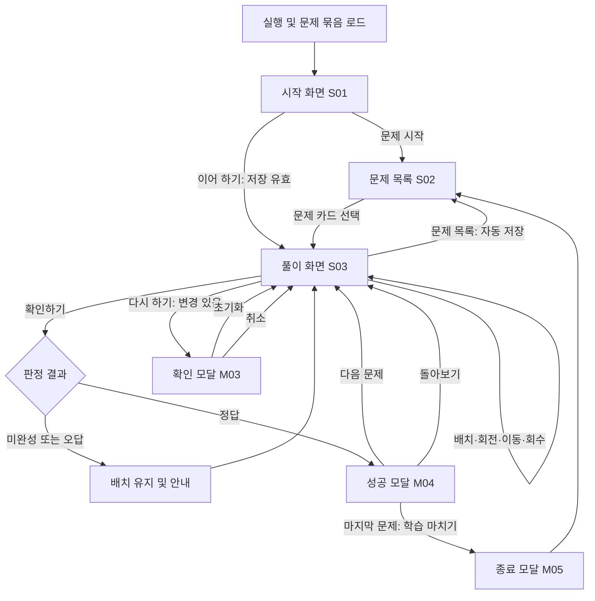

# 5×5 아동용 인지발달 교구 — 프로그램 개발 및 UI/UX 상세서

> 문서 버전: 1.0 · 작성일: 2026-10-06 · 대상: 기획자, UI/UX 디자이너, 프론트엔드 개발자, 콘텐츠 담당자, QA
>
> 이 문서는 제공된 프로젝트 개요를 기준으로 한 구현 설계 제안이다. 현재 프로젝트 폴더에 기존 소스, 실물 교구 디자인, 문제 카드, 정답 자료가 없으므로 실물 규칙과 동일하다는 검증은 아직 이루어지지 않았다. 아래의 **확정 요구**, **설계 기본값**, **자료 확인 필수**를 구분하여 적용한다.

## 목차

1. 문서 적용 원칙과 결정 사항
2. 제품 범위와 완료 조건
3. 서비스 구조와 사용자 흐름
4. 보드·조각·문제의 규칙
5. 색상·타이포그래피·디자인 토큰
6. 레이아웃과 태블릿 반응형 규칙
7. 화면별 구현 명세
8. 터치·드래그·회전·재배치 상세 계약
9. 상태 모델과 상태 전이
10. 정답 판정 알고리즘
11. 데이터 모델과 완결된 개발용 예시
12. 샘플 문제 제작·검수 규격
13. 공통 컴포넌트 규격
14. 컴포넌트 상태 및 피드백
15. 접근성 구현 기준
16. 입력값 검증과 오류 메시지
17. 로딩·빈 상태·네트워크·권한 예외
18. 저장·복원·문제 이동 규칙
19. 권장 기술 구조와 데이터 요청 계약
20. 기능별 인수 시나리오와 테스트
21. 디자인·개발 인계와 구현 순서
22. 미확인 사항·위험·근거 자료

## 1. 문서 적용 원칙과 결정 사항

### 1.1 규정의 의미

| 구분           | 의미                                                 | 구현에 적용하는 방법                                                            |
| -------------- | ---------------------------------------------------- | ------------------------------------------------------------------------------- |
| 확정 요구      | 사용자가 직접 제시한 요구                            | 변경 시 요구사항 변경 기록 필요                                                 |
| 설계 기본값    | 자료가 없어 본 문서에서 선택한 구체적인 구현안       | 화면·기반 개발은 해당 값으로 시작하며 실물 자료 검수 후 문서와 구현을 함께 갱신 |
| 자료 확인 필수 | 실제 교구 또는 판매 운영 정보를 받아야 정해지는 항목 | 임의로 실제 상품 규칙·콘텐츠·계약 사실로 확정하지 않음                          |

- 문서에서 별도 표기가 없는 화면 치수·상태·동작은 **설계 기본값**이다.
- `필수`는 해당 기준 버전의 구현 의무, `선택`은 별도 범위 협의 없이는 구현하지 않는 항목이다.
- 모든 치수의 `px`는 CSS 논리 픽셀이다. 이미지의 실제 픽셀 수나 기기 화면 해상도와 구분한다.
- 행·열은 데이터에서 `0..4`, 아이에게 보여 주는 설명에서 `1..5`를 사용한다. 좌상단은 데이터 `(row:0, col:0)`이다.
- 수치 경계는 별도 언급이 없으면 포함한다. 상태 enum, 오류 코드, 문구는 본 문서의 표기를 그대로 사용한다.
- 실제 자료와 설계 기본값이 충돌하면 콘텐츠 담당자와 기획자가 충돌 사항을 기록하고 수정한다. 개발자가 실물 규칙을 추정하여 코드만 변경하지 않는다.

### 1.2 요구사항 및 설계 결정 등록부

| ID  | 항목           | 현재 상태                    | 기준 값 / 필요한 자료                                                                       |
| --- | -------------- | ---------------------------- | ------------------------------------------------------------------------------------------- |
| R01 | 보드           | 확정 요구                    | 가로 5칸 × 세로 5칸, 총 25칸                                                                |
| R02 | 문제 표현      | 확정 요구                    | 도안 카드와 조건을 보면서 직접 해결                                                         |
| R03 | 조작           | 확정 요구                    | 터치·드래그 배치, 회전, 이동·재배치                                                         |
| R04 | 진행           | 확정 요구                    | 정답 확인, 오답 재시도, 다시 하기, 다음 문제                                                |
| R05 | 문제 수        | 확정 요구                    | 실물 콘텐츠 기반 10~20문제                                                                  |
| R06 | 상품 목적      | 확정 요구                    | 아이가 패드에서 사용하는 판매용 디지털 교구                                                 |
| D01 | 초기 문제 묶음 | 설계 기본값                  | 15문제, 자료 납품 수에 따라 10~20개 허용                                                    |
| D02 | 조각 크기      | 설계 기본값 + 자료 확인 필수 | 조각 1개가 1칸을 점유. 다칸 조각이면 데이터 모델·히트 테스트·회전 규격부터 개정             |
| D03 | 회전           | 설계 기본값 + 자료 확인 필수 | 시계 방향 90°씩, 0°·90°·180°·270°. 뒤집기 없음                                              |
| D04 | 연결 규칙      | 자료 확인 필수               | 접점의 위치·색/종류, 조각 내부 연결, 분기·교차·고리·열린 끝 허용 여부                       |
| D05 | 정답 조건      | 자료 확인 필수               | 전체/일부 칸 사용, 필수 조각, 고정칸, 금지칸, 복수 정답 여부, 문제별 정답 증거              |
| D06 | 대상 아동      | 설계 기본값 + 자료 확인 필수 | 보호자 도움을 받을 수 있는 5~8세를 디자인 검토 대상으로 가정. 실제 상품 권장 연령 확인 필요 |
| D07 | 기술           | 설계 기본값                  | React + TypeScript + Vite, DOM/SVG 보드, Pointer Events, 로컬 판정                          |
| D08 | 저장           | 설계 기본값                  | 같은 브라우저의 IndexedDB에 자동 저장, 계정·기기 간 동기화 없음                             |
| D09 | 판매·이용 권한 | 자료 확인 필수               | 판매 채널, 이용권 방식, 계정 및 기기 수 제한, 온라인/오프라인 정책                          |
| D10 | 원본 디자인    | 자료 확인 필수               | 보드·조각·문제 카드 원본, 로고, 폰트·이미지 사용권                                          |

**개발 착수 범위:** D02~~D05를 이 문서의 개발용 예시로 대체하여 화면과 조작 엔진을 구현할 수 있다. 실제 샘플 콘텐츠의 판정 구현 및 실물 일치 검수는 D02~~D05의 원본 확인 후 수행한다. D09가 확정되지 않은 버전을 유료 이용권 보호가 구현된 판매 완성본으로 취급하지 않는다.

## 2. 제품 범위와 완료 조건

### 2.1 첫 버전의 구현 범위

| 기능           | 상세 범위                                                  | 완료 조건                                                |
| -------------- | ---------------------------------------------------------- | -------------------------------------------------------- |
| 시작·문제 목록 | 시작 화면, 모든 문제 보기, 이전 풀이 이어 하기             | 유효한 문제 10~20개를 순서대로 표시하고 직접 진입 가능   |
| 풀이           | 5×5 보드, 도안, 조건, 조각 보관함, 조각 선택 도구          | 드래그와 탭으로 동일한 배치·회전·이동·회수 수행          |
| 판정           | 명시적인 `확인하기` 버튼, 조건 기반 판정, 결과 피드백      | 승인된 정답을 모두 허용하고 규칙 위반을 구분             |
| 진행           | 같은 문제 재시도, 다시 하기, 다음 문제, 마지막 문제 종료   | 오답 시 배치 유지, 다시 하기만 초기 배치로 복원          |
| 안정성         | 자동 저장, 일시중단·회전 복구, 로드 오류 처리              | 잘못된 드롭·터치 취소·오류가 기존 배치를 손상시키지 않음 |
| 접근성         | 드래그 대체 탭 조작, 키보드, 보이는 포커스, 의미 있는 안내 | 키보드와 단일 탭만으로 한 문제를 끝까지 해결 가능        |
| 인계           | 화면, 컴포넌트, 콘텐츠 구조, 인수 시나리오                 | 디자이너·개발자가 같은 상태와 숫자를 적용                |

이 버전의 화면에는 회원가입, 결제, 광고, 채팅, 순위, 제한 시간, 점수 차감, 보호자 대시보드, 콘텐츠 편집 관리자, 정답 자동 공개를 추가하지 않는다. 입력창·드롭다운·탭·테이블은 요청된 디자인 체계에 규격을 정의하되 현재 아동 화면에는 필요할 때만 배치하며, 사용처는 13장에서 지정한다.

### 2.2 사용자와 사용자 이야기

| 사용자             | 목적                           | 구현으로 검증할 이야기                                                      |
| ------------------ | ------------------------------ | --------------------------------------------------------------------------- |
| 아동               | 직접 조각을 움직이며 조건 해결 | 조각을 잘못 놓아도 회수·회전·재배치하여 같은 문제를 계속 풀 수 있다.        |
| 보호자/교사        | 문제를 열고 조작을 안내        | 목록에서 문제를 선택하고 도움말로 조작 방법을 설명할 수 있다.               |
| 콘텐츠 담당자      | 실물 문제를 디지털 구조로 변환 | 승인된 문제·정답을 정형 데이터와 검수 기록으로 제공할 수 있다.              |
| 개발·디자인 담당자 | 같은 화면과 규칙 구현          | 화면 ID, 토큰, 상태 enum, 판정 예시, 테스트를 같은 기준으로 사용할 수 있다. |

### 2.3 품질 목표

- 승인된 실제 문제 10~20개의 필수 정답 사례 통과율 100%, 승인된 오답 사례의 오판정 0건.
- 25칸 보드에서 같은 조작 100회 반복 후 조각 중복·소실·좌표 불일치 0건.
- 대상 실기기에서 터치 피드백 P95 100ms 이하, 정답 계산 P95 100ms 이하. 측정 방법은 20장 적용.
- 지원 화면에서 모든 칸의 터치 영역 최소 56×56px, 주요 버튼 최소 56px 높이.
- 정해진 600~1366px 태블릿 테스트 화면에서 본문 가로 스크롤 0건. 접근성 확대 시 보드만 예외적으로 가로 스크롤 가능.
- 강제 새로고침·앱 전환 복귀 후 마지막 저장 완료 시점까지의 풀이 복원. 저장 불가 환경은 문구로 고지하고 메모리에서 계속 풀이 가능.
- QA에서 치명적(P0)·주요(P1) 오류 0건. 아직 검증하지 않은 사항을 통과로 기록하지 않음.

## 3. 서비스 구조와 사용자 흐름

### 3.1 화면·경로 등록부

| ID  | 경로/표시 방식           | 목적                          | 진입                                         | 정상 종료               |
| --- | ------------------------ | ----------------------------- | -------------------------------------------- | ----------------------- |
| S01 | `/`                      | 시작·이어 하기                | 최초 실행, 로고/홈 이동                      | S02 또는 S03            |
| S02 | `/problems`              | 문제 목록                     | 시작 화면, 풀이의 `문제 목록`                | S03                     |
| S03 | `/play/:problemId`       | 문제 풀이                     | 목록, 이어 하기, 다음 문제, 직접 링크        | S02 또는 다음 S03       |
| M01 | S03 위 모달              | 조작 도움말                   | 헤더의 `사용 방법`                           | 같은 S03                |
| M02 | S03 위 모달              | 도안 확대                     | 도안의 `크게 보기`                           | 같은 S03                |
| M03 | S03 위 모달              | 다시 하기 확인                | `다시 하기`, 현재 배치가 초기 상태와 다를 때 | 취소 또는 초기화된 S03  |
| M04 | S03 위 모달              | 정답 성공                     | 현재 배치에 대한 판정 `correct`              | 같은 S03 또는 다음 문제 |
| M05 | S03 위 모달              | 마지막 문제 종료 안내         | 마지막 문제에서 `학습 마치기`                | S02                     |
| E01 | 요청 경로 안의 오류 영역 | 잘못된 문제 ID·자료 로드 실패 | 404, 검증 실패, 네트워크 실패                | 재시도 또는 S02         |

모달은 URL이나 브라우저 history 항목을 추가하지 않는다. S03의 실제 문제 ID가 바뀔 때만 페이지 이동으로 취급한다. 직접 링크와 새로고침을 지원하도록 배포 서버에서 유효한 앱 경로를 `index.html`로 연결한다. 콘텐츠 파일의 404는 앱 경로로 치환하지 않는다.

### 3.2 기본 흐름



### 3.3 이동 규칙

- 모든 문제는 처음부터 선택 가능하다. 이전 문제를 풀어야 열리는 잠금은 두지 않는다.
- `문제 시작`은 목록으로 이동한다. `이어 하기`는 마지막으로 편집한 문제의 유효한 저장 상태가 있을 때만 표시한다.
- 목록에서 풀었던 문제를 열면 저장된 배치를 복원한다. 새 시도는 풀이 화면의 `다시 하기`로 시작한다.
- `다음 문제`는 **현재 배치가 정답으로 확인된 동안** 활성화된다. 정답 확인 후 배치를 바꾸면 다시 비활성화한다.
- 다음 문제는 `order` 오름차순으로 바로 뒤의 문제이며, 이미 풀었는지에 따라 건너뛰지 않는다. 도착한 문제의 기존 저장은 복원한다.
- 마지막 문제의 다음 버튼 문구는 `학습 마치기`이다. 전체 완료 여부에 따라 M05 문구를 구분한다.
- 앱 내 이동 전 드래그를 취소하고 저장 큐를 실행한다. 저장 완료 대기는 최대 500ms이며 실패해도 이동을 막지 않고 저장 경고를 표시한다.
- 브라우저 뒤로 가기는 history대로 동작한다. 최초 직접 링크로 들어와 이전 앱 경로가 없으면 화면의 `문제 목록`으로 복귀한다.
- 저장이 가능한 일반 이동에는 나가기 확인 모달을 추가하지 않는다. 배치를 지우는 `다시 하기`에서만 확인한다.
- 페이지 이동 후 제목으로 포커스를 이동한다. 다음 문제에서는 `문제 {order}` 제목을 읽고 선택 상태를 해제한다.

## 4. 보드·조각·문제의 규칙

### 4.1 보드 좌표와 영역

- 보드는 5행 × 5열, 좌상단 원점, 행은 아래로 증가, 열은 오른쪽으로 증가한다.
- 각 칸은 `empty | occupied | fixed | blocked` 중 하나다. `fixed`와 `blocked`는 문제 데이터가 지정할 때만 생성한다.
- `occupied`는 가변 조각 1개, `fixed`는 이동·회전할 수 없는 조각 1개, `blocked`는 조각을 놓을 수 없는 칸이다.
- 겹침, 자동 덮어쓰기, 조각 교환은 허용하지 않는다. 이동 대상이 차 있으면 원래 상태로 돌아간다.
- 시작할 때 25칸을 반드시 채운다고 가정하지 않는다. 사용 칸 수·필수 위치는 문제의 `requirements`로 지정한다.
- 조작 중 연결이 틀리거나 조건이 충족되지 않는 배치는 허용한다. 점유·금지칸·경계 같은 물리 배치 조건만 즉시 검사한다.
- connection의 경계 단말은 도안과 같은 위치·색·모양의 편집 불가 표식으로 보드에 표시한다. 각 면 중앙의 보드 padding 안에10×10px 표식을 두고, 중심은 격자 경계에서 바깥쪽6px이다. 예시에서는 원형 파란 표식을 사용하며 실제 모양은 원본에 맞춘다. 표식은 칸을 점유하거나 드롭 대상이 되지 않는다. 단말의 좌표·면·채널은 도안 대체 설명에도 포함한다.

### 4.2 조각과 방향

| 용어                       | 정의                                      | 예시                       |
| -------------------------- | ----------------------------------------- | -------------------------- |
| 조각 종류 `typeId`         | 모양·그림·연결 구조가 같은 조각 설계      | `straight-blue`            |
| 조각 인스턴스 `instanceId` | 실제로 배치·회수하는 1개의 카드           | `line-01`, `line-02`       |
| 방향 `rotation`            | 원본 그림 대비 시계 방향 회전             | `0`, `90`, `180`, `270`    |
| 보관함                     | 현재 보드에 없는 가변 인스턴스의 위치     | `location: "tray"`         |
| 선택                       | 현재 회전·회수 도구가 적용될 인스턴스     | 동시에 최대 1개            |
| 접점 `port`                | 칸의 N/E/S/W 중 한 면 중앙에 있는 연결 끝 | `side:"E", channel:"blue"` |
| 내부 연결 `connection`     | 동일 조각 안에서 서로 이어지는 접점 집합  | `[["west","east"]]`        |

- 가변 조각 수는 문제별 1~25개, 고정 조각과 가변 조각의 총합도 25개 이하다. 실제 교구가 여분 조각 25개 초과를 요구하면 이 제한을 개정한다.
- 보관함에서 조각을 회전해도 위치는 보관함에 유지한다. 보드에서 회전해도 점유 칸은 유지한다.
- 회수할 때 현재 회전값을 유지한다. `다시 하기`에서는 문제의 `initialPieces` 방향으로 복원한다.
- `allowedRotations`는 비어 있지 않은 중복 없는 배열이며 위 4개 값의 부분집합이다. 회전 버튼은 오름차순 목록에서 현재 값의 다음 값으로 순환한다.
- `[0]`인 조각은 회전 버튼을 비활성화하고 `이 조각은 돌리지 않아요`를 도구 안내에 표시한다.
- 방향을 바꾸어도 그림이 같은 조각의 정답 비교는 종류의 `equivalentRotations`에 따른다. 직선의 예는 `[[0,180],[90,270]]`이다.
- 뒤집기, 자유 각도 회전, 다칸 조각은 현재 기본값에 포함되지 않는다. 원본에 존재하면 먼저 규칙과 도식 예시를 추가한다.

### 4.3 문제 카드의 내용

- 한 문제는 `id`, `order`, `title`, `prompt`, 도안 이미지, 도안 대체 설명, 조각 종류·수량, 초기 배치, 필수 조건, 판정 모드를 포함한다.
- 아이에게 표시하는 조건은 최대 3개, 각 30자 이하다. 길이를 초과하는 실물 조건은 기획자가 의미를 유지하여 문장을 나누고 승인한다.
- 도안은 **문제에 제시된 정보**만 표현한다. 해결 배치나 정답 경로를 시스템이 자동으로 겹쳐 보여 주지 않는다.
- 연결 문제는 `connection`, 정확한 그림 재현 문제는 `exact` 모드를 사용한다. 문제 담당자가 모드를 지정하며 개발자가 이미지에서 추정하지 않는다.
- 난이도는 선택 메타데이터 `1 | 2 | 3`이다. 실제 자료에 근거가 없으면 화면에 난이도를 표시하지 않는다.
- 조건 안내, 대체 설명, 판정 데이터는 같은 `contentVersion`으로 묶는다. 문구와 판정이 다르면 콘텐츠 오류다.

## 5. 색상·타이포그래피·디자인 토큰

### 5.1 시각적 방향

화면은 따뜻한 밝은 바탕, 짙은 초록의 주요 버튼, 흰 보드, 명확한 조각 윤곽을 사용한다. 실제 카드의 그림과 규칙 색상을 가장 먼저 읽을 수 있게 하며, 배경 장식·그라데이션·반복 애니메이션은 넣지 않는다. 로고와 조각 그림은 원본 수령 후 교체하는 자산이고, 아래 색은 앱의 조작 UI용 기본값이다.

### 5.2 색상 팔레트 및 사용 기준

| 토큰                      | HEX                   | 사용처                         | 함께 쓰는 전경/제약                                |
| ------------------------- | --------------------- | ------------------------------ | -------------------------------------------------- |
| `color.bg.page`           | `#F6F8F3`             | 전체 페이지                    | 기본 글자 `text.primary`                           |
| `color.bg.surface`        | `#FFFFFF`             | 카드, 모달, 보드 칸            | 기본 글자 `text.primary`                           |
| `color.bg.subtle`         | `#ECF3EC`             | 조각함, 설명 영역              | 초록 배경 위에 녹색 작은 글자를 임의 사용하지 않음 |
| `color.text.primary`      | `#24313B`             | 제목, 본문, 칸 설명            | 기본 배경·흰색 배경                                |
| `color.text.secondary`    | `#52616B`             | 보조 안내, 진행 수             | 밝은 배경에서만 사용                               |
| `color.primary`           | `#25634C`             | 확인·시작·다음 버튼, 선택 경계 | 흰색 글자                                          |
| `color.primary.hover`     | `#1E513E`             | 주요 버튼 Hover                | 흰색 글자                                          |
| `color.primary.active`    | `#173F30`             | 주요 버튼 누름                 | 흰색 글자                                          |
| `color.primary.soft`      | `#E9F3EE`             | 선택된 조각의 바탕             | 경계는 `primary`, 글자는 `text.primary`            |
| `color.border.decorative` | `#D4DED8`             | 정보 카드의 보조 구분          | 입력·버튼·보드의 유일한 식별 경계로 사용하지 않음  |
| `color.border.control`    | `#73808C`             | 버튼·입력·빈칸 경계            | 필수 조작 영역 식별용                              |
| `color.focus`             | `#1D4ED8`             | 키보드 포커스                  | 흰색 2px 분리선 + 파란색 3px 외곽선                |
| `color.success`           | `#236644`             | 성공 아이콘·성공 제목          | 배경 `#EAF5EE`, 문구와 체크 아이콘 병행            |
| `color.warning`           | `#854D0E`             | 미완성·저장 경고               | 배경 `#FFF6E5`, 경고 아이콘·문구 병행              |
| `color.error`             | `#B42318`             | 잘못된 드롭·시스템 오류        | 배경 `#FEF0ED`, 오류 아이콘·문구 병행              |
| `color.info`              | `#1D4ED8`             | 일반 정보·로딩 안내            | 배경 `#EFF6FF`                                     |
| `color.disabled.bg`       | `#E4E9E7`             | 비활성 버튼                    | 글자 `text.secondary`, 불투명도는 1                |
| `color.overlay`           | `rgba(24,34,30,0.40)` | 모달 배경                      | 모달 내부에는 적용하지 않음                        |
| `color.piece.blue`        | `#2558A5`             | 개발용 파란 연결선 예시        | 실제 조각 색상으로 확정하지 않음                   |
| `color.piece.orange`      | `#985700`             | 개발용 두 번째 채널 예시       | 색 외에 모양/패턴/이름을 함께 지정                 |
| `color.piece.purple`      | `#6C4097`             | 개발용 세 번째 채널 예시       | 상태 강조 색상으로 재사용하지 않음                 |

- 정상 텍스트의 명도 대비는 최소 4.5:1, 큰 텍스트는 3:1이다. 본 디자인은 크기에 관계없이 주요 글자 4.5:1을 목표로 한다. 기준 근거: [W3C Contrast Minimum](https://www.w3.org/WAI/WCAG22/Understanding/contrast-minimum.html).
- 필수 조작 경계·아이콘·포커스와 인접 바탕의 대비는 3:1 이상이다. 원본 그림도 판정에 필요한 선·접점 구분을 검수한다.
- 선택은 초록 3px 경계 + 체크 아이콘, 잘못된 드롭은 빨강 경계 + 금지 아이콘, 고정칸은 자물쇠 + `고정`, 금지칸은 빗금 + `놓을 수 없음`으로 구분한다.
- 실제 교구의 색이 조건의 일부라면 색 자체를 바꾸지 않는다. 접근성 보조 패턴을 추가하려면 그 패턴이 문제의 새로운 힌트가 되지 않는지 콘텐츠 검수한다.
- 다크 모드는 첫 버전에 제공하지 않는다. OS의 강제 색상 모드에서는 경계·글자·포커스를 시스템 색으로 표현한다.

### 5.3 타이포그래피

폰트 기본값은 `Noto Sans KR`, 대체 순서는 `system-ui, -apple-system, "Segoe UI", sans-serif`이다. 배포 자산은 사용권을 확인한 WOFF2를 자체 호스팅한다. 외부 폰트 요청 실패가 풀이를 막지 않으며 `font-display: swap`을 사용한다. 기본 루트 크기는 16px, 아래 크기는 rem으로 구현하여 사용자 글자 확대를 따른다.

| 스타일            | 크기            | 굵기 | 행간         | 자간    | 용도                               |
| ----------------- | --------------- | ---- | ------------ | ------- | ---------------------------------- |
| `display`         | 32px / 2rem     | 700  | 44px / 1.375 | -0.02em | 시작 제목, 전체 완료 제목          |
| `heading.page`    | 24px / 1.5rem   | 700  | 34px / 1.417 | -0.01em | 페이지·모달 제목                   |
| `heading.section` | 20px / 1.25rem  | 600  | 30px / 1.5   | 0       | 문제 카드 제목, 조각함 제목        |
| `body.child`      | 18px / 1.125rem | 400  | 28px / 1.556 | 0       | 문제 조건, 도움말, 피드백          |
| `control`         | 18px / 1.125rem | 600  | 24px / 1.333 | 0       | 주요 버튼                          |
| `label`           | 16px / 1rem     | 600  | 24px / 1.5   | 0       | 도구 버튼, 조각 이름, 배지         |
| `body.secondary`  | 16px / 1rem     | 400  | 24px / 1.5   | 0       | 보조 설명                          |
| `caption`         | 14px / 0.875rem | 500  | 20px / 1.429 | 0       | 보호자용 버전·진단 코드, 부가 정보 |

- 아이가 읽어야 하는 문제·행동 안내는 16px 이상을 사용한다. 핵심 버튼은 18px을 유지한다.
- 본문은 왼쪽 정렬, 제목·성공 안내만 필요에 따라 중앙 정렬한다. 양쪽 맞춤을 사용하지 않는다.
- 한 줄 최대 읽기 폭은 60자, 도움말 본문은 40자 권장이다. 긴 한글은 `word-break: keep-all; overflow-wrap: anywhere`로 처리한다.
- 핵심 조건과 오류 메시지는 말줄임하지 않는다. 목록 제목은 2줄까지 표시하고 초과 제목은 콘텐츠 검증에서 수정한다.
- 숫자 진행 표시는 `font-variant-numeric: tabular-nums`를 사용한다. 표시 예: `문제 3 / 15`, `풀어 본 문제 4 / 15`.

### 5.4 간격·곡률·그림자·동작 토큰

| 항목          | 값                                                                        | 사용                                          |
| ------------- | ------------------------------------------------------------------------- | --------------------------------------------- |
| 간격          | 4, 8, 12, 16, 20, 24, 32, 40, 48px                                        | 임의 7px·13px 간격 생성 금지                  |
| 곡률          | 칸·조각 10px, 버튼 12px, 카드 16px, 모달 24px, 배지 999px                 | 중첩 요소는 내부 곡률을 더 작게 적용          |
| 경계          | 정보 카드 1px, 조작 경계 2px, 선택 3px                                    | 선택 경계는 inset으로 그려 크기를 바꾸지 않음 |
| 카드 그림자   | `0 4px 16px rgba(36,49,59,0.08)`                                          | 시작·문제 카드만, 모든 칸에 개별 그림자 금지  |
| 모달 그림자   | `0 16px 48px rgba(24,34,30,0.20)`                                         | 모달 1개                                      |
| 드래그 그림자 | `0 8px 24px rgba(24,34,30,0.22)`                                          | 움직이는 미리보기 1개                         |
| Hover 전환    | 120ms                                                                     | 배경·경계만                                   |
| 정상 스냅     | 120ms, `cubic-bezier(.2,.8,.2,1)`                                         | 위치 확정 후 미리보기 이동                    |
| 실패 복귀     | 160ms, 같은 easing                                                        | 원래 위치 복귀                                |
| 회전          | 120ms, 같은 easing                                                        | 데이터 각도는 즉시 확정                       |
| 모달          | opacity 160ms                                                             | 과장된 확대·흔들림 없음                       |
| z-index       | 기본 0, 헤더 10, 피드백 20, 드래그 40, 오버레이 100, 모달 110, 토스트 120 | 모달이 열리면 드래그는 먼저 취소              |

`prefers-reduced-motion: reduce`에서는 장식·위치·회전 전환 시간을 0ms로 한다. 애니메이션 완료를 배치·저장·다음 이동의 전제 조건으로 사용하지 않는다.

## 6. 레이아웃과 태블릿 반응형 규칙

### 6.1 측정·그리드 공통 규칙

- `<meta name="viewport" content="width=device-width, initial-scale=1, viewport-fit=cover">`를 사용한다. 사용자 확대를 막는 설정을 넣지 않는다.
- `box-sizing: border-box`를 전체 요소에 적용한다.
- `W`는 문서의 CSS 뷰포트 너비에서 좌우 safe-area를 뺀 값이다. `H`는 `visualViewport.height`가 있으면 그 값, 없으면 `innerHeight`에서 상하 safe-area를 뺀 값이다.
- safe-area는 `env(safe-area-inset-*)`를 사용한다. 브라우저 주소창·분할 화면 변화는 `ResizeObserver`와 viewport resize로 반영한다.
- 화면 외곽 여백 `M`은 `W < 840`이면 16px, 그 외 24px이다. 컨테이너 너비 `L = min(W - 2M, 1280px)`이며 가로 중앙 정렬한다.
- 시작·목록 화면은 12열 기준, gutter 20px(600~767에서는 16px), 최대 너비 1280px를 사용한다. 풀이 화면의 열 구조는 다음 표를 우선한다.
- 페이지 최소 높이는 `100dvh`, 대체값은 `100vh`이다. 세로 공간이 부족하면 본문 스크롤을 허용하고 보드·글자를 더 줄이지 않는다.

### 6.2 Breakpoint와 화면 변경

| 범위              | 분류                    | 시작 S01             | 목록 S02       | 풀이 S03                                                    |
| ----------------- | ----------------------- | -------------------- | -------------- | ----------------------------------------------------------- |
| `W < 600`         | 축소·확대 접근성 대응   | 1열, 버튼 전체 폭    | 1열            | 세로 쌓기, 보드 최소 324px, 보드 영역만 필요 시 가로 스크롤 |
| `600 ≤ W < 768`   | 소형 태블릿             | 단일 중앙 카드       | 2열            | 도안 요약 → 보드 → 도구 → 조각함 → 액션                     |
| `768 ≤ W < 1024`  | 태블릿 세로·분할 화면   | 중앙 카드 최대 640px | 3열            | 위와 같은 세로 구조, 외곽 여백은 840px에서 24px로 변경      |
| `1024 ≤ W < 1280` | 태블릿 가로             | 중앙 카드 최대 640px | 4열            | 도안 240px / 보드 유동 / 조각함 192px, 열 간격 20px         |
| `W ≥ 1280`        | 큰 태블릿·검수 데스크톱 | 최대 폭 유지         | 4열, 카드 확장 | 동일 3열, 보드는 최대 480px 유지                            |

가로·세로 방향만으로 레이아웃을 결정하지 않는다. 브라우저 분할 화면의 실제 `W`, `H`로 결정한다. 정상 크기에서 고정 footer로 내용을 가리지 않으며 액션 영역은 문서 흐름 안에 있다.

### 6.3 보드 크기 계산

보드 외곽 너비·높이는 같은 `B`이다. 외곽선 2px, 안쪽 padding 12px, 셀 사이 gap 4px, 5열/5행이다.

```text
셀 너비·높이 C = (B - 2×2 - 2×12 - 4×4) / 5 = (B - 44) / 5
보드 최소 B = 324px → C = 56px
보드 최대 B = 480px → C = 87.2px
```

- 셀은 CSS Grid의 `repeat(5, minmax(0, 1fr))`로 나누며 소수점은 유지한다. JS에서 개별 셀 크기를 반올림하여 누적하지 않는다.
- 조각 그림의 최대 크기는 `C - 8px`, 최소 크기는 48px이다. 터치 영역은 그림 크기와 관계없이 셀 전체다.
- 보드 경계·padding은 드롭 영역이 아니다. 셀 사이 4px gap의 대상 결정은 8장의 규칙을 적용한다.

**가로 3열(`W ≥ 1024`)**

```text
가운데 열 너비 R = L - 240 - 192 - 2×20 = L - 472
워크스페이스 높이 A = H - 헤더72 - 본문상하32 - 액션72 - 사이간격16 = H - 192
B = max(324, min(480, R, A - 도구56 - 도구간격12))
  = max(324, min(480, R, H - 260))
```

`H < 584`이면 보드 최소 크기 때문에 전체 화면 높이에 맞추지 못한다. 워크스페이스 최소 높이 392px(324+12+56)을 유지하고 본문을 스크롤한다. 도안·조각함 높이도 최소 392px로 맞춘다.

**세로 쌓기(`600 ≤ W < 1024`)**

```text
헤더64 + 본문상하32 + 도안112 + 간격16 + 보드B + 간격12
+ 도구56 + 간격16 + 조각함128 + 간격16 + 액션72 = B + 624
B = max(324, min(480, L, H - 624))
```

조건 글자 확대 등으로 도안 112px보다 높아지면 실제 도안 높이를 계산하여 남는 높이를 줄인다. 보드가 324px 미만으로 줄어야 하는 상황이면 324px을 유지하고 페이지 스크롤로 전환한다. 보드는 화면 가운데 가로 정렬한다.

| 검수 뷰포트 W×H | L    | 레이아웃 | 계산 B | 셀 C | 세로 처리             |
| --------------- | ---- | -------- | ------ | ---- | --------------------- |
| 600×960         | 568  | 세로     | 336    | 58.4 | 기준 글자에서 한 화면 |
| 768×1024        | 736  | 세로     | 400    | 71.2 | 기준 글자에서 한 화면 |
| 820×1180        | 788  | 세로     | 480    | 87.2 | 남는 공간 중앙 정렬   |
| 1024×768        | 976  | 3열      | 480    | 87.2 | 보드+도구 548px       |
| 1024×600        | 976  | 3열      | 340    | 59.2 | 기준 글자에서 한 화면 |
| 1180×820        | 1132 | 3열      | 480    | 87.2 | 최대 보드 유지        |
| 1366×1024       | 1280 | 3열      | 480    | 87.2 | 최대 컨테이너 유지    |

이 표의 W·H는 safe-area 적용 후의 값이다. 실제 기기에서는 주소창·safe-area 때문에 결과가 달라질 수 있으므로 계산식을 적용한다.

### 6.4 화면별 배치 도식

```text
가로 풀이: 1024px 이상
┌──────────────── 헤더 72px ─────────────────┐
│ 문제 목록      문제 3 / 15       사용 방법 │
├────240px────┬────── 유동 R ─────┬──192px───┤
│ 도안 제목   │                  │ 조각함   │
│ 도안 정사각 │    5×5 보드 B     │ 카드 격자│
│ 문제 조건   │                  │ 페이지   │
│ 피드백      │ 회전 · 돌려놓기   │ 이동버튼 │
├─────────────┴──────────────────┴──────────┤
│ 다시 하기          확인하기     다음 문제 │ 72px
└───────────────────────────────────────────┘

세로 풀이: 600~1023px
┌────────────── 헤더 64px ───────────────┐
│ 문제 목록     문제 번호     사용 방법 │
├───────────────────────────────────────┤
│ 도안 미리보기 96px │ 제목·조건·확대   │ 최소 112px
│              5×5 보드 B              │
│         회전 · 조각함으로 돌려놓기    │ 56px
│ 조각함: 한 줄 카드 + 페이지 이동     │ 128px
│ 다시 하기    확인하기    다음 문제    │ 72px
└───────────────────────────────────────┘
```

도식의 순서와 DOM 읽기 순서를 같게 유지한다. 좁은 화면에서 CSS로 위치만 바꾸고 키보드 순서를 반대로 남겨 두지 않는다. 세로 도안 행은 콘텐츠와 글자 확대에 따라 높이가 증가한다.

## 7. 화면별 구현 명세

### 7.1 S01 — 시작 화면

**목적:** 문제 묶음에 진입하거나 저장된 마지막 풀이를 이어 한다.

| 요소           | 크기·배치                                                    | 내용·동작                                                                                                  |
| -------------- | ------------------------------------------------------------ | ---------------------------------------------------------------------------------------------------------- |
| 공통 헤더      | 높이 72px, 작은 화면 64px, L 안쪽 정렬                       | 제공된 로고 또는 임시 텍스트 `생각 연결 보드`; 임시명은 실제 상품명 승인 후 교체                           |
| 시작 카드      | 너비 `min(640px,L)`, padding 32px, 좁은 화면 24px, 곡률 24px | 본문 영역에서 가로 중앙; 세로 공간이 있으면 중앙, 부족하면 위에서 24px                                     |
| 보드 소개 그림 | 160×160px, 중앙, 제목과 24px 간격                            | 개발용 5×5 도식 또는 승인된 상품 이미지; 장식이면 alt 빈 값                                                |
| 제목           | display 32/44, 중앙, 하단 12px                               | `조각을 움직이며 문제를 풀어요`                                                                            |
| 설명           | 18/28, 중앙, 하단 24px                                       | `도안을 보고 조각을 놓고 돌려 보세요.`                                                                     |
| 진행 표시      | 16/24, 하단 24px                                             | `풀어 본 문제 {everSolvedCount} / {total}`; 저장 없으면 0                                                  |
| 주요 버튼      | 높이 56px, 카드 내부 전체 폭                                 | 저장 유효 시 `이어 하기`, 그 아래 12px 간격의 Secondary `문제 고르기`; 저장 없으면 Primary `문제 시작` 1개 |
| 저장 안내      | 16/24, 버튼 아래 16px                                        | 저장 불가일 때만 `이 기기에서는 풀이가 저장되지 않아요. 지금 문제는 계속 풀 수 있어요.`                    |

- 최초 문제 묶음을 불러오는 동안 버튼을 렌더링하지 않고 같은 높이의 Skeleton을 표시한다.
- 유효한 묶음이 0문제면 S01 Empty State, 묶음 검증 실패면 Error State를 표시한다.
- 이어 하기 대상이 삭제되었거나 버전이 맞지 않으면 버튼을 숨기고 목록으로 시작한다. 다른 문제의 유효한 기록까지 삭제하지 않는다.

### 7.2 S02 — 문제 목록

**목적:** 문제의 순서·완료 상태를 보고 한 문제를 선택한다.

- 헤더 왼쪽 `처음으로`, 가운데 페이지 제목 `문제 고르기`, 오른쪽 `풀어 본 문제 {n} / {total}`을 표시한다.
- 제목 아래 12px 간격에 `풀고 싶은 문제를 골라요.`를 표시한다. 그 아래 24px 간격에 카드 격자를 시작한다.
- 카드 gap은 20px, 600~767px에서는 16px이다. 격자와 페이지 하단 사이 최소 32px을 둔다.

| 카드 내부 | 크기·간격                                                        | 규칙                                                        |
| --------- | ---------------------------------------------------------------- | ----------------------------------------------------------- |
| 전체      | width 100%, 최소 높이 240px, padding 16px, radius 16px, 경계 2px | 카드 전체가 하나의 링크. 내부에 별도 버튼을 중첩하지 않음   |
| 상단      | 번호 16/24, 완료 배지 오른쪽                                     | `문제 1`; 완료 배지는 체크 아이콘 + `풀었어요`              |
| 도안      | 정사각 최대 144px, 내부 가로 중앙, 상단 12px                     | `object-fit: contain`; 미리보기 실패 시 해당 카드 오류 표시 |
| 제목      | 20/30, 상단 12px, 2줄 최대                                       | 말줄임 없이 콘텐츠 제한 적용                                |
| 상태 설명 | 16/24, 상단 8px                                                  | `시작하기` / `이어서 풀기` / `다시 살펴보기`                |

- 카드의 판정·도안 자료가 모두 유효해야 링크를 활성화한다. 일부만 로드 실패한 카드는 같은 자리에서 `문제를 준비하지 못했어요`와 재시도 버튼을 표시한다.
- 현재 묶음 전체가 승인된 상태라면 모두 활성화한다. 배포 전 검수에서 오류 문제를 제외하여 실제 제공 문제 수가 10~20개인지 다시 확인한다.
- 스크롤 위치는 풀이에서 목록으로 돌아올 때만 복원한다. 시작 화면에서 새로 목록을 열면 맨 위로 이동한다.
- 목록 키보드 순서는 행 우선, 좌→우이다. 전체 카드 수 20개 이하이므로 검색·필터·무한 스크롤·페이지 나누기를 추가하지 않는다.

### 7.3 S03 — 문제 풀이

**목적:** 도안 조건을 보면서 조각을 자유롭게 놓고 정답을 확인한다.

| 영역           | 규격                                                       | 정상 상태                                                                         | 조건·예외                                                             |
| -------------- | ---------------------------------------------------------- | --------------------------------------------------------------------------------- | --------------------------------------------------------------------- |
| 헤더           | 가로 72px/세로 64px                                        | 왼쪽 112×56 `문제 목록`, 중앙 `문제 {order} / {total}`, 오른쪽 112×56 `사용 방법` | 600px 미만에서는 문구 줄바꿈 허용, 높이 자동 증가                     |
| 도안 패널      | 가로 width 240px, padding 16px, 최소 높이는 workspace 높이 | 제목20/30 → 간격12 → 최대208×208 이미지 → 간격12 → 조건18/28                      | 긴 조건은 패널 내부 또는 본문에서 스크롤, 핵심 문구 생략 없음         |
| 세로 도안 요약 | 최소112px, padding8px, 이미지96×96, 이미지·텍스트 간격16px | 텍스트 오른쪽에 제목·최대3개 조건; `크게 보기` 48px 버튼                          | 높이 부족 시 패널 높이 증가. 도안 확대 외 별도 조건 펼치기 없음       |
| 보드           | 6장 B/C 규격                                               | 25칸, 흰 바탕, 선택·드롭 미리보기                                                 | 연결 맞음/틀림은 확인 전 자동 색칠하지 않음                           |
| 조각 도구      | 높이56px, 보드 아래12px, gap12px, 중앙 정렬                | `돌리기` 최소144px, `조각함으로` 최소160px                                        | 미선택이면 모두 비활성. 회수는 보드의 가변 조각 선택 때만 활성        |
| 선택 설명      | 도구의 aria-describedby 텍스트, 필요한 안내는 시각 표시    | `{조각 이름} 선택됨`                                                              | 선택 설명을 위해 보드 위치가 흔들리지 않도록 도구 영역에 포함         |
| 조각함         | 가로192px/세로L, 바탕subtle, padding8px                    | 현재 보관함의 인스턴스만 표시; 고유 번호로 동일 종류 구분                         | 페이지 크기는 13장 산식. 네이티브 스크롤 대신 명시적 페이지 버튼 제공 |
| 피드백         | 도안 아래 최소56px 예약 또는 판정 후 등장                  | 미완성·오답·저장 경고의 문구                                                      | 공간 부족 시 본문 높이가 늘어남. 보드 위에 토스트를 덮지 않음         |
| 액션           | 최소72px, 가운데 정렬, 버튼 높이56px                       | 왼쪽 `다시 하기`144px, 오른쪽 `확인하기`176px와 `다음 문제`144px, gap12px         | 다음은 현재 정답 확인 후 활성. 600px 미만은 전체 폭으로 세로 배치     |

- Header·보드·조각함은 현재 문제 데이터가 완전히 검증된 후 함께 활성화한다. 필수 도안이 로드되지 않았는데 풀이만 열지 않는다.
- `확인하기`는 편집 가능·가변 조각 1개 이상 보드 배치·포인터 조작 없음일 때 활성화한다. 고정 조각만 있는 문제는 콘텐츠 검수에서 제외한다.
- 오답·미완성은 화면 내 피드백으로 표시한다. 성공만 M04를 연다.
- 성공 후 `돌아보기`로 닫으면 배치를 살펴보고 수정할 수 있다. 배치를 바꾸기 전에는 다음 버튼이 활성 상태다.
- 조각함 카드 수가 0이면 같은 공간에 `조각을 모두 놓았어요. 보드의 조각을 눌러 옮기거나 돌릴 수 있어요.`를 표시한다.
- 도안과 회전 도구·빈칸 사이에는 최소 12px을 둔다. 버튼을 셀 위에 띄우지 않는다.

### 7.4 M01 — 사용 방법

- 모달 너비 `min(560px,L)`, padding24px, 최대 높이 `H-48px`, 내부 본문 스크롤.
- 제목 `이렇게 풀어요`, 제목 아래16px 간격에 3개의 단계 카드. 각 단계는 번호32px + 그림64px + 문구18/28, 요소 간격12px, 카드 간격16px.
- 단계 문구는 `1. 조각을 눌러 고른 뒤 빈칸을 눌러요.`, `2. 조각을 끌어 놓아도 돼요.`, `3. 돌리고 옮긴 뒤 확인하기를 눌러요.`이다.
- 하단16px 간격에 `알겠어요` 전체 폭56px 버튼, 우상단48×48px 닫기 버튼.
- 자동 재생·음성·실제 보드 조작 튜토리얼을 포함하지 않는다. 그림은 조작을 설명하며 실제 정답을 공개하지 않는다.

### 7.5 M02 — 도안 크게 보기

- 모달 너비 `min(720px,L)`, padding24px, 제목24/34, 원본 비율 유지.
- 도안 영역 최대 `min(560px,L-48px,H-220px)`, 너무 낮으면 최소160px과 본문 스크롤. 이미지는 정사각 프레임에서 `contain`한다.
- 이미지 아래16px 간격에 원래 조건을 전부 표시하고 하단24px 간격에 `닫기`56px 버튼.
- 새 도안을 요청하지 않는다. S03에서 검증·로드한 동일한 자산을 사용한다. 브라우저 확대를 허용하고 앱 자체의 핀치 제스처는 추가하지 않는다.

### 7.6 M03 — 다시 하기 확인

- 제목 `처음부터 다시 할까요?`, 본문 `놓은 조각은 처음 상태로 돌아가요.`.
- 하단24px 간격에 `계속 풀기` Secondary와 `다시 하기` Primary, 각 최소128×56px, gap12px. 좁은 화면은 세로 배치.
- 기본 포커스는 `계속 풀기`. Escape·배경 탭·닫기는 취소와 같은 동작.
- 확정하면 초기 위치·회전으로 원자적으로 복원, 선택·피드백·현재 정답 확인 해제, 저장 갱신. 과거 `everSolved`는 유지.
- 현재 위치·회전이 초기 상태와 같으면 모달 없이 선택·피드백과 현재 판정을 해제한다(`judgeStatus=unchecked`, `checkedRevision=null`). 위치·회전이 같으므로 revision은 유지하고 저장된 lastCheck만 null로 갱신한다. everSolved는 유지한다.

### 7.7 M04 — 정답 성공

- 너비 `min(480px,L)`, padding24px, 체크 아이콘56×56px, 제목 `해냈어요!`24/34, 본문 `문제의 조건을 모두 맞췄어요.`18/28, 요소 간격16px.
- 하단24px 간격에 `돌아보기` Secondary와 `다음 문제` Primary. 마지막 문제는 Primary를 `학습 마치기`로 변경한다.
- 기본 포커스는 Primary. Escape·배경 탭·닫기는 `돌아보기`와 같다.
- 점수·등수·남은 시간은 표시하지 않는다. 모달이 열려 있는 동안 보드 입력은 차단하고 배치를 유지한다.
- 같은 `boardRevision`을 다시 확인하면 성공 모달을 다시 열 수 있지만 완료 기록은 중복 생성하지 않는다.

### 7.8 M05 — 마지막 문제 종료

| 조건                        | 제목                      | 본문                                                      | 버튼                       |
| --------------------------- | ------------------------- | --------------------------------------------------------- | -------------------------- |
| `everSolvedCount === total` | `모든 문제를 풀었어요!`   | `도안을 보고 연결하는 방법을 찾아냈어요.`                 | Primary `문제 목록으로`    |
| `everSolvedCount < total`   | `마지막 문제를 풀었어요!` | `아직 풀지 않은 문제 {total-everSolvedCount}개가 있어요.` | Primary `다른 문제 고르기` |

크기는 M04와 같고 기본 포커스는 버튼이다. 버튼은 S02로 이동한다. Escape·닫기는 현재 마지막 S03으로 돌아간다. 완료 상태를 서버에 전송하는 기능은 없다.

### 7.9 E01 — 문제 로드 오류

- 오류 영역 너비 `min(560px,L)`, padding24px, 아이콘48px, 제목24/34, 본문18/28, 간격16px.
- 미존재 문제: `이 문제를 찾을 수 없어요.` + `문제 목록` 버튼만.
- 일시적인 자료 요청 실패: `문제를 가져오지 못했어요.` + `인터넷 연결을 확인하고 다시 눌러 주세요.` + `다시 시도`/`문제 목록` 버튼.
- 데이터 오류: `이 문제를 준비하지 못했어요.` + `다른 문제를 골라 주세요.`. 보호자용 상세 코드만 caption으로 표시한다.
- 기존에 편집한 보드가 있다면 오류를 그 보드 위의 모달로 바꾸지 않는다. 현재 보드는 유지하고 다음 문제 로딩 실패를 액션 인근에 표시한다.

## 8. 터치·드래그·회전·재배치 상세 계약

### 8.1 입력 장치·허용 범위

- Pointer Events로 손가락·펜·마우스를 동일하게 처리한다. 네이티브 HTML Drag and Drop을 주 조작으로 사용하지 않는다.
- 동시에 활성 `pointerId`는 1개, 조작 인스턴스는 1개다. `isPrimary`만으로 여러 입력 장치 간 동시 조작을 막지 않는다.
- 마우스는 왼쪽 버튼만 조작을 시작한다. 보조 버튼·두 번째 손가락은 새로운 조작을 시작하지 않는다.
- 드래그 시작 전에 가변 조각 요소에 `touch-action: none`, `user-select: none`, 그림에 `draggable="false"`를 적용한다. 페이지·빈칸·설명·조각함 버튼에는 적용하지 않는다.
- 조각 카드 사이 여백과 설명 영역에서는 브라우저 스크롤·확대가 유지된다. 보관함은 페이지 버튼으로 넘기므로 카드 자체의 스크롤 제스처와 드래그가 충돌하지 않는다.
- `preventDefault()`는 처리한 조작·키보드 이벤트에만 적용한다. 문서 전체 `touchmove`를 막지 않는다.
- 구현 근거: [MDN Pointer Events](https://developer.mozilla.org/en-US/docs/Web/API/Pointer_events). 아래 임계값·애니메이션 시간은 본 프로젝트의 설계값이다.

### 8.2 탭 조작

탭은 누른 위치에서의 최대 이동 거리가 **8px 미만**이고 취소 없이 같은 입력이 해제된 조작이다. 최소 대기·길게 누르기·더블 탭을 요구하지 않는다.

| 현재 선택 | 누른 대상               | 상태 변경                       | 안내                                       |
| --------- | ----------------------- | ------------------------------- | ------------------------------------------ |
| 없음      | 보관함/보드의 가변 조각 | 해당 조각 선택                  | `{이름}을 골랐어요. 빈칸을 눌러요.`        |
| 있음      | 같은 선택 조각          | 선택 해제                       | `선택을 풀었어요.`; 스크린리더만 알림 가능 |
| 있음      | 다른 가변 조각          | 새 조각으로 선택 전환           | 새 이름 알림; 기존 위치 변경 없음          |
| 있음      | 빈칸                    | 선택 조각을 그 칸으로 이동·배치 | 선택은 유지, 위치·회전 저장                |
| 없음      | 빈칸                    | 상태 변경 없음                  | `먼저 조각을 골라요.`                      |
| 무관      | 고정 조각               | 상태 변경 없음                  | `고정된 조각이에요.`                       |
| 무관      | 금지칸                  | 상태 변경 없음                  | `여기에는 놓을 수 없어요.`                 |
| 있음      | 보드 밖 일반 여백       | 선택 해제                       | 보드 배치 변경 없음                        |
| 있음      | 회전·회수·확인 버튼     | 해당 버튼 동작                  | 버튼을 누른 것으로 선택 해제하지 않음      |

배치 전 손을 떼고 다음 칸을 누르는 단일 포인터 대안을 제공한다. 키보드 지원과 별도로 필요하며, 기준 근거는 [W3C Dragging Movements](https://www.w3.org/WAI/WCAG22/Understanding/dragging-movements.html)이다.

### 8.3 드래그 시작과 이동

1. 가변 조각의 `pointerdown`에서 `pressing`으로 전환하고 원래 위치·회전·선택·활성 pointerId를 snapshot에 보관한다. 이때부터 `setPointerCapture(pointerId)`를 설정하여 임계값 이전에 요소 밖으로 나간 입력도 끝까지 받는다.
2. 원래 누른 지점 대비 최대 이동 거리 `sqrt(dx²+dy²) ≥ 8px`가 되면 `dragging`으로 전환한다. 한번 넘으면 다시 가까워져도 탭으로 되돌리지 않는다.
3. 이미 설정한 포인터 캡처를 유지하고 시작점과 카드 중심의 오프셋을 유지한다. 보관함 카드와 보드 카드 크기가 다르면 잡은 지점을 0~1 비율로 변환하여 보드 크기의 미리보기에 적용한다.
4. 드래그 미리보기는 보드 조각 그림과 같은 크기 `C-8`, 불투명도0.95, z-index40, `pointer-events:none`으로 렌더링한다. 원래 자리의 그림은 불투명도0.30으로 남긴다.
5. 원래 칸·보관함 인스턴스는 완료 전까지 예약한다. 이동 중 `pieces`·`boardRevision`·저장 데이터는 변경하지 않는다.
6. 이동 좌표는 `clientX/clientY`, 대상 셀은 현재 `getBoundingClientRect()`에 따른다. 포인터 캡처 중 `event.target`으로 목적지를 찾지 않는다.
7. `requestAnimationFrame`마다 미리보기 transform을 최대 1회 갱신한다. 움직일 때 전체 문제 목록을 다시 계산·렌더링하지 않는다.
8. 후보 칸은 유효하면 초록 경계+놓기 아이콘, 무효하면 빨강 경계+금지 아이콘으로 표시한다. 연결 조건의 정답 여부를 보여 주는 색은 아니다.

### 8.4 드롭 위치 계산

- 드롭 기준은 **미리보기 카드의 중심**이다. 잡은 손가락 위치가 아니다.
- 외곽선·padding을 제외한 실제 셀 격자의 시작 좌표를 `(Gx,Gy)`라고 한다. 격자 한 변 `G = B-28`, pitch `P=C+4`다.
- 중심 좌표가 `[Gx,Gx+G) × [Gy,Gy+G)` 안에 있어야 한다. 왼쪽·위쪽 포함, 오른쪽·아래쪽 제외다.
- 열은 `min(4, floor((centerX-Gx+2)/P))`, 행은 `min(4, floor((centerY-Gy+2)/P))`로 구한다. 4px gap의 절반은 앞 칸, 나머지 절반은 뒤 칸이며 정확한 가운데는 뒤 칸이다.
- 칸 경계에서 가까운 칸을 안정적으로 선택하기 위해 위 산식을 사용하며 임의의 20px 바깥 흡착 영역은 두지 않는다.
- 드래그 중심이 명시적인 조각함 영역의 내부에 들어오면 회수 후보로 처리한다. 조각함의 페이지 버튼·헤더 위에 떨어뜨려도 영역 안이면 회수다.
- 보드와 조각함 모두에 들어오지 않으면 잘못된 드롭이다. 단순 보드 밖 이동으로 조각을 삭제하지 않는다.

### 8.5 해제와 원자적 확정

| 드롭 대상               | 동작                                                   | boardRevision     | 선택·회전                                         |
| ----------------------- | ------------------------------------------------------ | ----------------- | ------------------------------------------------- |
| 허용된 빈칸             | 원래 위치 해제 + 새 칸 배치를 한 reducer 동작으로 확정 | +1                | 해당 조각 선택 유지, 각도 유지                    |
| 자신의 원래 칸          | 이동 없는 종료                                         | 변경 없음         | 해당 조각 선택, 각도 유지                         |
| 다른 조각·고정칸·금지칸 | snapshot의 위치·회전 복구, 160ms 복귀                  | 변경 없음         | drag 시작 직전 선택 복구                          |
| 조각함                  | 보드의 가변 조각을 보관함으로 회수                     | 위치 변경 때만 +1 | 조각 선택·각도 유지; 해당 조각이 있는 페이지 표시 |
| 조각함→같은 조각함      | 이동 없는 종료                                         | 변경 없음         | 선택만 적용 가능                                  |
| 그 외 영역              | snapshot 복구                                          | 변경 없음         | 시작 전 상태 유지                                 |

- 정상 스냅은 데이터 확정 후 120ms 표현이다. 입력 잠금은 애니메이션 완료를 기다리지 않는다.
- 모든 종료에서 pointer capture를 해제하고 preview·예약·activePointerId를 제거한다.
- 조각·칸의 탭 활성화는 `click` 한 경로에서 처리한다. pressing의 pointerup은 tap 자격 확인·캡처 해제만 하고 탭 동작을 직접 실행하지 않는다. 이후 해당 포인터의 click에서 한 번 실행한다. dragging/cancel로 종료된 제스처의 후속 포인터 click은 해당 제스처에 한해 무시하며 키보드·스크린리더 click은 전역 차단하지 않는다.
- 네이티브 버튼은 onClick으로만 활성화한다. Enter/Space keydown에서 직접 버튼 action을 실행하여 브라우저 click과 중복시키지 않는다. 비네이티브 gridcell은 처리한 Enter/Space에서만 직접 activateCell을 호출하고 기본 동작을 차단한다.
- 무효 드롭 문구: 겹침 `다른 조각이 있어요. 빈칸에 놓아 보세요.`, 금지칸 `여기에는 놓을 수 없어요.`, 밖 `보드 안의 빈칸에 놓아 보세요.`.
- 탭 배치와 드래그 배치는 같은 `placePiece()`/reducer 검증 로직을 사용한다.

### 8.6 회전·회수·취소

| 조작               | 실행 조건                                     | 확정 상태                                              | 예외                                              |
| ------------------ | --------------------------------------------- | ------------------------------------------------------ | ------------------------------------------------- |
| 돌리기             | 가변 조각 선택, `idle`, `ready`, 판정 중 아님 | allowedRotations의 다음 값, boardRevision+1, 선택 유지 | allowedRotations 길이1이면 Disabled               |
| 조각함으로         | 보드의 가변 조각 선택, 위 입력 가능 조건      | tray 위치, 각도 유지, boardRevision+1                  | 이미 tray이면 Disabled                            |
| Escape             | 모달 닫기 → 드래그 취소 → 선택 해제 순서      | 가장 위 상태만 종료                                    | 같은 키 입력으로 여러 상태를 한꺼번에 지우지 않음 |
| pointercancel      | 활성 pointer의 취소                           | snapshot 복구                                          | 아이의 오답으로 표시하지 않음                     |
| lostpointercapture | 아직 종료되지 않은 조작의 캡처 소실           | snapshot 복구                                          | 정상 pointerup 처리 후 발생하면 무시              |
| 앱 백그라운드      | `visibilitychange`에서 hidden, 또는 pagehide  | 미확정 드래그 취소, 마지막 확정 데이터 저장            | 미리보기 위치를 저장하지 않음                     |
| resize·화면 회전   | 드래그/pressing 중 좌표계 변화                | 조작 취소 후 새 레이아웃 계산                          | 이미 확정된 보드와 선택은 유지                    |

처리 중 회전·확인·다시 하기·페이지 넘김 버튼은 비활성화한다. 홈·목록·도움말처럼 문맥을 바꾸는 입력이 실행될 경우 조작 취소를 먼저 수행한다. 고정 조각에는 드래그 이벤트를 시작하지 않는다.

## 9. 상태 모델과 상태 전이

### 9.1 서로 독립된 상태

| 필드                 | 값                                                             | 의미                                                         |
| -------------------- | -------------------------------------------------------------- | ------------------------------------------------------------ |
| `viewStatus`         | `booting/loading/ready/empty/error`                            | 화면 자료 준비 상태                                          |
| `interaction`        | `idle/pressing/dragging`                                       | 활성 포인터 조작                                             |
| `selectedInstanceId` | 문자열/null                                                    | 도구가 적용되는 조각. 포커스와 독립                          |
| `focusedCell`        | row·col/null                                                   | 키보드 보드 이동 위치                                        |
| `judgeStatus`        | `unchecked/checking/incomplete/incorrect/correct/system_error` | 현재 배치 판정 상태                                          |
| `boardRevision`      | 0부터 시작하는 정수                                            | 위치·회전 변경이 확정될 때 +1                                |
| `checkedRevision`    | 정수/null                                                      | 판정 결과가 검사한 revision                                  |
| `everSolved`         | true/false                                                     | 해당 contentVersion의 문제를 한 번 이상 해결한 이력          |
| `saveStatus`         | `idle/saving/saved/unavailable/error`                          | 로컬 저장 상태                                               |
| `navigationStatus`   | `idle/loading/error`                                           | 다음 문제를 검증·로드하는 상태. 기존 문제는 완료 전까지 유지 |
| `modal`              | `none/help/pattern/reset/success/finish`                       | 동시에 최대1개 모달                                          |
| `feedback`           | code·문구/null                                                 | 화면 내 안내. 시스템 오류와 오답을 구별                      |

```text
canEdit = viewStatus === ready && modal === none && judgeStatus !== checking
          && navigationStatus !== loading
canUseTools = canEdit && interaction === idle && selectedInstanceId !== null
canCheck = canEdit && interaction === idle && placedMovableCount > 0
canNext = viewStatus === ready && interaction === idle && modal === none
          && navigationStatus !== loading
          && judgeStatus === correct && checkedRevision === boardRevision
```

M04 내부의 다음 버튼은 `canNext`에서 `modal===none` 조건을 `modal===success`로 바꾼 동일한 조건을 사용한다. `everSolved`만으로 다음 버튼을 열지 않는다.

### 9.2 주요 상태 전이

| 현재 상태 + 이벤트                                              | 다음 상태                           | 데이터 처리                                                                                        |
| --------------------------------------------------------------- | ----------------------------------- | -------------------------------------------------------------------------------------------------- |
| loading + 자료/그림 검증 완료                                   | ready, idle, unchecked 또는 correct | 18.3의 배치·성공 복원 결과 적용, 저장 없으면 initialPieces+unchecked                               |
| idle + 가변 조각 pointerdown                                    | pressing                            | snapshot 생성                                                                                      |
| pressing + 최대 이동≥8px                                        | dragging                            | 미리보기만 생성                                                                                    |
| pressing + tap pointerup                                        | idle                                | tap 자격 확인·캡처 해제; 후속 click에서 탭 규칙1회 수행                                            |
| dragging + 유효 pointerup                                       | idle                                | 원자적 배치·저장 예약                                                                              |
| pressing/dragging + cancel                                      | idle                                | snapshot 복구, 판정·revision 보존                                                                  |
| unchecked/incorrect/incomplete/correct/system_error + 실제 편집 | unchecked                           | checkedRevision=null, feedback 제거, everSolved 보존                                               |
| canCheck + 확인                                                 | checking                            | 해당 revision의 확정 상태 복사, 입력 잠금                                                          |
| checking + correct                                              | correct + success modal             | checkedRevision 저장, everSolved=true, 저장 즉시 예약                                              |
| checking + incomplete/incorrect                                 | 해당 상태                           | 배치·선택 유지, 해당 revision 저장, 화면 피드백                                                    |
| checking + 실행 실패/규칙 오류                                  | system_error                        | 오답 이력 생성 없음, 배치 유지, 재시도 가능                                                        |
| 다시 하기 확정                                                  | idle + unchecked                    | initialPieces 복원, 위치·회전 변경 시에만 boardRevision+1, checkedRevision/feedback/selection 해제 |
| 다음 문제 성공 로드                                             | ready + idle, navigationStatus=idle | 새 problemId, 18.3의 배치·판정 복원 규칙 적용                                                      |
| 다음 문제 로드 실패                                             | 현재 문제 상태 유지                 | 실패한 대상만 안내, 현재 정답·배치 유지                                                            |

- 선택·포커스·도안 확대·보관함 페이지 이동은 배치 수정이 아니므로 revision을 증가시키지 않는다.
- 보관함 조각의 회전도 저장 상태를 바꾸므로 revision을 증가시킨다. 현재 정답 확인은 보수적으로 해제한다.
- 판정 요청을 시작한 revision과 응답의 revision이 다르면 응답을 적용하지 않는다. 동기 판정에도 같은 계약을 유지한다.
- `system_error`는 편집을 허용한다. 같은 배치를 다시 확인할 수 있고 다음 버튼은 비활성이다.

### 9.3 항상 지켜야 할 불변식

1. 인스턴스는 보관함 또는 보드의 정확히 한 위치에 있다.
2. 보드 칸에는 인스턴스가 최대1개이며 고정·금지칸 상태를 임의로 바꾸지 않는다.
3. 모든 좌표·각도·ID는 현재 문제의 유효한 데이터 집합에 속한다.
4. 고정 조각의 위치·각도는 원본 데이터와 동일하다.
5. 미확정 드래그는 저장·판정·문제 이동의 배치에 포함되지 않는다.
6. 현재 성공은 동일 revision의 판정만 의미하고 과거 성공과 구분한다.
7. UI에 표시된 회전, SVG 회전, 판정 회전, 저장 회전은 하나의 데이터값을 사용한다.

## 10. 정답 판정 알고리즘

### 10.1 판정 공통 순서

`evaluate(problem, pieceStates, boardRevision)`는 UI·네트워크·저장에 의존하지 않는 순수 함수다. 문제 또는 조각 상태를 변경하지 않고 결과를 반환한다.

1. problemId·typeId·instanceId, 위치·각도, 중복·점유, 고정 상태를 구조 검증한다. 런타임 구조 오류는 `system_error`이며 아이의 오답이 아니다.
2. `requirements`를 검사한다. 먼저 수량 초과·비워야 할 칸 점유를 검사하여 있으면 `incorrect`, 그다음 필수 사용 미달·필수 칸 미점유가 있으면 `incomplete`다. 두 종류의 위반이 동시에 있으면 incorrect를 우선한다.
3. `mode`가 `exact`면 10.2, `connection`이면 10.3을 수행한다. 알 수 없는 모드는 `system_error`다.
4. 결과에 `status`, `code`, `checkedRevision`을 포함한다. `correct`일 때만 완료를 기록한다.

`placedCount`는 고정+가변 보드 조각 수, 종류별 수량도 보드 전체를 센다. `requireAllMovablePieces`는 가변 인스턴스의 보드 사용만 의미한다. 구조 검증이 끝나기 전에 정답 배열과 비교하지 않는다.

### 10.2 정확한 도안 재현 — exact

- `solutions`의 한 항목은 행 우선의 **25칸 전체 배열**이다. `null`은 반드시 빈칸이어야 함을 뜻한다. 생략·와일드카드는 지원하지 않는다.
- 조각은 `judgeKey + 정규화한 rotation`으로 비교한다. 교환 가능한 동일 종류 인스턴스는 instanceId가 달라도 통과한다.
- `judgeKey`가 다르면 외형이 같아도 다른 답이다. 교환 가능성은 콘텐츠 담당자가 결정한다.
- rotation 정규화는 `equivalentRotations`의 해당 그룹 최솟값을 사용하고 실제 배치와 정답 배열 양쪽에 적용한다. 같은 judgeKey를 공유하는 종류는 allowedRotations·equivalentRotations가 같아야 한다. 그림의 화살표·번호 등 방향이 의미를 가지면 `[0,180]` 같은 등가를 임의로 지정하지 않는다.
- 여러 정답 중 하나라도 모든25칸이 같으면 correct. 대표 정답 하나를 유일한 정답으로 취급하지 않는다.
- 도안을 이미지 픽셀로 비교하지 않는다. SVG 경로 좌표·화면 크기·부동소수점 드래그 좌표도 판정에 사용하지 않는다.

### 10.3 연결 조건 — connection

연결은 셀 전체를 하나의 노드로 보지 않고 **조각의 접점과 내부 접점**을 노드로 사용한다.

1. 보드에 있는 각 조각의 포트 방향을 회전한다. `N→E→S→W→N` 순환이며 90°당 한 단계다.
2. 각 포트와 내부 노드의 전역 ID는 `{instanceId}:{localNodeId}`이다. `internalEdges`를 무방향 간선으로 추가한다.
3. 인접 두 칸의 서로 마주 보는 포트가 있고 `channel` 문자열이 같으면 외부 간선을 하나 추가한다. 대각선 연결은 없다.
4. 경계 밖의 포트는 같은 좌표·면·channel의 `terminal`이 있을 때만 terminal 노드에 연결한다. terminal은 연결 목표이며 칸을 점유하지 않는다.
5. BFS/DFS로 requiredPairs의 도달 가능성, forbiddenPairs의 미연결을 검사한다.
6. 아래 정책을 **모두** 적용한다. 누락된 정책을 임의 true/false로 해석하지 않고 콘텐츠 오류로 처리한다.

| 정책                          | false일 때의 검사                                                   | true일 때             |
| ----------------------------- | ------------------------------------------------------------------- | --------------------- |
| `allowDanglingPorts`          | 모든 배치 포트에 외부 상대 포트 또는 terminal 연결이 정확히1개 필요 | 상대가 없는 포트 허용 |
| `allowCycles`                 | 전체 무방향 그래프에서 순환이 있으면 incorrect                      | 순환 허용             |
| `allowBranches`               | 어떤 내부/포트/terminal 노드든 차수가3 이상이면 incorrect           | 분기 허용             |
| `allowDisconnectedComponents` | 전체 배치 그래프+terminal의 연결 성분이1개여야 함                   | 여러 연결 성분 허용   |

- 모든 terminal ID는 최소 하나의 requiredPairs에 사용한다. 단말 없는 자유 연결 문제는 실제 규칙 확인 후 모드를 확장한다.
- 다른 색의 접점은 외부 간선을 만들지 않는다. 열린 끝 허용 여부에 따라 나머지 조건을 검사한다.
- 교차 조각 예: `internalEdges:[["n","s"],["e","w"]]`이면 세로·가로는 만나지 않는다.
- T자 분기 예: 내부 노드 `center`를 추가하고 `[["n","center"],["e","center"],["s","center"]]`로 정의한다. 세 접점을 서로 완전 연결하는 방식은 가짜 순환을 만들므로 사용하지 않는다.
- 순환 검사는 조각 내부 간선과 외부 간선을 모두 포함하되 중복 간선은 제거한다. 자체 연결·중복 내부 간선은 콘텐츠 검증에서 거부한다.
- 여러 쌍 A↔B, C↔D를 서로 분리해야 하면 A↔C, A↔D, B↔C, B↔D를 forbiddenPairs에 명시한다. requiredPairs만으로 분리가 보장되지 않는다.
- 조건을 만족하는 모든 배치를 통과시킨다. 대표 정답 위치와의 추가 비교를 하지 않는다.
- 단방향·색 혼합·한 면 여러 포트·여러 칸 조각은 이 기본 계약으로 표현하지 않는다. 원본에 있다면 규칙 플러그인과 테스트를 먼저 추가한다.

### 10.4 판정 문구와 공개 수준

| 상태         | code 예                              | 아이에게 보이는 문구                                    | 처리                              |
| ------------ | ------------------------------------ | ------------------------------------------------------- | --------------------------------- |
| incomplete   | `MISSING_REQUIRED`                   | `조각을 더 놓아 볼까요?`                                | 사용 수량 미달, 배치·선택 유지    |
| incomplete   | `REQUIRED_CELL_EMPTY`                | `도안의 조건을 다시 살펴볼까요?`                        | 필수 칸 미점유, 배치·선택 유지    |
| incorrect    | `RULE_NOT_MET`                       | `아직 조건이 맞지 않아요. 조각을 옮기거나 돌려 보세요.` | 배치·선택 유지, 다시 시도         |
| correct      | `ALL_RULES_MET`                      | `해냈어요!`                                             | 성공 모달, 완료 저장              |
| system_error | `UNSUPPORTED_RULE` / `INVALID_STATE` | `확인하는 중 문제가 생겼어요. 다시 눌러 주세요.`        | 배치 유지, 재확인, 완료 기록 없음 |

개발용 검사 결과에는 실패한 규칙 코드를 포함할 수 있지만 아이에게 정답 위치·특정 오류 칸·완성 경로를 공개하지 않는다. 오답에 대한 감점·시도 횟수 제한·자동 초기화가 없다.

## 11. 데이터 모델과 완결된 개발용 예시

### 11.1 권장 TypeScript 계약

```ts
type Rotation = 0 | 90 | 180 | 270;
type Side = "N" | "E" | "S" | "W";
type Cell = { row: number; col: number }; // 런타임에서 각각 정수 0..4 검증
type PieceState =
  | { instanceId: string; location: "tray"; rotation: Rotation }
  | { instanceId: string; location: "board"; cell: Cell; rotation: Rotation };

interface PieceType {
  id: string;
  judgeKey: string;
  name: string;
  asset: string;
  allowedRotations: Rotation[];
  equivalentRotations: Rotation[][]; // allowedRotations의 중복 없는 전체 분할
  topology?: {
    ports: { id: string; side: Side; channel: string }[];
    internalNodes: string[];
    internalEdges: [string, string][];
  };
}
interface PieceInstance {
  id: string;
  typeId: string;
  locked: boolean;
}
interface Requirements {
  minPlaced: number;
  maxPlaced: number;
  requireAllMovablePieces: boolean;
  requiredCells: Cell[];
  emptyCells: Cell[];
  requiredTypeCounts: { judgeKey: string; count: number }[]; // 정확히 일치해야 하는 수량
}
interface ExactJudge {
  mode: "exact";
  solutions: (null | { judgeKey: string; rotation: Rotation })[][];
}
interface ConnectionJudge {
  mode: "connection";
  terminals: { id: string; cell: Cell; side: Side; channel: string }[];
  requiredPairs: [string, string][];
  forbiddenPairs: [string, string][];
  allowDanglingPorts: boolean;
  allowCycles: boolean;
  allowBranches: boolean;
  allowDisconnectedComponents: boolean;
}
interface Problem {
  id: string;
  order: number;
  title: string;
  prompt: string[];
  pattern: { asset: string; alt: string; description: string };
  board: { rows: 5; cols: 5; blockedCells: Cell[] };
  pieces: PieceInstance[];
  initialPieces: PieceState[];
  requirements: Requirements;
  judge: ExactJudge | ConnectionJudge;
  difficulty?: 1 | 2 | 3;
}
interface ContentPack {
  schemaVersion: 1;
  packId: string;
  contentVersion: string;
  purpose: "development" | "release";
  title: string;
  pieceTypes: PieceType[];
  problems: Problem[];
}
interface JudgeResult {
  status: "correct" | "incorrect" | "incomplete" | "system_error";
  code: string;
  checkedRevision: number;
}
```

`locked:true` 조각은 initialPieces에서 board 위치여야 한다. initialPieces에는 pieces의 모든 인스턴스가 정확히1회 존재한다. 고정 여부를 저장값으로 덮어쓰지 않는다. 접점은 한 면에 최대1개이며 노드 ID는 조각 안에서 유일하다.

connection 문제의 모든 사용 종류는 topology를 반드시 제공한다. exact에서는 생략 가능하다. connection에서 topology가 없거나 내부 간선이 포트를 표현하지 못하면 콘텐츠 오류이며 아이의 오답으로 처리하지 않는다. 같은 judgeKey인 서로 다른 typeId는 이름·그림이 다를 수 있어도 exact 판정의 허용 회전·등가 규격은 같아야 한다.

### 11.2 완결된 연결 문제 데이터

다음은 **엔진 검증용 가상 문제 1개**다. 실물 샘플을 임의로 제작한 것이 아니며 판매용 문제 수에 포함하지 않는다. `purpose:development`에서는 1~~20문제, `purpose:release`에서는 10~~20문제를 허용한다. 예시의 SVG 자산 2개는 구현 단계에서 동일 경로에 제작해야 하며 현재 제공된 실제 파일이 아니다.

```json
{
  "schemaVersion": 1,
  "packId": "engineering-demo",
  "contentVersion": "1.0.0",
  "purpose": "development",
  "title": "연결 엔진 검증용",
  "pieceTypes": [
    {
      "id": "straight-blue",
      "judgeKey": "straight-blue",
      "name": "파란 직선",
      "asset": "assets/pieces/straight-blue.svg",
      "allowedRotations": [0, 90, 180, 270],
      "equivalentRotations": [
        [0, 180],
        [90, 270]
      ],
      "topology": {
        "ports": [
          { "id": "w", "side": "W", "channel": "blue" },
          { "id": "e", "side": "E", "channel": "blue" }
        ],
        "internalNodes": [],
        "internalEdges": [["w", "e"]]
      }
    }
  ],
  "problems": [
    {
      "id": "demo-001",
      "order": 1,
      "title": "두 끝을 이어 보세요",
      "prompt": ["파란 직선 조각 5개를 모두 사용해요.", "왼쪽과 오른쪽의 파란 끝을 이어 주세요."],
      "pattern": {
        "asset": "assets/patterns/demo-001.svg",
        "alt": "5×5 보드의 3행 왼쪽과 오른쪽 경계에 파란 끝점이 있어요.",
        "description": "파란 끝점은 3행 1열의 왼쪽과 3행 5열의 오른쪽에 있어요. 두 끝점을 연결해요."
      },
      "board": { "rows": 5, "cols": 5, "blockedCells": [] },
      "pieces": [
        { "id": "line-01", "typeId": "straight-blue", "locked": false },
        { "id": "line-02", "typeId": "straight-blue", "locked": false },
        { "id": "line-03", "typeId": "straight-blue", "locked": false },
        { "id": "line-04", "typeId": "straight-blue", "locked": false },
        { "id": "line-05", "typeId": "straight-blue", "locked": false }
      ],
      "initialPieces": [
        { "instanceId": "line-01", "location": "tray", "rotation": 0 },
        { "instanceId": "line-02", "location": "tray", "rotation": 0 },
        { "instanceId": "line-03", "location": "tray", "rotation": 0 },
        { "instanceId": "line-04", "location": "tray", "rotation": 0 },
        { "instanceId": "line-05", "location": "tray", "rotation": 0 }
      ],
      "requirements": {
        "minPlaced": 5,
        "maxPlaced": 5,
        "requireAllMovablePieces": true,
        "requiredCells": [
          { "row": 2, "col": 0 },
          { "row": 2, "col": 4 }
        ],
        "emptyCells": [],
        "requiredTypeCounts": [{ "judgeKey": "straight-blue", "count": 5 }]
      },
      "judge": {
        "mode": "connection",
        "terminals": [
          { "id": "start", "cell": { "row": 2, "col": 0 }, "side": "W", "channel": "blue" },
          { "id": "finish", "cell": { "row": 2, "col": 4 }, "side": "E", "channel": "blue" }
        ],
        "requiredPairs": [["start", "finish"]],
        "forbiddenPairs": [],
        "allowDanglingPorts": false,
        "allowCycles": false,
        "allowBranches": false,
        "allowDisconnectedComponents": false
      }
    }
  ]
}
```

### 11.3 예시 문제의 정답 배치 fixture

```json
{
  "problemId": "demo-001",
  "expectedStatus": "correct",
  "pieces": [
    { "instanceId": "line-01", "location": "board", "cell": { "row": 2, "col": 0 }, "rotation": 0 },
    { "instanceId": "line-02", "location": "board", "cell": { "row": 2, "col": 1 }, "rotation": 0 },
    { "instanceId": "line-03", "location": "board", "cell": { "row": 2, "col": 2 }, "rotation": 0 },
    { "instanceId": "line-04", "location": "board", "cell": { "row": 2, "col": 3 }, "rotation": 0 },
    { "instanceId": "line-05", "location": "board", "cell": { "row": 2, "col": 4 }, "rotation": 0 }
  ]
}
```

| 변형 사례                                   | 기대 결과      | 이유                                            |
| ------------------------------------------- | -------------- | ----------------------------------------------- |
| 위 배치 그대로                              | correct        | 좌우 단말 연결, 조각5개, 열린 끝·분기·순환 없음 |
| line-01과 line-05의 위치만 교환             | correct        | 같은 judgeKey인 카드의 교환                     |
| line-03을180°로 회전                        | correct        | 포트 방향만 교환되고 양방향 연결 유지           |
| line-03을90°로 회전                         | incorrect      | 가운데 직선이 세로, 단말 도달 실패              |
| line-03을 보관함에 둠                       | incomplete     | 필요한5개 사용 미달                             |
| line-03을 `(1,2)`에 배치                    | incorrect      | 5개 사용했지만 연결이 끊어짐                    |
| line-02와 line-03을 같은 칸으로 저장해 로드 | 저장 복원 오류 | 구조 오류이며 아이의 오답 아님                  |

### 11.4 exact 모드의 완결된 판정 예시

아래 객체는 11.2 문제의 `judge`만 교체하는 개발 검증용 예다. `requirements`와 조각5개는 동일하다. `solutions[0]`은 null10개 + 3행 직선5개 + null10개로 총25칸이며, 정답 인스턴스의 순서는 구분하지 않는다.

```json
{
  "mode": "exact",
  "solutions": [
    [
      null,
      null,
      null,
      null,
      null,
      null,
      null,
      null,
      null,
      null,
      { "judgeKey": "straight-blue", "rotation": 0 },
      { "judgeKey": "straight-blue", "rotation": 0 },
      { "judgeKey": "straight-blue", "rotation": 0 },
      { "judgeKey": "straight-blue", "rotation": 0 },
      { "judgeKey": "straight-blue", "rotation": 0 },
      null,
      null,
      null,
      null,
      null,
      null,
      null,
      null,
      null,
      null
    ]
  ]
}
```

connection 모드와 exact 모드는 이 예에서 결과가 같지만 일반적으로 같은 의미가 아니다. 실제 문제를 둘 중 어느 방식으로 판정할지는 도안·규칙 제공자가 지정한다.

## 12. 샘플 문제 제작·검수 규격

### 12.1 15문제 기본 편성안

이는 실제 문제·난이도를 만들어 넣은 목록이 아니라 **납품을 정리하는 편성 제안**이다. 기존 콘텐츠의 순서와 난이도가 있으면 그 값을 우선 사용한다. 10문제라면 Q01~~Q10, 20문제라면 Q01~~Q20으로 동일한 검수 절차를 적용한다.

| 문제 ID 구간 | 제안 수량 | 검수 목적                         | 현재 상태                     |
| ------------ | --------- | --------------------------------- | ----------------------------- |
| Q01~Q05      | 5개       | 배치·회전·이동의 기본 조작 확인   | 실제 도안·규칙·정답 제공 필요 |
| Q06~Q10      | 5개       | 복수 조건과 반복 수정 확인        | 실제 도안·규칙·정답 제공 필요 |
| Q11~Q15      | 5개       | 원본의 응용 문제와 판정 경계 확인 | 실제 도안·규칙·정답 제공 필요 |

### 12.2 문제마다 받아야 하는 자료

| 자료        | 요구 형식                                         | 합격 조건                                          |
| ----------- | ------------------------------------------------- | -------------------------------------------------- |
| 문제 카드   | 편집 원본 + SVG 또는 PNG 1024×1024 이상           | 보드 좌표·선·글자가 식별되고 필요한 정보 누락 없음 |
| 문제 조건   | 번호별 텍스트, 원본과 대응되는 설명               | 표시 문장과 판정 규칙의 의미가 일치                |
| 조각 목록   | 종류별 그림, 상하 기준, 개수, 회전·등가 정보      | 인스턴스 수와 실제 사용 가능한 카드 수 일치        |
| 시작 상태   | 고정·금지·초기 배치와 방향                        | 도안과 initialPieces/blockedCells 일치             |
| 정답 구조   | exact의 전체 배치 또는 connection의 규칙          | 복수 정답 인정 범위, 빈칸·남는 조각 처리 명시      |
| 검증 배치   | 정답 최소1개, 오답 최소3개, 가능하면 대체 정답1개 | 구조·회전·수량·연결 위반을 각각 검증               |
| 난이도·순서 | 원본 문제 순서와 선택 난이도                      | 객관적 근거 없으면 difficulty 생략                 |
| 사용 권한   | 원본 제공 및 프로그램 사용 가능 범위              | 디자인·그림·폰트·문제의 사용 범위 확인 기록        |

- 카드 그림은 원본을 벡터로 정리하고 `viewBox="0 0 100 100"` 같은 일관된 좌표계를 사용한다. 원본의 상하·그림·색 의미를 유지한다.
- 도안은 `contain`, 카드 그림은 칸 중심 정렬이다. 글자가 픽셀 그림에만 포함되어 있으면 별도 텍스트 조건을 제공한다.
- 외부 SVG는 script·foreignObject·외부 참조·이벤트 핸들러를 제거하고 신뢰할 수 있는 빌드 자산으로 처리한다.
- 연결 port 위치는 그림의 각 면 중앙과 일치해야 한다. 그림과 topology가 다르면 검수 실패다.

### 12.3 배포 전 콘텐츠 검증

1. JSON 구조, ID·order 중복, 참조·회전·수량·좌표 검증.
2. 초기 배치가 금지칸·고정칸 규칙을 위반하지 않는지 확인.
3. 모든 도안·조각 자산이 존재하고 깨지지 않는지 확인.
4. 각 정답 fixture를 evaluate에 넣어 correct인지 확인.
5. 각 오답 fixture가 기대 상태인지 확인. 대표 정답과 다른 합법 배치가 있으면 correct여야 함.
6. 실물 문제를 태블릿에서 재현하여 문구·그림·회전·결과를 함께 대조.
7. 콘텐츠 담당자의 승인 후 purpose를 release로 지정. 가상 개발 예시는 release 묶음에 포함하지 않음.

검수 산출물은 `problemId`, contentVersion, 정답/오답 fixture ID, 기대·실제 결과, 검수자, 날짜, 실물 일치 여부를 기록한다. 아직 받지 못한 문제의 자리를 난수나 추정 정답으로 채우지 않는다.

## 13. 공통 컴포넌트 규격

### 13.1 사용처와 크기 원칙

모든 규격은 기본 글자 크기에서의 값이다. 200% 글자 확대에서는 height를 `min-height`로 적용하고 내용에 따라 늘린다. 각 컴포넌트는 text/ARIA name, 상태, 활성 조건, 오류 코드, 테스트 ID를 명시한다.

| 컴포넌트         | 현재 버전 사용처                 | 기본 규격                                            |
| ---------------- | -------------------------------- | ---------------------------------------------------- |
| Button           | 모든 화면·모달                   | Primary/Secondary/Ghost, 높이56px                    |
| IconButton       | 모달 닫기·조각함 페이지          | 48×48px, 아이콘24px                                  |
| Card             | 시작·목록·도안                   | padding16/24/32px, 곡률16/24px                       |
| BoardCell        | S03                              | 56~87.2px 정사각, 경계2px                            |
| PieceCard        | S03 조각함                       | 80×88px, 조작 영역 전체                              |
| Badge            | 목록 완료                        | 최소높이28px, px8, 아이콘16px                        |
| Modal            | M01~M05                          | 너비480/560/720px, padding24px                       |
| InlineFeedback   | S03 및 E01                       | 최소높이56px, padding12px                            |
| Loading/Skeleton | 자료 로드                        | 실제 요소와 같은 외곽 크기                           |
| Toast            | 짧은 부가 안내가 필요한 경우에만 | 최대420px, 최소높이80px                              |
| Input            | 아동 풀이 화면 사용처 없음       | 인계용 규격만 정의, 첫 버전 UI·개인정보 폼 추가 없음 |
| Dropdown         | 현재 사용처 없음                 | 인계용 규격만 정의                                   |
| Tab              | 현재 사용처 없음                 | 인계용 규격만 정의                                   |
| Table            | 현재 사용처 없음                 | 콘텐츠 검수 도구가 별도 승인될 때 적용할 인계용 규격 |

### 13.2 버튼

- 기본 높이56px, 가로 padding20px, 최소너비112px, 아이콘과 문구 gap8px, 아이콘24px, control 18/24, radius12px.
- Secondary는 surface 바탕+text.primary+border.control 2px, Ghost는 투명 바탕+text.primary이며 투명 상태에서도 문구·아이콘이 식별된다.
- 액션마다 label과 `onClick`에 같은 의미를 사용한다. 페이지 이동은 `<a>`, 같은 화면의 상태 변경은 `<button type="button">`이다.
- 한 액션 영역에는 가장 중요한 Primary 1개를 사용한다. S03에서는 확인 전 `확인하기`가 Primary이고, 정답 후 `다음 문제`가 Primary로 바뀌며 확인 버튼은 Secondary가 된다.
- 확인 로딩 문구는 `확인 중`, 자료 재시도는 `가져오는 중`. spinner20px를 왼쪽에 표시하며 버튼 너비를 유지한다.
- Disabled는 이유를 화면 안내 또는 연결된 설명으로 제공한다. 예: 다음 버튼 옆 상태 설명 `조건을 맞추면 다음 문제로 갈 수 있어요.`.
- Loading에서 포커스를 유지해야 하는 버튼은 `aria-disabled="true"`, `aria-busy="true"`와 이벤트 guard를 사용한다. 일반 Disabled는 native disabled를 사용한다.
- 클릭 직후 동작 잠금을 동기적으로 설정한다. 빠른 연타로 같은 판정·초기화·이동을 여러 번 수행하지 않는다.

### 13.3 카드·도안

- 일반 정보 카드 radius16px, padding16px, 경계1px decorative. 클릭 가능한 카드 경계2px control, 내부 링크/버튼 중첩 없음.
- 이미지 상하 여백12px, 제목·설명 gap8px. 이미지의 고정 비율 영역을 먼저 확보하여 로딩 후 높이 변화를 방지한다.
- 원본 도안은 정사각 프레임에서 contain하며 배경surface, 잘림·늘어남·좌우 뒤집힘 없음.
- 깨진 이미지에 빈 사각형만 남기지 않는다. 필수 도안이면 해당 문제의 Error State, 소개 장식이면 텍스트로 대체한다.
- 카드 Hover는 배경primary.soft + 경계primary로 표현한다. 완료 배지 색만으로 풀었는지 판단하게 하지 않는다.

### 13.4 보드 칸·조각 카드·보관함

| 요소        | 규격                                           | 조작·상태                                                                      |
| ----------- | ---------------------------------------------- | ------------------------------------------------------------------------------ |
| 보드 칸     | C×C, radius10px, 빈칸 경계2px control          | full-cell 탭, 좌표·점유·고정 여부를 accessible name에 포함                     |
| 보드 그림   | 최대(C-8)×(C-8), 중심 정렬                     | 회전 중심50% 50%, 데이터 각도 적용                                             |
| 고정 표시   | 자물쇠16px + sr-only `고정된 조각`             | 자물쇠를 그림의 중요 선 위에 놓지 않고 모서리 바깥 여백 활용                   |
| 금지칸      | 빗금 바탕+금지 아이콘24px                      | 편집 불가, 키보드 탐색에는 포함                                                |
| 조각함 카드 | 80×88px, padding4px, radius10px, 경계2px inset | 그림48×48 → gap8 → label16/24, 위아래4px; 전체 영역 드래그·탭                  |
| 카드 문구   | `조각 {원본 인스턴스 순번}`                    | 순번은 배치·회수 후에도 동일. 전체 종류명·각도는 aria-label과 선택 도구에 표시 |
| 선택 표시   | 3px primary inset 경계+체크16px                | 그림과 체크가 충돌하면 체크를 label 영역 우측에 배치                           |

**가로 보관함:** 너비192px, padding8px, 헤더28px, 헤더→격자 gap8px, 2열80px·가로gap8px, 세로gap8px, 격자→하단 gap8px, 페이지 도구56px. 사용 가능한 workspace 높이 A에서 행 수는 `rows = min(4, max(1, floor((A-108)/96)))`, 페이지당 수는 `2×rows`다. 남는 높이는 격자와 페이지 도구 사이에 둔다.

**세로 보관함:** 전체높이128px, padding8px. 왼쪽136px 영역에 제목28px·진행24px·gap4px 두 개·페이지 버튼48px을 둔다. 오른쪽은 gap12px 후 카드 한 줄88px이며 세로 중앙 정렬한다. 카드 열 수는 `cols=max(1,floor((L-156)/88))`, 페이지당 수는 cols다. 각 카드 간격8px이다.

- 페이지 버튼은 이전/다음48×48px, gap8px, `aria-label="조각함 이전 페이지"`/`다음 페이지`이며 끝에서는 Disabled이다.
- `page`는1부터 시작, 총수는 `ceil(trayCount/pageSize)`, trayCount=0이면 페이지 도구를 숨긴다.
- 보관함 순서는 문제의 pieces 배열 순서다. 배치 시 해당 인스턴스만 제외하고 회수 시 원래 순서로 돌아간다.
- 배치·회수·resize 후 page를 유효 범위로 clamp한다. 선택된 보관함 인스턴스가 숨겨지면 그 인스턴스가 있는 페이지를 보여 준다.
- 드래그 중에는 페이지 전환을 막는다. 회수 후 선택 유지와 해당 페이지 표시를 한 동작으로 처리한다.
- 페이지 변경 시 `조각함 {page}/{totalPages}쪽`을 알린다. 자동 순환·자동 페이지 이동 애니메이션은 없다.

### 13.5 배지

- 높이28px 이상, 가로 padding8px, gap4px, label16/24, 아이콘16px, radius999px.
- 완료는 success+연한 성공 배경+체크+`풀었어요`. 미완료를 빨간 실패 배지로 표현하지 않는다.
- 숫자만으로 난이도를 표현하지 않는다. 실제 difficulty가 있을 때만 `난이도 1` 같은 이름을 사용한다.
- 배지는 버튼이 아니며 탭 순서에 들어가지 않는다.

### 13.6 모달

- 오버레이가 뷰포트 전체를 덮고 모달을 중앙 정렬한다. 바깥 여백 최소24px, 너비는 화면별 최대폭과 L 중 작은 값.
- 기본 padding24px, 제목→본문16px, 본문→액션24px, 액션 gap12px. 닫기48px 영역은 우상단에서8px, 제목 오른쪽에 최소56px 공간을 예약한다.
- `role="dialog"`, `aria-modal="true"`, `aria-labelledby` 필수. 짧은 단일 설명만 `aria-describedby`로 연결하고 긴 도움말 전체를 한 번에 읽지 않는다.
- 동시에 모달1개. 성공→종료는 M04를 닫고 M05를 연다. 도움말 위에 다른 모달을 열지 않는다.
- 배경은 inert로 처리하고 스크롤 위치를 보존한다. 모달 내부가 H-48px보다 길면 내부 스크롤이며 제목·액션도 가려지지 않게 접근 가능해야 한다.
- Tab/Shift+Tab 포커스 순환, Escape 닫기, 호출 요소로 포커스 복원. 호출 요소가 사라졌으면 페이지 제목으로 복원.
- 다시 하기는 기본 포커스 취소, 성공은 다음, 도움말·확대는 닫기/알겠어요에 둔다.
- 행동 근거: [W3C Modal Dialog Pattern](https://www.w3.org/WAI/ARIA/apg/patterns/dialog-modal/).

### 13.7 InlineFeedback·Toast

**화면 내 피드백:** padding12px, 아이콘24px, gap8px, body.child18/28, radius12px, 최소56px. 오답·미완성·저장 실패·다음 문제 로드 실패는 해당 액션에 가까운 화면 영역에 지속 표시한다. 다음 유효 편집·재확인·문제 이동으로 사라진다. 저장 불가 경고는 다음 성공 저장 또는 화면 이동까지 유지한다.

**Toast 규격:** 너비 `min(420px,L)`, 최소높이80px, padding16px, 아이콘24px, 문구16/24, 닫기48px, gap8px, radius12px, 노출5초. 중요한 실패를 Toast만으로 고지하지 않는다. 최대2개, gap8px, 반복 동일 code는 한 개로 합친다. 포커스·Hover가 있으면 만료를 일시중지한다.

현재 주요 풀이 피드백은 InlineFeedback을 사용한다. Toast를 사용하는 부가 안내가 추가되면 헤더 아래의 전용 알림 영역에 배치하고 보드·도구·액션을 가리지 않도록 영역 높이를 확보한다. 단순 선택마다 Toast를 띄우지 않는다.

### 13.8 입력창 — 인계용 규격

- 아동 풀이에는 텍스트 입력이 없다. 실명·나이·연락처를 입력받는 기능을 임의로 추가하지 않는다.
- 기준 높이56px, 너비100%, 최소너비240px(좁은 화면100%), 좌우padding16px, 경계2px control, radius12px, 입력글자18/28.
- label16/24를 위쪽에 표시하고 label→입력 gap8px, 입력→도움말/오류 gap8px. 필수 표기는 label에 `필수`로 추가한다.
- textarea는 최소112px, padding16px, 세로 resize 허용. Placeholder는 label을 대체하지 않는다.
- Error 경계error+오류 아이콘24px+문구16/24, `aria-invalid=true`, `aria-describedby`로 오류 연결.
- 검증은 첫 blur 또는 제출 후 시작하고 오류가 발생한 필드는 수정 시 다시 검사한다. 작성 중 모든 글자 입력마다 새 오류를 띄우지 않는다.
- Disabled는 값·이유를 읽을 수 있고 입력되지 않는다. Readonly는 선택·복사가 가능하며 Disabled와 구분한다.

### 13.9 드롭다운 — 인계용 규격

- trigger 높이56px, 좌우padding16px, 우측 아이콘24px, gap8px, radius12px, 경계2px, 글자18/28, 너비는 입력 규격과 동일.
- 커스텀 구현 시 메뉴는 trigger 너비 이상, 최대높이280px, 내부 세로 스크롤, 메뉴padding4px, 각 옵션 최소56px, 좌우padding12px, radius8px.
- 옵션0개이면 `선택할 항목이 없어요` 행을 비활성으로 표시한다. Loading이면 trigger aria-busy와 `불러오는 중`, 기존 선택값 유지.
- Enter/Space/ArrowDown으로 열기, ArrowUp/Down 이동, Enter 선택, Escape 취소, 바깥 탭 닫기. 선택하지 않고 닫으면 기존값 유지.
- `combobox`의 expanded/controls/activedescendant와 `listbox`/`option`을 연결한다. 네이티브 select를 선택할 경우 팝업 모양은 OS 기본이며 위 메뉴 픽셀 규격을 강제로 적용하지 않는다.
- 현재 버전의 문제 고르기에 드롭다운을 추가하지 않는다.
- 접근성 패턴 근거: [W3C Combobox Pattern](https://www.w3.org/WAI/ARIA/apg/patterns/combobox/).

### 13.10 탭 — 인계용 규격

- tablist 최소높이56px, 탭 최소112×56px, 가로padding16px, gap8px, label18/24, 선택 하단선3px primary.
- 선택 상태는 하단선+굵기600+aria-selected, 비선택은 굵기400. 포커스는 선택 표시와 별도의3px 외곽선.
- roving tabindex로 활성 탭만 Tab 진입점, ArrowLeft/Right 이동, Home/End 첫/마지막, Enter/Space 활성화하는 수동 활성 방식을 사용한다.
- tab·tabpanel을 ID로 연결하며 비활성 패널은 hidden 처리한다. Loading·Error는 선택한 패널 안에 표시하고 탭 자체 선택을 지우지 않는다.
- 현재 아동 화면에는 탭을 렌더링하지 않는다.
- 접근성 패턴 근거: [W3C Tabs Pattern](https://www.w3.org/WAI/ARIA/apg/patterns/tabs/).

### 13.11 테이블 — 인계용 규격

- 헤더 최소48px, 본문 행 최소56px, 셀 가로padding16px·세로12px, 글자16/24, 경계1px decorative, 첫 열/텍스트 왼쪽·수량 오른쪽 정렬.
- 행 액션이 있으면 버튼48px 이상을 제공하고 행 전체 클릭과 겹치지 않는다. 줄바꿈이 필요하면 행 높이가 증가한다.
- `table/caption/thead/tbody/th/td`, 열 제목에 `scope="col"`, 행 제목에 `scope="row"`를 사용한다.
- 최소 열 너비120px, 표 전체가 컨테이너보다 넓으면 표 영역만 가로 스크롤. 기본 데이터 정렬은 원본 order, 별도 정렬 기능은 요청될 때만 추가한다.
- Empty는 `표시할 항목이 없어요`를 전체열 colspan으로, Error는 표 위의 지속 안내, Skeleton은5행을 사용한다.
- 아동 문제 목록을 표로 표시하지 않는다. 별도 검수 도구가 범위에 포함되어야 구현한다.

## 14. 컴포넌트 상태 및 피드백

### 14.1 공통 상태 매트릭스

| 상태     | 시각 표현                             | 동작                                              | ARIA/포커스                                          |
| -------- | ------------------------------------- | ------------------------------------------------- | ---------------------------------------------------- |
| Default  | 지정된 토큰·기본 경계                 | 활성 조건을 충족하면 실행                         | 의미 있는 이름·role                                  |
| Hover    | Primary hover 또는 연한 선택 배경     | hover만으로 실행하지 않음                         | `(hover:hover) and (pointer:fine)`에서만 적용        |
| Focus    | 흰2px 분리+focus3px 외곽선, offset2px | 포커스만으로 선택·회전하지 않음                   | `:focus-visible`, 절대로 숨기지 않음                 |
| Active   | Primary active, 버튼 translateY(1px)  | 해제에서 실행, 취소하면 실행 없음                 | 키보드 Enter/Space도 동등하게 처리                   |
| Selected | primary3px inset+체크                 | 현재 조각/탭 선택 유지                            | aria-selected 또는 aria-pressed를 적합한 역할에 사용 |
| Disabled | disabled.bg+secondary 글자, opacity1  | 포인터·키보드 이벤트 차단                         | native disabled, 필요한 설명은 인근 노출             |
| Loading  | spinner20px+명시적 문구, 크기 유지    | 중복 실행 금지, 취소·목록 이동은 가능한 경우 유지 | aria-busy, 같은 내용 반복 낭독 금지                  |
| Error    | error 아이콘·경계·지속 문구           | 원인별 재시도/수정                                | 오류 연결, 필요할 때 role=alert                      |
| Empty    | 안내 그림48px+제목·다음 행동          | 실제 데이터0일 때만                               | 준비 중 Skeleton을 Empty로 오표시하지 않음           |
| Dragging | preview+원본0.30+후보 경계            | 확정 전 데이터 변경 없음                          | 동작 종료에서 결과만 낭독                            |

상태 우선순위는 Error 안내·Focus 표시가 유지되는 범위에서 `Disabled/Loading > Dragging > Active > Selected > Hover > Default`다. Focus는 별도 레이어이며 Selected와 동시에 보여야 한다. 한 상태를 표현한다고 accessible name을 잃지 않는다.

### 14.2 피드백 빈도

- pointermove마다 스크린리더 상태를 갱신하지 않는다. 선택·배치·회전·회수·판정 종료 때만 알린다.
- 같은 안내 code의 반복 발생은1초 안에는 시각/음성 중복 알림을 합친다. 상태 변화는 즉시 적용한다.
- 정상 배치 알림 예: `파란 직선 조각 2를 3행 4열에 놓았어요.`. 회전 예: `파란 직선, 90도로 돌렸어요.`.
- 판정 결과는 `role=status`와 polite 사용, 진행을 막는 로드 오류는 새로 발생할 때1회 `role=alert`를 사용한다.
- 성공 알림은 모달 제목 포커스/설명으로 전달하고 별도 live region에서 동일 문구를 중복 읽지 않는다.
- 로딩이300ms 이내에 끝나면 spinner/Skeleton을 보여 주지 않는다. 지연을 일부러 추가해 성공 애니메이션을 기다리게 하지 않는다.

## 15. 접근성 구현 기준

### 15.1 목표와 터치 영역

WCAG 2.2 AA를 검수 목표로 한다. 준수했다고 표시하려면 전체 경로를 실제로 검사해야 한다. 표준 최소 터치 목표와 별도로 이 제품은 아동 조작을 위해 **보드 칸56px 이상·주요 버튼56px 높이·아이콘 버튼48px 이상**을 적용한다. 기준 구분 근거: [W3C Target Size Minimum](https://www.w3.org/WAI/WCAG22/Understanding/target-size-minimum.html).

- touch target 간 여유는 일반 버튼12px, 조각 카드8px, 보드gap4px이다. 보드는 셀56px 이상 확보로 이웃 오조작 위험을 줄인다.
- 회전·회수·배치·문제 이동은 단일 탭 및 키보드로 모두 가능해야 한다.
- 시간 제한, 빠른 반응 요구, 더블 탭, 길게 누르기만으로 가능한 기능을 넣지 않는다.

### 15.2 키보드와 포커스

| 대상      | 키                                    | 동작                                          |
| --------- | ------------------------------------- | --------------------------------------------- |
| 전체      | Tab/Shift+Tab                         | DOM 순서에 따라 이동, 양수 tabindex 금지      |
| 링크·버튼 | Enter, 버튼은 Space도                 | 해당 동작1회 실행                             |
| 조각함    | Tab으로 각 표시 조각·페이지 버튼 접근 | Enter/Space로 탭 선택과 같은 동작             |
| 보드      | ArrowLeft/Right/Up/Down               | 한 칸 이동, 가장자리에서는 유지, 줄 넘김 없음 |
| 보드      | Home/End                              | 현재 행 첫/마지막 칸                          |
| 보드      | Ctrl+Home/End                         | `(0,0)`/`(4,4)`                               |
| 보드 칸   | Enter/Space                           | 8.2 탭 선택·배치 규칙                         |
| 보드·조각 | Escape                                | 활성 조작 취소 또는 선택 해제                 |
| 회전·회수 | Tab 접근 후 Enter/Space               | 명시적 버튼 실행                              |
| 모달      | Tab/Shift+Tab, Escape                 | 내부 순환, 모달 닫기                          |

- 보드에는25개 Tab 정지점 대신 마지막 focusedCell1개만 `tabindex=0`, 나머지 -1인 roving tabindex를 사용한다. 처음은 `(0,0)`이다.
- `role=grid` → `role=row` 5개 → `role=gridcell` 25개 구조, grid의 이름 `5행 5열 조각 보드`, rowcount/colcount5, rowindex/colindex1~5를 제공한다.
- 칸 이름 예: `3행 4열, 빈칸`, `3행 4열, 파란 직선 조각 2, 90도, 선택됨`, `1행 1열, 고정된 조각`.
- 방향키 기본 스크롤 차단은 보드가 포커스를 가진 때만 수행한다. 포커스 이동으로 selectedInstanceId를 바꾸지 않는다.
- 고정칸·금지칸도 보드 탐색에 포함하여 전체 구조를 읽을 수 있게 한다. activation은 정보 안내만 제공한다.
- 모달 종료 시 원래 호출 버튼/칸으로 복귀, 문제 변경 시 페이지 제목, 로드 오류 시 오류 제목으로 이동한다.
- 포커스가 sticky 요소나 viewport 밖에 가려지면 `scrollIntoView({block:"nearest"})`를 사용한다. 드래그 preview에 포커스를 옮기지 않는다.
- 패턴 근거: [W3C ARIA Grid Pattern](https://www.w3.org/WAI/ARIA/apg/patterns/grid/).

### 15.3 도안·의미·확대

- 문제 도안에 짧은 alt와 화면에서 접근 가능한 조건 설명을 제공한다. 정답을 대체 설명에 추가하지 않는다.
- 실제 그림을 설명하는 것 자체가 정답을 누설할 경우 콘텐츠 담당자가 과제 목적과 제공 정보를 검토한다. 모든 시각 과제가 시각장애 사용자에게 완전히 동등해진다고 자동으로 주장하지 않는다.
- 장식 그림은 alt="", 아이콘은 버튼 이름이 있으면 aria-hidden=true이다. 상태는 색+아이콘+글자로 제공한다.
- `aria-grabbed` 같은 과거 드래그 속성을 주 접근성 구현으로 사용하지 않는다. 선택 상태와 live region 안내를 사용한다.
- 200% 텍스트 확대에서 버튼·모달 높이는 증가하고 문구가 잘리지 않는다. 400% 페이지 확대에서는 제어·조건 영역을1열로 reflow한다.
- 320px 상당 너비에서 주변 콘텐츠는 가로 스크롤 없이 읽힌다. 공간적인5×5 보드는 보드 wrapper만 수평 스크롤을 허용하고 나머지 영역은 화면 폭에 맞춘다. 기준 근거: [W3C Reflow](https://www.w3.org/WAI/WCAG22/Understanding/reflow.html).
- reduce-motion·forced-colors를 지원하고 성공 효과에 깜박임·색 점멸을 사용하지 않는다.
- 수동 검수는 iPad VoiceOver와 Android TalkBack, 키보드, 확대를 포함한다. 자동 검사만으로 준수를 확정하지 않는다.

## 16. 입력값 검증과 오류 메시지

### 16.1 무엇을 입력으로 검사하는가

현재 아동이 입력하는 값은 조각 ID·목적지·회전·확인 행동이다. 텍스트 폼은 없다. 외부 문제 데이터와 로컬 저장 데이터도 신뢰하지 않고 로드 경계에서 검사한 후 내부 타입으로 변환한다.

| 필드/상태               | 허용값                                                                                                        | 위반 시                                   |
| ----------------------- | ------------------------------------------------------------------------------------------------------------- | ----------------------------------------- |
| ID                      | `^[a-z0-9][a-z0-9-]{0,39}$`, 집합 내 유일                                                                     | CONTENT_INVALID, 해당 자료 비활성         |
| contentVersion          | 숫자3개 `major.minor.patch`                                                                                   | CONTENT_INVALID; 저장 호환성 추정 금지    |
| schemaVersion           | 현재1                                                                                                         | CONTENT_UNSUPPORTED_VERSION               |
| release 문제 수         | 10~~20, development1~~20                                                                                      | CONTENT_INVALID_COUNT                     |
| order                   | 1..N 중복·누락 없는 정수                                                                                      | CONTENT_INVALID_ORDER                     |
| title                   | NFC 정규화 후1~30자                                                                                           | 콘텐츠 작성 단계에서 수정                 |
| prompt                  | 1~~3문장, 문장당1~~30자                                                                                       | 콘텐츠 오류, 임의 잘라 표시하지 않음      |
| pattern alt/description | 각각1~~200자/1~~1000자                                                                                        | 대체 정보가 없으면 release 검수 실패      |
| asset 경로              | 현재 origin의 `assets/` 아래 상대 경로                                                                        | 외부 URL·`..`·data/javascript scheme 거부 |
| row·col                 | 각각 정수0..4                                                                                                 | 배치 거부 또는 저장 복원 오류             |
| rotation                | 해당 종류 allowedRotations 원소                                                                               | 회전 거부/데이터 오류                     |
| equivalentRotations     | allowedRotations 전체를 정확히1회 분할                                                                        | CONTENT_INVALID_ROTATION                  |
| pieces/initialPieces    | 1~25개, 모든 인스턴스 정확히1회                                                                               | 누락·중복·참조 오류로 콘텐츠 실패         |
| 고정 배치               | locked 조각은 초기 board 위치, 금지칸과 불일치                                                                | CONTENT_INVALID_FIXED                     |
| requirements            | min/max/count 모두 정수, minPlaced≥1, maxPlaced≥minPlaced, maxPlaced≤총조각수 및 사용 가능 칸 수, counts0..25 | 모순이면 CONTENT_INVALID_RULE             |
| 필수/빈칸/금지칸        | 좌표 유효·각 목록 중복 없음, 서로 모순 없음                                                                   | CONTENT_INVALID_RULE                      |
| topology                | connection의 모든 종류에 필수, node ID 유일, 참조 존재, 한 면 최대1포트, edges 중복·자체간선 없음             | CONTENT_INVALID_TOPOLOGY                  |
| terminal                | 경계 칸의 바깥 면, ID/위치·면 유일, channel 일치 가능                                                         | CONTENT_INVALID_TERMINAL                  |
| pair                    | 존재하는 서로 다른 terminal 2개, required/forbidden 충돌 없음                                                 | CONTENT_INVALID_RULE                      |
| exact solution          | 25칸, judgeKey 존재, 회전 유효, requirements·고정·금지와 일치                                                 | CONTENT_INVALID_SOLUTION                  |

문자 수는 UTF-16 length가 아닌 NFC 정규화 후 Unicode code point 수로 센다. HTML을 데이터에서 렌더링하지 않고 텍스트로 escape한다. 공백 trim은 제목·문구에만 적용하며 ID나 채널을 임의로 보정하지 않는다.

수량 조건은 다음의 모순 검사도 수행한다.

- requiredTypeCounts의 judgeKey는 유일하고 존재해야 하며, 각 count는 해당 judgeKey의 고정 배치 수 이상·전체 보유 수 이하다.
- 사용 가능한 칸 수는25에서 blockedCells 수를 뺀 값이다. 고정 조각도 이 용량을 점유한다.
- requireAllMovablePieces=true이면 모든 고정+가변 인스턴스 수가 min/max 범위에 있고, 지정된 종류별 정확한 count는 해당 키의 보유 수와 같다.
- exact의 각 solution과 connection의 승인된 정답 fixture에는 가변 조각 최소1개가 보드에 있어야 한다. 고정 조각만으로 해결되는 문제는 현재 canCheck 규격에서 제외한다.
- 초기 배치가 이미 정답인 문제는 샘플 편성에서 제외한다. 개발용 판정 테스트 fixture와 실제 시작 상태를 구분한다.
- 같은 judgeKey의 허용/등가 회전 규격이 다르거나 연결 모드 필수 topology가 누락되면 자료 로드 단계에서 거부한다.

### 16.2 조작 오류 표시

- 잘못된 목적지는 즉시 원래 상태로 복구하고 그 이유를 InlineFeedback으로 표시한다. 유효 편집이 발생하면 제거한다.
- 한 행동의 오류를 여러 개 겹쳐 표시하지 않는다. 우선순위는 `시스템 준비 안 됨 → 고정/금지 → 점유 → 경계 → 문제 조건`이다.
- 선택 없이 회전하는 버튼은 비활성이고 옆 안내 `조각을 고르면 돌릴 수 있어요.`를 제공한다.
- 콘텐츠/저장 오류를 아이의 실수 문구로 표시하지 않는다. 정상 입력 범위를 벗어난 내부 상태는 진단 코드만 보호자용 상세로 제공한다.
- 콘솔·화면에 전체 저장 데이터, 사용자 정보, 토큰을 출력하지 않는다. 진단은 code, problemId, contentVersion, 화면 상태만 사용한다.

### 16.3 공통 메시지 등록부

| code                | 문구                                                                       | 표시·복구                                      |
| ------------------- | -------------------------------------------------------------------------- | ---------------------------------------------- |
| SELECT_FIRST        | 먼저 조각을 골라요.                                                        | 보드 인근, 조각 선택 시 해제                   |
| TARGET_OCCUPIED     | 다른 조각이 있어요. 빈칸에 놓아 보세요.                                    | 드래그 무효 복귀, 다음 편집 시 해제            |
| TARGET_BLOCKED      | 여기에는 놓을 수 없어요.                                                   | 무효 복귀, 다음 편집 시 해제                   |
| OUTSIDE_BOARD       | 보드 안의 빈칸에 놓아 보세요.                                              | 원위치 복귀                                    |
| FIXED_PIECE         | 고정된 조각이에요.                                                         | 배치 변경 없음                                 |
| MISSING_REQUIRED    | 조각을 더 놓아 볼까요?                                                     | 판정 안내, 수정 또는 재확인 가능               |
| REQUIRED_CELL_EMPTY | 도안의 조건을 다시 살펴볼까요?                                             | 필수 칸 안내, 오류 칸·정답 위치 자동 공개 없음 |
| RULE_NOT_MET        | 아직 조건이 맞지 않아요. 조각을 옮기거나 돌려 보세요.                      | 배치 유지                                      |
| NETWORK_FAILED      | 인터넷 연결을 확인하고 다시 눌러 주세요.                                   | 다시 시도 제공                                 |
| CONTENT_INVALID     | 이 문제를 준비하지 못했어요. 다른 문제를 골라 주세요.                      | 목록 이동 제공                                 |
| ACCESS_DENIED       | 이 문제를 열 수 없어요. 보호자에게 알려 주세요.                            | 목록/다시 시도, 자동 로그인 이동 없음          |
| STORAGE_UNAVAILABLE | 이 기기에서는 풀이가 저장되지 않아요. 지금 문제는 계속 풀 수 있어요.       | 지속 경고, 메모리 모드                         |
| STORAGE_FAILED      | 풀이를 저장하지 못했어요. 화면을 닫으면 마지막 변경이 남지 않을 수 있어요. | 계속 풀이, 다음 저장 때 재시도                 |
| RESTORE_INVALID     | 지난 배치를 불러오지 못했어요. 처음 상태로 시작해요.                       | 해당 문제만 초기 상태, 기록 보존               |
| CHECK_FAILED        | 확인하는 중 문제가 생겼어요. 다시 눌러 주세요.                             | 다시 확인, 배치 유지                           |

## 17. 로딩·빈 상태·네트워크·권한 예외

### 17.1 Loading·Skeleton

| 상황         | 0~300ms                           | 300ms 이후                                           | 8초 단일 요청 제한 이후                            |
| ------------ | --------------------------------- | ---------------------------------------------------- | -------------------------------------------------- |
| 최초 묶음    | 구조 프레임만 표시, 버튼 잠금     | 시작 카드의 제목·진행·버튼 Skeleton                  | 요청 취소, 재시도 정책 후 Error State              |
| 목록 로드    | 목록 제목/격자 위치 확보          | 현재 breakpoint의 첫2행 카드 Skeleton                | 목록 전체 오류 안내                                |
| 문제 첫 진입 | 기존 페이지 유지 또는 풀이 프레임 | 도안·25칸·조각함 Skeleton, `문제를 준비하고 있어요.` | 실패 화면, 조작 잠금                               |
| 다음 문제    | 현재 보드 유지, 다음 버튼 Loading | 액션 아래 안내, 현재 문제 편집 일시 잠금             | 대상 로드 실패 안내, 현재 보드 다시 활성           |
| 정답 계산    | 즉시 checking·중복 실행 차단      | 버튼 spinner+`확인 중`                               | 1초 경과 시 성능 경고;2초 초과는 CHECK_FAILED 처리 |

- Skeleton 바탕은 `#E4E9E7`, 강조 `#F0F3F1`, radius는 실제 요소와 동일, pointer-events none, aria-hidden true다.
- Skeleton의 의미는 wrapper aria-busy와 상태 문구로만 전달한다.25칸을 각각 낭독하지 않는다.
- shimmer는 선택이며 기본은 정적인 바탕이다. reduce-motion에서는 정적 표시만 허용한다.
- 지연 시작300ms, 최소 노출시간 강제 없음. 데이터가 준비되면 바로 교체한다.
- 동기 계산이 메인 스레드를 오래 막으면 타이머만으로2초 제한을 보장할 수 없다. 엔진의100ms 목표를 검사하고 필요 시 Worker/취소 가능한 실행으로 옮긴다.

### 17.2 Empty State

| 상황                | 문구                                                              | 행동                                            |
| ------------------- | ----------------------------------------------------------------- | ----------------------------------------------- |
| 묶음의 problems0개  | 아직 준비된 문제가 없어요.                                        | 다시 확인 버튼, 문제 시작 비활성                |
| 유효한 문제0개      | 문제를 준비하지 못했어요.                                         | 콘텐츠 오류로 표시, 목록 빈 상태와 구분         |
| 보관함0개           | 조각을 모두 놓았어요. 보드의 조각을 눌러 옮기거나 돌릴 수 있어요. | 보드·도구 조작 유지                             |
| 보드가 초기 빈 상태 | 조각을 골라 빈칸에 놓아 보세요.                                   | 확인 비활성, 전체 보드를 덮는 빈 상태 그림 없음 |
| 저장 기록0개        | 별도 오류 없음                                                    | 이어 하기 숨김, 진행0/N                         |

문제0개의 운영 응답은 Empty UI로 표현하되 release 빌드 검증은 실패한다. 로딩·검증 실패를 데이터 없음으로 바꾸지 않는다.

### 17.3 요청·네트워크 오류

- GET 콘텐츠 요청의 단일 timeout은8초. 자동 재시도는 최대2회, 첫 실패 후1초·다음 실패 후2초 대기한다. 총 최대3회다.
- 네트워크 연결 실패, HTTP408/502/503/504만 자동 재시도한다.429는 유효한 Retry-After가60초 이하면 그 값에 따라1회 재시도하고 기다리는 시간을 표시한다. 그 외429는 수동 재시도.
- 400/401/403/404/422, JSON·규칙 검증 실패는 자동 재시도하지 않는다. 수동 `다시 시도`가 새 요청 묶음을 시작한다.
- 이전 problemId 로드 작업은 AbortController로 취소한다. 응답의 대상 ID가 현재 요청 ID와 다르면 결과를 버린다.
- `navigator.onLine`은 참고 표시만 사용하며 요청 성공을 보장하는 판단으로 사용하지 않는다.
- 연결이 끊겨도 이미 로드된 현재 문제의 배치·회전·로컬 판정은 계속 가능하다. 다음 문제의 필수 자산이 없으면 현재 문제를 유지한다.
- 앱 종료 후 완전 오프라인 재실행은 첫 버전 보장 범위가 아니다. 브라우저 캐시가 있더라도 설치형 PWA/Service Worker의 오프라인 보장으로 표현하지 않는다.
- HTTP 응답이 없으면 NETWORK_FAILED, 유효한5xx 응답이면 REQUEST_FAILED, 응답을 파싱하지 못하면 CONTENT_INVALID로 구분한다.

### 17.4 권한·버전·자산 오류

| 상황                    | 처리                                            | 배치·완료 기록                                     |
| ----------------------- | ----------------------------------------------- | -------------------------------------------------- |
| 콘텐츠401/403           | ACCESS_DENIED, 보호자 안내, 목록/수동 재시도    | 현재 보드가 있으면 유지. 자동 초기화·로그아웃 없음 |
| problemId404            | 이 문제를 찾을 수 없어요. + 목록                | 다른 문제 저장에 영향 없음                         |
| 미지원 schema           | 업데이트된 자료를 열 수 없어요. + 새로고침/목록 | 기존 저장 보존                                     |
| 필수 도안·조각 SVG 실패 | 해당 문제 준비 실패                             | 이미 열린 문제의 자산은 제거하지 않음              |
| 폰트 실패               | system-ui 대체                                  | 풀이 계속, 오류 모달 없음                          |
| 소개 장식 그림 실패     | 텍스트/기본 도식 대체                           | 시작 계속                                          |
| 판정 로직 예외          | CHECK_FAILED, 같은 배치 재시도 가능             | 오답·완료 기록 생성 없음                           |
| 저장 quota·접근 실패    | 메모리 모드·저장 경고                           | 현재 배치 유지, 다른 데이터 삭제 없음              |

판매 권한은 D09의 별도 결정 사항이다. 현재 정적 콘텐츠403 대응을 정의했다고 계정·유료 이용권 체계가 존재하는 것은 아니다. 향후 이용권을 추가할 경우 서버 권한 검증과401/403 이후 이용권 확인 흐름을 이 문서에 개정하여 넣는다.

## 18. 저장·복원·문제 이동 규칙

### 18.1 저장 위치와 필드

- IndexedDB 데이터베이스 `cognitive-board`, DB version1, object store `attempts`와 `meta`를 사용한다. 앱 서버로 아동의 배치를 전송하지 않는다.
- attempts의 키는 `[packId,contentVersion,problemId]`, meta에는 해당 pack/version의 마지막 편집 problemId를 기록한다.
- 저장 내용은 아래 필드로 제한한다. 조각 그림·정답 배열·아이 이름·기기 식별 정보·광고 식별자를 저장하지 않는다.

```ts
interface SavedAttempt {
  schemaVersion: 1;
  packId: string;
  contentVersion: string;
  problemId: string;
  boardRevision: number;
  pieces: PieceState[];
  everSolved: boolean;
  lastCheck: null | {
    status: "correct" | "incorrect" | "incomplete";
    revision: number;
  };
  savedAt: string; // UTC ISO 8601; 화면에 아동 활동 시간표를 만들지 않음
}
```

- selectedInstanceId·focusedCell·drag preview·모달·Toast는 저장하지 않는다. 재진입 선택은 null, 보드 포커스는 `(0,0)`이다.
- record 예상 크기는 문제당20KB 이하, 20문제 합계400KB 이하를 목표로 한다. 브라우저가 저장을 허용한다는 보장은 별도로 검사한다.

### 18.2 저장 시점

| 이벤트                     | 저장 정책                                                    |
| -------------------------- | ------------------------------------------------------------ |
| 확정 배치·회전·회수        | 마지막 변경 후250ms debounce, 연속 수정 중 최대1초 간격 저장 |
| 성공 판정·다시 하기        | 즉시 저장 예약                                               |
| 오답·미완성 판정           | 배치+lastCheck를 저장 예약                                   |
| 앱 내 문제/목록 이동       | 저장 flush, 최대500ms 대기                                   |
| visibility hidden/pagehide | 확정된 최신 상태로 best-effort flush; 완료를 보장하지 않음   |
| 선택·포커스·보관함 페이지  | 저장하지 않음                                                |
| 드래그 중 미리보기         | 저장하지 않음                                                |

- 저장 큐는 하나만 실행하고 대기 중 여러 변경은 최신 확정 snapshot으로 합친다. 오래된 저장이 뒤늦게 최신 배치를 덮지 않도록 직렬화한다.
- attempts와 lastProblem metadata는 같은 readwrite transaction에서 갱신한다.
- 저장 실패로 보드를 되돌리지 않는다. 메모리 상태를 유지하고 STORAGE_FAILED/UNAVAILABLE을 표시한다.
- 실패 후 다음 확정 수정·명시적인 재시도에서 다시 저장한다. 무제한1초 재시도 루프는 만들지 않는다.
- 브라우저 강제 종료 직전의 미저장250ms 변경은 복원되지 않을 수 있다. UX에서는 마지막 저장 완료 상태까지 보존하는 것으로 정의한다.
- 동일 브라우저에서 여러 탭으로 같은 문제를 동시에 편집하는 것은 첫 버전 지원 범위 밖이다. 마지막 완료 transaction이 적용되며 계정·탭 간 병합은 하지 않는다. 판매 정책에서 동시 사용을 지원하려면 저장 충돌 규격을 별도 추가한다.

### 18.3 복원 검증

1. 현재 packId/contentVersion/problemId와 일치하는 record만 찾는다.
2. record schema, ID·수량·좌표·회전·고정 상태·점유 불변식을 검사한다. boardRevision은0 이상의 안전한 정수여야 한다. 저장된 값으로 문제의 pieces/topology/locked를 변경하지 않는다.
3. 유효하면 pieces·everSolved와 `boardRevision=record.boardRevision`을 복원한다. 기본값은 judgeStatus=unchecked, checkedRevision=null이다. lastCheck.revision과 boardRevision이 다르면 이 기본값을 유지한다.
4. 같은 revision의 lastCheck가 correct라면 현재 엔진으로 조용히 재판정하여 correct인 경우에만 `judgeStatus=correct`, `checkedRevision=boardRevision`으로 현재 성공을 복원한다. 그 외에는 unchecked/null을 유지한다. 성공 모달을 자동으로 열지 않는다.
5. 이전 incorrect/incomplete는 저장된 status를 그대로 신뢰하지 않고 unchecked로 진입한다. 아이가 다시 확인할 수 있고 과거 완료는 유지한다.
6. 잘못된 record는 해당 문제만 initialPieces로 시작하고 RESTORE_INVALID를 표시한다. 다른 문제 기록은 유지하며 손상 record를 자동 삭제하지 않는다.
7. 다른 contentVersion의 기록은 새 문제로 자동 이식하지 않는다. 새 버전은 초기 상태·새 완료 이력으로 시작하고 `문제가 바뀌어 처음부터 풀어요.`를 표시할 수 있다. 이전 버전 기록은 보존한다.

저장 접근 자체가 불가능하면 메모리 모드다. `이어 하기`와 목록 완료 표시는 현재 탭에서 쌓인 메모리 이력만 반영하고, 새로 실행해도 유지된다고 표시하지 않는다.

### 18.4 다음 문제의 안전한 전환

- 다음 버튼은 현재 정답을 검사한 revision에서만 실행한다. 마지막 문제라면 요청·loading 설정 전에 M05를 열고 navigationStatus=idle을 유지한다. 그 외 문제에서만 navigationStatus=loading을 먼저 설정한다.
- M04에서 눌렀으면 M04를 닫고 기존 S03 위에서 다음 자료를 준비한다. 기존 보드·완료·문제 URL을 유지한다.
- 대상 문제 데이터·필수 자산·복원 상태가 준비된 후에만 problemId와 URL을 함께 변경하고 navigationStatus=idle로 되돌린 다음 page heading에 포커스를 둔다.
- 실패하면 navigationStatus=error, 현재 보드는 그대로, 다음 버튼을 다시 활성화하고 인근에 실패 안내를 표시한다. 성공 모달을 자동으로 다시 열지 않는다.
- 목록에서 직접 문제를 고르면 새 URL의 로딩/오류 화면을 사용할 수 있다. 다음 문제 전환과 달리 이전 문제 성공 상태가 전제되지 않는다.
- 전체 완료 수는 현재 pack/version의 everSolved만 집계한다. M05를 닫아 현재 문제로 돌아와도 navigationStatus는 idle이다.

## 19. 권장 기술 구조와 데이터 요청 계약

### 19.1 기술 제안과 책임 분리

기술 선택은 기존 구현이 없는 현재 상황에 대한 제안이다. 최종 기술 협의가 있으면 동작·데이터 계약은 유지하고 구현 수단만 갱신한다. 화면25칸을 의미 있는 DOM으로 만들고 조각 그림을 SVG로 표현하여 터치와 키보드를 같은 데이터로 처리한다.

| 계층        | 권장 구성                                     | 책임                                      |
| ----------- | --------------------------------------------- | ----------------------------------------- |
| 화면        | React + TypeScript, Vite SPA                  | 라우트·화면·모달·접근성 표현              |
| UI 상태     | 명시적 reducer, 파생 canEdit/canCheck/canNext | 원자적 배치·revision·선택·입력 잠금       |
| 조작        | Pointer Events + requestAnimationFrame        | capture,8px 임계값, preview, 히트 테스트  |
| 판정 도메인 | TypeScript 순수 함수                          | 콘텐츠 구조 검증, exact/connection 판정   |
| 렌더링      | CSS Grid 5×5 + SVG                            | 반응형 셀·원본 그림·포커스                |
| 저장        | IndexedDB adapter                             | 버전별 자동 저장·복원·실패 시 메모리 모드 |
| 콘텐츠      | 동일 origin의 JSON/SVG 정적 파일              | 실물 자료의 승인된 데이터 제공            |
| 서버        | 첫 풀이 버전에는 정적 호스팅                  | 판매 권한을 선택하면 별도 서버 계약 필요  |

- 정답 계산을 외부 AI·이미지 인식·원격 API에 맡기지 않는다. 제공된 조건을 결정적으로 검사한다.
- 선택·저장을 위해 처음부터 대규모 상태관리·드래그 라이브러리를 추가하지 않는다. 구현자가 필요한 패키지와 사용 목적을 기록한다.
- DOM의 transform은 시각 표현이고 domain의 rotation/Cell을 대체하지 않는다.
- 자료 검증 함수는 네트워크와 저장 경계 모두에서 재사용한다. 판정 코드는 사용자 문구·화면 치수에 의존하지 않는다.

### 19.2 제안 폴더 구조

아래는 후속 구현 시 사용할 구조이며 현재 파일을 생성하는 작업 범위가 아니다.

```text
src/
  app/                 routes, AppShell, error boundary
  pages/               StartPage, ProblemListPage, PlayPage
  components/ui/       Button, Card, Modal, Badge, Feedback, Skeleton
  components/board/    Board, BoardCell, Piece, PieceTray, PieceTools
  domain/              types, parseContent, validateState, evaluate, graph
  state/               playReducer, selectors
  hooks/               usePointerInteraction, useResponsiveBoard
  services/            contentRepository, progressRepository
  styles/              tokens.css, global.css, layout.css
public/
  content/pack.json
  assets/pieces/
  assets/patterns/
  assets/fonts/
tests/
  unit/                domain, hitTest, reducer
  e2e/                 touch, keyboard, navigation, recovery
  fixtures/            approved answers and invalid states
```

### 19.3 정적 요청 계약

| 요청                         | 응답                      | 제한·캐시                                        | 실패 처리                             |
| ---------------------------- | ------------------------- | ------------------------------------------------ | ------------------------------------- |
| `GET /content/pack.json`     | 200 +11장의 ContentPack   | JSON 비압축 최대512KB, timeout8초, ETag 재검증   | status별17장, 구조 검증 후 사용       |
| `GET /assets/...svg`         | 200 +승인된 SVG           | 종류당30KB·도안당250KB 목표, 필수 현재 문제 우선 | 필수 자산 실패 시 해당 문제 준비 실패 |
| `GET /assets/fonts/...woff2` | 200 +라이선스 확인한 폰트 | 초기 폰트 합계800KB 목표, swap                   | 실패 시 시스템 폰트                   |

- 콘텐츠 저장·판정용 POST 요청이나 학습 기록 수집 API는 없다. 정적 요청을 API라고 부르더라도 인증·DB가 존재한다는 의미가 아니다.
- HTTP status를 먼저 검사한다. 오류 응답의 HTML을 JSON으로 파싱하거나 서버 상세 오류를 아이에게 그대로 표시하지 않는다.
- pack.json은 `Cache-Control: max-age=0, must-revalidate`, 해시 파일명 자산은 `max-age=31536000, immutable`, 해시 없는 변경 가능 자산은 재검증한다.
- 한 묶음의 JSON·SVG가 같은 버전이어야 한다. release 자산은 해시 파일명 또는 버전별 경로로 발행하고 구버전 자산을 새 그림으로 덮어쓰지 않는다. 개발 예시의 평문 경로는 검증용이다.
- 최초에 JSON을 읽고 현재 문제의 필수 그림을 우선 로드한다. 나머지 그림은 화면 준비 후 최대2개 병렬로 prefetch하며 prefetch 실패를 현재 문제 오류로 올리지 않는다.
- 같은 자산의 중복 요청은 Promise/cache로 합친다. 문제 전환은 현재 세션에 검증된 자산을 재사용할 수 있다.
- retry·timeout·abort는 contentRepository 한 곳에서 처리한다. 각 React component가 별도 재시도 횟수를 만들지 않는다.

### 19.4 성능·보안·판매 준비 기준

| 항목          | 기준                                                              | 검증 방법                        |
| ------------- | ----------------------------------------------------------------- | -------------------------------- |
| 최초 로드     | 초기 앱 JS gzip250KB 이하, CSS60KB 이하 목표                      | production build 산출물 측정     |
| 전체 묶음     | 도안·조각·폰트 포함10MB 이하 목표                                 | 배포 자산 합계 측정              |
| 표시 속도     | 20Mbps·RTT80ms 조건에서 cold load의 주요 화면 표시2.5초 이하 목표 | 네트워크 제한을 고정한5회 측정   |
| 터치          | pointerdown→선택/미리보기 피드백 P95≤100ms                        | 실기기50회 측정                  |
| 판정          | 25칸 최대 사례 evaluate P95≤100ms                                 | 정답·분기·순환 사례 각각100회    |
| 드래그        | 60Hz 기기에서5초 이동 중 프레임 처리 P95≤16.7ms 목표              | 실기기 trace; DOM 읽기/쓰기 분리 |
| 콘텐츠 렌더링 | HTML 미사용, SVG 사전 정제, 외부 script 미사용                    | 빌드 콘텐츠 검수                 |
| 네트워크      | HTTPS 동일 origin 기본, 접근권한 데이터 최소화                    | 배포 설정 검수                   |
| 비밀값        | 프론트엔드 번들·JSON·로그에 키/토큰 없음                          | 코드·빌드 검사                   |
| 판매 권한     | 선택한 이용권 정책을 서버에서 검증할 계약 필요                    | D09 결정 후 별도 설계·실행 검수  |

- 클라이언트의 숨겨진 정답·난독화·localStorage flag를 유료 권한 보호 방식으로 취급하지 않는다.
- 정답이 브라우저에서 계산되는 기본안에서는 해당 규칙을 기술적으로 완전히 비공개로 보장하지 않는다. 정답 비공개가 판매 조건이면 서버 판정과 오프라인 정책을 함께 재설계한다.
- 아동 개인정보 수집, 외부 분석 SDK, 광고 SDK는 기본 범위에 없다. 이후 추가 시 필요한 데이터·보호자 동의·운영 기준을 별도 검토한다.
- 지원 브라우저는 검수 시점의 iPadOS Safari 최신/직전 주버전, Android Chrome 최신/직전 주버전을 기본 대상으로 잡고 실제 버전·기기·OS를 QA 기록에 남긴다. 데스크톱 Chrome/Edge는 인계 검수용이다. 모든 브라우저에서 자동으로 검증된 것으로 주장하지 않는다.
- 실행 전 Pointer Events·SVG·CSS Grid·IndexedDB 기능을 확인한다. 저장만 없으면 메모리 모드, 필수 조작 기능이 없으면 `이 브라우저에서는 조각을 움직일 수 없어요. 다른 브라우저로 열어 주세요.` 안내를 표시한다.

## 20. 기능별 인수 시나리오와 테스트

### 20.1 화면·조작·진행 시나리오

아래는 **후속 구현의 필수 테스트 명세**다. 지금 문서 작성 과정에서 실제 앱 테스트를 실행했다는 의미가 아니다.

| ID  | 조건·행동                               | 기대 결과                                                     | 연관     |
| --- | --------------------------------------- | ------------------------------------------------------------- | -------- |
| T01 | 저장 없는 최초 시작                     | 문제 시작 버튼1개, 진행0/N, 목록 이동                         | S01/R05  |
| T02 | 유효한 이전 풀이 있음                   | 이어 하기 표시, 해당 문제 배치 복원                           | S01/18   |
| T03 | 15문제 묶음 목록                        | order대로15카드, 완료·진행 상태 일치                          | S02/R05  |
| T04 | 조각 탭→빈칸 탭                         | 조각1개 배치, 선택 유지, revision+1                           | 8.2/R03  |
| T05 | 최대 이동7.9px 후 해제                  | 탭으로 선택, click에서1회 실행                                | 8.2/8.5  |
| T06 | 최대 이동8px 후 유효 드롭               | 드래그로 배치, 후속 click 중복 없음                           | 8.3      |
| T07 | 다른 조각 있는 칸으로 드래그            | 원래 위치·각도 복구, 두 조각 보존                             | 8.5      |
| T08 | 금지칸·외곽 padding·화면 밖 드롭        | 복구와 원인 안내, 삭제 없음                                   | 8.4/8.5  |
| T09 | 자신의 원래 칸으로 드롭                 | revision 증가 없음, 선택만 적용                               | 8.5      |
| T10 | 보드→조각함 드롭/회수 버튼              | tray로 이동, 회전 유지, 원래 순서 표시                        | 8.5/13.4 |
| T11 | 보관함/보드에서4회 회전                 | 0→90→180→270→0, 칸 점유 유지                                  | 4.2/R03  |
| T12 | allowedRotations=[0,180]                | 돌리기마다0↔180,90° 생성 없음                                 | 4.2      |
| T13 | 고정 조각 탭·드래그·회전 시도           | 고정 안내, 데이터 변경 없음                                   | 4.1      |
| T14 | 드래그 중 두 번째 손가락/마우스 입력    | 기존 pointer만 처리, 다른 조각 변경 없음                      | 8.1      |
| T15 | pointercancel/예상치 못한 capture 소실  | snapshot 복구, 미확정 상태 저장 없음                          | 8.6      |
| T16 | 정상 pointerup 뒤 lostpointercapture    | 확정 배치를 유지                                              | 8.6      |
| T17 | 드래그 중 화면 회전·앱 전환             | 조작 취소, 새 레이아웃에서 확정 배치 유지                     | 8.6      |
| T18 | 오답으로 확인                           | 배치·회전·선택 유지, 재시도 가능                              | R04/10.4 |
| T19 | 빈 보드 또는 수량 미달                  | 빈 상태 확인 Disabled, 배치 후 부족하면 incomplete            | 7.3/10.1 |
| T20 | 정답 판정                               | M04, everSolved=true, 다음 활성                               | R04/9    |
| T21 | 성공 모달 닫은 뒤 배치 수정             | 현재 성공 해제, 다음 Disabled, 과거 배지 유지                 | 9/18     |
| T22 | 다시 하기 취소/확정/초기 상태 빠른 경로 | 취소 변화0, 재시작은 초기 배치·판정·선택 처리 규격 준수       | M03/9.2  |
| T23 | 정답 없이 목록으로 이동                 | 저장 후 목록, 모든 문제 선택 가능                             | 3.3      |
| T24 | 다음 대상 자료 로드 실패                | 현재 URL·배치·완료 보존, 재시도 가능                          | 18.4     |
| T25 | 마지막 문제만 풀고 종료                 | 아직 안 푼 개수 안내, 전체 완료로 오표시 없음                 | M05      |
| T26 | 모든 문제 everSolved 후 종료            | 모든 문제 완료 문구, 목록으로 이동                            | M05      |
| T27 | 확인/다음/초기화 빠른 연타              | 각 action1회만 처리, 중복 전환 없음                           | 13.2     |
| T28 | 재진입 시 saved correct                 | 현재 엔진 재검사 후 다음 활성 복원, 성공 모달 자동 표시 없음  | 18.3     |
| T29 | 저장 quota/접근 거부                    | 현재 보드 계속 사용, 저장 불가 고지, 다른 데이터 보존         | 18       |
| T30 | contentVersion 변경·손상 저장           | 버전 자동 이식 없음, 해당 문제 초기 상태·안내, 다른 기록 유지 | 18.3     |
| T31 | 조각25개·작은 태블릿                    | 페이지 계산·이전/다음·회수 조각 표시 정상                     | 13.4     |
| T32 | HTTP403/404/5xx/offline                 | 17장 상태별 문구·재시도·보드 보존                             | 17       |
| T33 | 유효 응답0문제/손상 JSON                | Empty와 Error 구분, release 검수 실패                         | 17       |
| T34 | 키보드만으로 문제1개 해결               | 선택·배치·회전·회수·확인·다음 완료                            | 15       |
| T35 | 단일 탭만으로 문제1개 해결              | 드래그 없이 같은 기능 완료                                    | 15/R03   |
| T36 | 글자200%·페이지400% 확대                | 글자 잘림0, 주변 콘텐츠 reflow, 보드 별도 스크롤              | 6/15     |
| T37 | VoiceOver/TalkBack                      | 칸·조각·각도·조건·모달 읽기, 포커스 복원                      | 15       |
| T38 | 폰트/장식/필수 이미지 실패              | 대체 가능 자산은 진행, 필수 자산은 문제 오류                  | 17.4     |

### 20.2 판정·도메인 단위 테스트

| ID  | 입력                                        | 기대                                                        |
| --- | ------------------------------------------- | ----------------------------------------------------------- |
| J01 | 11.3 fixture                                | connection correct                                          |
| J02 | 같은 judgeKey인 인스턴스 교환               | correct                                                     |
| J03 | 등가180°·비등가90°                          | 직선180° correct, 연결 단절90° incorrect                    |
| J04 | 인스턴스/좌표/각도/고정 배치 변조           | 구조 오류, 아이의 오답 아님                                 |
| J05 | exact 배열25칸 일치/빈칸에 추가 조각        | 일치 correct, 추가 incorrect                                |
| J06 | exact solutions2개 중 두 번째와 일치        | correct                                                     |
| J07 | connection 대표 배치와 다른 합법 경로       | correct                                                     |
| J08 | 교차 카드 N↔S, E↔W만 연결                   | N↔E로 도달 불가                                             |
| J09 | T자 중앙 노드 분기                          | allowBranches=false는 incorrect, true는 나머지 조건 검사    |
| J10 | 고리 경로                                   | allowCycles=false는 incorrect, true는 나머지 조건 검사      |
| J11 | 다른 channel 인접·열린 포트                 | 외부 간선 없음, allowDanglingPorts 정책대로 검사            |
| J12 | 필수 쌍 연결·금지 쌍도 연결                 | incorrect                                                   |
| J13 | 여러 연결 성분                              | allowDisconnectedComponents에 따른 결과                     |
| J14 | requiredCells/사용량 부족·초과·동시 위반    | 부족 incomplete, 초과 incorrect, 동시 위반은 incorrect 우선 |
| J15 | 이미 확인한 revision과 현재 revision 불일치 | 결과 폐기, 다음 Disabled                                    |
| J16 | 미지원 규칙·누락 정책·존재하지 않는 노드    | 콘텐츠 검증 실패, 오답 처리 없음                            |
| J17 | 8.4 gap 중앙·좌상단·우하단 경계             | gap 가운데는 뒤 칸, 좌상 포함, 우하 제외                    |
| J18 | reducer 동작100회 반복                      | 인스턴스 수·점유·고정 불변식100% 유지                       |
| J19 | 모순 수량·같은 judgeKey의 다른 회전 규격    | parse 단계에서 콘텐츠 오류                                  |
| J20 | system_error 상태에서 유효 편집             | unchecked로 전환, 현재 판정·오류 안내 해제                  |

실제 문제는 각 문제 최소 정답1개·오답3개를 추가한다. 복수 정답이 있으면 대체 정답을 최소1개 포함하고 실물 담당자가 인정한 배치를 대상으로 한다.

### 20.3 테스트 환경·수행 순서

1. 콘텐츠 schema 검사 및 승인된 모든 fixture 단위 테스트.
2. reducer·회전·히트 테스트·무효 드롭·취소 테스트.
3. 웹 통합 테스트: 목록→풀이→오답→수정→성공→다음, 저장·재진입.
4. 뷰포트600×960,768×1024,820×1180,1024×600,1024×768,1180×820,1366×1024에서 스크린샷과 주요 행동 비교.
5. 실제 iPad Safari·Android Chrome에서 손가락/펜(지원 기기), 앱 전환·가로세로 전환 확인. 에뮬레이션만으로 터치 완료 판정하지 않음.
6. 키보드·VoiceOver/TalkBack·확대·대비·reduce-motion 수동 검사와 자동 접근성 검사.
7. build·lint·typecheck, production 경로 새로고침, 네트워크 오류, 배포 자산 존재 확인.
8. 변경 영향 검토 후 P0/P1이0건인 상태에서 실제 문제와 시각 원본 담당자의 승인 기록.

| 심각도 | 정의                                 | 예                                                  |
| ------ | ------------------------------------ | --------------------------------------------------- |
| P0     | 풀이 불가·상태 손실·실제 정답 오판정 | 정답 거부, 조각 소실, 필수 화면 로드 불가           |
| P1     | 핵심 동작 일부 불가·복구 불가        | 터치 회전 불가, 무효 드롭 원복 실패, 다음 진행 실패 |
| P2     | 핵심 완료는 가능한 표시·접근 오류    | 일부 포커스 복원, 긴 문구 잘림, 레이아웃 불일치     |
| P3     | 완료에 영향 없는 시각 오차           | 장식 간격·그림자 오차                               |

### 20.4 성능 측정 기록

- 측정 기록에는 기기/OS/브라우저 실제 버전, 뷰포트 CSS 크기, 네트워크 조건, build/contentVersion을 적는다.
- 터치 지연은 입력 이벤트부터 다음 프레임의 선택/미리보기 표시까지50회 측정하고 P95를 사용한다.
- 판정은 초기 준비 시간을 제외한 evaluate 실행100회, 정답·최대 조각·순환·분기를 각각 측정한다.
- cold load는 캐시를 비운5회, 대표값은 중앙값이며 최악값도 기록한다. 기준을 넘으면 이미지/폰트/불필요한 렌더링을 분석하고 다시 측정한다.
- 엔진 예시 통과와 실제 콘텐츠 통과는 구별한다. 현재 문서의 예시만으로 실물 교구 검증 완료라고 기록하지 않는다.

## 21. 디자인·개발 인계와 구현 순서

### 21.1 디자이너 산출물

| 산출물   | 필수 내용                                  | 검수 기준                                                  |
| -------- | ------------------------------------------ | ---------------------------------------------------------- |
| 토큰     | 5장의 색/글자/간격/곡률/그림자             | HEX·크기·용도 일치, 필요한 대비 통과                       |
| 화면     | S01,S02,S03,E01 및 M01~M05                 | 기준 태블릿 가로/세로+작은 화면 배치                       |
| 컴포넌트 | 13장 사용 컴포넌트와14장 상태              | Default/Focus/Disabled/Loading/Error/Empty와 조각 Dragging |
| 인터랙션 | 탭/드래그/회전/회수/무효 드롭/성공 후 수정 | 8·9장 상태와 일치                                          |
| 자산     | 원본 보드·조각·도안을 정리한 SVG/PNG       | 상하·접점·비율·색·파일 경로 일치                           |
| 주석     | 고정/최소/최대/Auto Layout/스크롤/포커스   | 디자인 도구 안에 치수·gap·구현 조건 표시                   |

프로토타입은 최소한 `선택→배치→돌리기→이동→무효 드롭→회수→오답→재시도→성공→다음`을 연결한다. 정적인 정답 배치 화면만 인계하지 않는다. Input/Dropdown/Tab/Table의 규격 정의가 실제 첫 버전 화면 추가로 이어지지 않도록 사용 여부를 구분한다.

### 21.2 개발 인계 체크리스트

- 콘텐츠를 파싱한 후 내부 타입을 사용하며 fetch 결과를 바로 보드 상태에 넣지 않는다.
- 배치·회전·회수를 공통 reducer로 처리하고 실패 시 원본 snapshot을 보존한다.
- 조건 기반 판정과 exact 판정을 분리하고 단위 테스트 fixture를 콘텐츠와 같은 버전으로 관리한다.
- 저장은 미확정 상태를 제외하며 UI·선택·애니메이션과 독립시킨다.
- 페이지 전환·네트워크 응답·판정 결과에 대상 ID/revision 검사를 수행한다.
- 포커스·키보드·단일 탭 대안을 조작 기능과 함께 구현한다.
- 원본 콘텐츠를 받기 전에는 development 묶음만 사용하며 release 검수 통과를 기록하지 않는다.
- 파일 변경은 요청 범위에 한정한다. 실제 배포·판매 권한 연동은 별도 승인된 작업에서 수행한다.

### 21.3 구현 단계와 종료 조건

| 단계          | 작업                                    | 종료 조건·의존성                                                                    |
| ------------- | --------------------------------------- | ----------------------------------------------------------------------------------- |
| P01 자료 정리 | D02~D05,D10을 확인하고 실물 모델과 대조 | 조각·회전·연결·정답 구조 승인; 어긋난 가정은 문서 개정                              |
| P02 설계/기반 | 토큰·반응형 화면·데이터 파서·개발 예시  | S01~S03·모달 골격, 레이아웃 계산, JSON 검증; 실물 자료 없이 가능                    |
| P03 조작      | Pointer·탭·키보드·회전·이동·회수·취소   | T04~~T17,T34~~T37 핵심 동작 통과                                                    |
| P04 판정/진행 | exact/connection·오답 유지·초기화·다음  | J01~~J20 및 T18~~T28; 실물 규칙 확정 필요                                           |
| P05 콘텐츠    | 10~20개 문제 변환·자산·fixture          | 실제 모든 문제 정답/오답 검수, 실물 대조 승인                                       |
| P06 안정화    | 저장·복원·예외·접근성·실기기            | 20장 검수 통과, build/lint/typecheck, 남은 위험 기록                                |
| P07 판매 준비 | D09에 따른 권한·판매 운영 계약 확정     | 유료 제공 정책/기기 제한/지원 안내의 별도 설계·검수; 실제 배포는 승인 범위에서 수행 |

기반 화면 작업과 원본 자료 정리는 병행할 수 있다. 실제 연결 판정·문제 콘텐츠·판매 권한을 UI 기반 완료만으로 완료 처리하지 않는다. 일정·예산은 제공되지 않았으므로 본 단계를 계약 기간이나 견적 금액으로 간주하지 않는다.

## 22. 미확인 사항·위험·근거 자료

### 22.1 자료 확인 필수 항목과 변경 영향

| 항목             | 필요한 확인                           | 확인 결과가 기본값과 다르면 수정할 곳 | 그전 가능한 작업         |
| ---------------- | ------------------------------------- | ------------------------------------- | ------------------------ |
| 조각1칸 점유     | 실물 카드 크기·겹침·다칸 여부         | 4·8·11·13장과 회전/히트 테스트        | 프레임·토큰·라우트       |
| 회전90°          | 허용 각도·앞뒷면·그림 상하            | 4·8·10·11장, 회전 컴포넌트            | 탭·단일칸 배치           |
| 연결의 뜻        | 교차/분기/고리/방향/색 혼합           | 10·11·12장, graph 모델과 단위 테스트  | 기본 조작·가상 fixture   |
| 정답 범위        | 복수 답·필수 수량·빈칸·고정칸         | 10~12장, 모든 실제 fixture            | 목록·피드백 표현         |
| 대상 연령        | 읽기 수준·인지 특성·보호자 도움       | 5~7·15장 문구/크기/도움말             | 컴포넌트 기반            |
| 실제 문제10~20개 | 원본 도안·조건·정답·순서              | 11·12장 콘텐츠·검수                   | 파서·예시 문제 엔진      |
| 원본 사용권      | 그림·폰트·문제 콘텐츠의 사용 범위     | 자산과 배포 준비                      | 임시 도식 설계           |
| 판매 방식        | 이용권·계정·기기·정답 비공개·오프라인 | 3·17~19·21장과 서버 설계              | 판매 연동 없는 풀이 기반 |
| 지원 기기        | 실제 판매 고객 기기·브라우저          | 6·19·20장 검수 환경                   | 명시된 CSS 뷰포트 검수   |

### 22.2 남아 있는 위험

- 실물 규칙이 없어1칸/90°/무방향 연결 기본값의 상품 일치 여부는 미검증이다. 자료 확인 후 계약을 갱신한다.
- 연결 문제의 대표 정답만 받고 허용 조건을 받지 못하면 복수 정답을 정확히 판정할 수 없다. 조건과 대체 정답 검수가 필요하다.
- 브라우저 저장 삭제·시크릿/제한 환경·강제 종료·동시 탭 사용에서는 자동 저장 보존에 제약이 있다.18장의 고지·복원 기준을 적용한다.
- 첫 버전은 완전 오프라인 재실행·기기 간 동기화·유료 권한 보호를 제공하는 계약이 아니다. 이 항목이 판매 조건이면 관련 설계와 구현 범위를 추가한다.
- 아동이 실제로 터치하고 도안을 이해하는 사용성은 실기기와 승인된 대상 사용자 검수 전까지 확인되지 않는다. 기본 임계값8px·칸56px·문구의 적정성을 현장에서 검토한다.
- 현재 산출물은 구현 설계 문서다. 앱 소스·실제 문제·디자인 원본이 없는 상태에서 프로그램 기능/빌드/실물 정답을 검증 완료로 표시하지 않는다.

### 22.3 스킬 탐색·적용 기록

요청한 `find-skills` 지침을 읽고 아래 검색을 수행했다. 동일 목적의 스킬이 이미 로컬에 있으므로 프로젝트 의존성이나 전역 스킬을 추가 설치하지 않고 로컬 지침을 적용했다. 사용자가 불필요한 질문 없이 상세서를 작성하도록 요청했으므로 일반 PRD 인터뷰 절차 대신 제공된 개요·명시적 설계 기본값·미확인 등록부를 사용했다.

| 분야     | 실행한 검색                                   | 검색에서 확인한 관련 후보                                                                    | 적용한 로컬 스킬·적용 내용                                                                                              |
| -------- | --------------------------------------------- | -------------------------------------------------------------------------------------------- | ----------------------------------------------------------------------------------------------------------------------- |
| 요구사항 | `npx --yes skills find prd`                   | [github/awesome-copilot/prd](https://skills.sh/github/awesome-copilot/prd)                   | [prd](C:/Users/dbcdk/.agents/skills/prd/SKILL.md): 요구사항·수치 목표·범위·의존성·위험                                  |
| UI/UX    | `npx --yes skills find frontend-ui-ux-design` | [frontend-ui-ux-design](https://skills.sh/dauquangthanh/hanoi-rainbow/frontend-ui-ux-design) | [frontend-ui-ux-design](C:/Users/dbcdk/.agents/skills/frontend-ui-ux-design/SKILL.md): 토큰·반응형·컴포넌트·접근성·인계 |
| 기술문서 | `npx --yes skills find technical-writer`      | [technical-writer](https://skills.sh/shubhamsaboo/awesome-llm-apps/technical-writer)         | [technical-writer](C:/Users/dbcdk/.agents/skills/technical-writer/SKILL.md): 상태·계약·예시·목차·검증 구조              |

탐색 지침: [find-skills SKILL.md](C:/Users/dbcdk/.codex/skills/find-skills/SKILL.md). 로컬 스킬과 검색 후보의 공급자가 동일한지는 검증하지 않았으며, 실제 적용한 지침은 위 로컬 파일이다. UI/UX 스킬의 design-systems, responsive-design, component-library, accessibility-guide 참고 자료도 읽어 적용했다.

### 22.4 기술·접근성 근거

아래 자료는 접근성/웹 이벤트의 기준 근거다. 본 문서의 화면크기·8px 임계값·56px 버튼·문제편성·저장정책은 이 제품을 위해 정한 설계값이며 표준이 요구하는 동일 수치라는 의미가 아니다.

| 자료                                                                                            | 적용 항목                                 |
| ----------------------------------------------------------------------------------------------- | ----------------------------------------- |
| [W3C WCAG 2.2](https://www.w3.org/TR/WCAG22/)                                                   | 전체 접근성 검수 목표                     |
| [W3C Contrast Minimum](https://www.w3.org/WAI/WCAG22/Understanding/contrast-minimum.html)       | 텍스트 명도 대비                          |
| [W3C Dragging Movements](https://www.w3.org/WAI/WCAG22/Understanding/dragging-movements.html)   | 드래그의 단일 포인터 대체 조작            |
| [W3C Target Size Minimum](https://www.w3.org/WAI/WCAG22/Understanding/target-size-minimum.html) | 표준 최소 터치 기준과 제품 기준 구분      |
| [W3C Reflow](https://www.w3.org/WAI/WCAG22/Understanding/reflow.html)                           | 확대 시 주변 콘텐츠 reflow·보드 영역 분리 |
| [W3C ARIA Grid Pattern](https://www.w3.org/WAI/ARIA/apg/patterns/grid/)                         | 보드 키보드 탐색·roving 포커스            |
| [W3C Modal Dialog Pattern](https://www.w3.org/WAI/ARIA/apg/patterns/dialog-modal/)              | 모달 이름·포커스 순환·복원                |
| [W3C Combobox Pattern](https://www.w3.org/WAI/ARIA/apg/patterns/combobox/)                      | 드롭다운의 역할·선택·키보드               |
| [W3C Tabs Pattern](https://www.w3.org/WAI/ARIA/apg/patterns/tabs/)                              | 탭 선택·패널 연결·키보드                  |
| [MDN Pointer Events](https://developer.mozilla.org/en-US/docs/Web/API/Pointer_events)           | 입력 통합·캡처·취소·touch-action          |

### 22.5 변경 관리와 최종 인수 기준

- 문서 개정 시 버전·날짜·변경 이유·영향받는 화면/규칙/테스트를 기록한다. 콘텐츠의 규칙이 바뀌면 contentVersion도 올린다.
- 미확인 항목을 확정할 때는 승인된 실물 예시·자료 출처·적용값을 등록하고 충돌하는 기본값을 삭제 또는 교체한다.
- 개발 완료는 R01~~R06 구현, 승인된10~~20개 실물 문제 통과, 관련 테스트/build/lint/typecheck 통과, 실기기·접근성·원본 대조 검수, 불필요한 변경 없음으로 판정한다.
- 판매 완료는 별도로 D09의 이용권/운영 정책과 필요한 구현을 검수한 뒤 판정한다. 승인된 배포 절차가 없는 상태에서 실제 판매 배포를 진행하지 않는다.

| 문서 버전 | 날짜       | 변경                                                                                         |
| --------- | ---------- | -------------------------------------------------------------------------------------------- |
| 1.0       | 2026-10-06 | 제공된 개요에서 구현 설계·UI/UX 규격·판정 데이터·인수 기준 작성. 실물 자료 미수령 사항 분리. |

### 22.6 이번 문서 작성의 검증 기록

| 검증                              | 결과      | 의미·한계                                                                                         |
| --------------------------------- | --------- | ------------------------------------------------------------------------------------------------- |
| JSON 예시3개 파싱                 | 통과      | 데이터 묶음·정답 fixture·exact 판정 객체의 JSON 문법 확인                                         |
| 예시 배치6가지                    | 통과      | 문서 데이터로 정상·교환·180°·90°·미배치·연결 단절 결과를 별도 검증 스크립트에서 확인              |
| 주요 색상 대비16쌍                | 통과      | 지정된 전경/배경 조합의 계산값 확인; 실제 그림·전체 화면 검수는 후속 구현에서 수행                |
| 태블릿 크기7종                    | 통과      | B/C 산식·보관함 수용량·최소56px 칸 확인; 실제 브라우저 렌더링은 미검증                            |
| 히트 테스트 경계                  | 통과      | 보드5개 크기의 셀 중심·gap 양쪽·좌상/우하 경계 산식 확인                                          |
| 문서 구조                         | 통과      | 22장 순서, 코드 블록 닫힘, Markdown 표 열 수 확인                                                 |
| 독립 규칙 검토                    | 반영      | 포인터 캡처·탭 실행 중복·회전 문구·재시작 판정·수량 모순·judgeKey·저장 복원·문제 전환 규격을 보완 |
| 앱 테스트/build/lint/typecheck    | 해당 없음 | 기존 프로젝트 소스·실행 설정이 없고 이번 변경 파일은 상세서.md1개                                 |
| 실물 일치·실기기 UI·실제10~20문제 | 미검증    | 원본·문제·구현을 받은 후20장의 시나리오로 확인 필요                                               |
